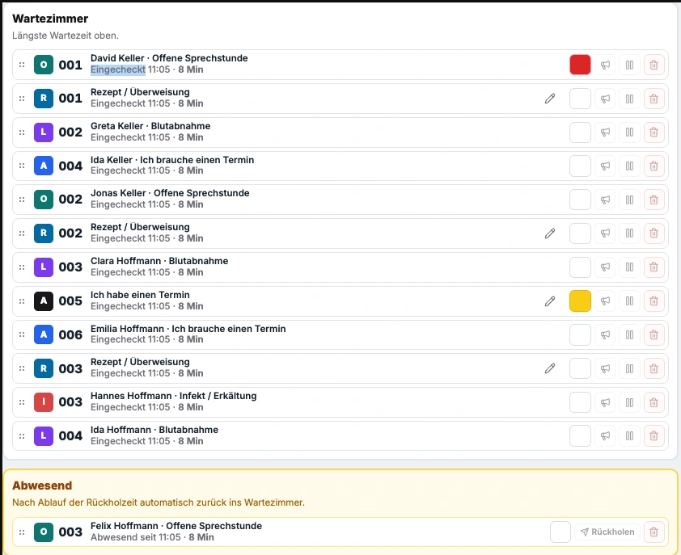
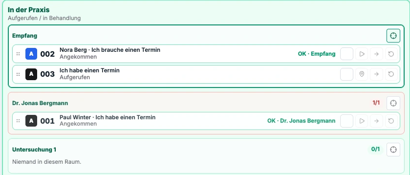

# Wartezimmer

Wartezimmer ist ein lokal betriebenes System zur Organisation von Patientenbesuchen in Arztpraxen. Es verbindet Anmeldung, Warteliste, Raumzuordnung und Patientenaufruf mit einem optionalen Portal für Dokumente und Anamnese. Das Praxisteam arbeitet im Browser; Anwendung und Datenverarbeitung laufen auf einem Docker-Host in der Praxis.

Diese README richtet sich an Entwickler und die Praxis-IT. Die [Projektwebsite](website/README.md) erklärt die Anwendung im Praxisalltag; die [Dokumentation](docs/README.md) beschreibt Fachlichkeit, Architektur und Betrieb.

## Fachlicher Umfang

| Bereich                | Funktion                                                                                                    |
| ---------------------- | ----------------------------------------------------------------------------------------------------------- |
| Anmeldung              | Check-in am Terminal, Auswahl des Anliegens und Vergabe einer Wartenummer                                   |
| Teamübersicht (MFA)    | Warteliste, Aufruf, Abwesenheit und Rückholen sowie Zuordnung zu Räumen                                     |
| Patientenführung       | Wartezimmer-TV und Raum-Panels mit Wartenummer und Aufrufziel                                               |
| Patientenportal        | Dokument-Upload und Anamnesebogen innerhalb einer Patientensitzung                                          |
| Dokumentenverarbeitung | Virenprüfung, geschützte Vorschau, PDF-Erstellung und Export in einen Host-Ordner                           |
| Verwaltung             | Praxis- und Geräteeinstellungen, Tagesreset sowie Installation, Updates und Datensicherung über den Manager |

Die Ablaufsteuerung unterstützt direkte Zuordnungen von Anliegen zu Zielräumen sowie mehrstufige Behandlungspfade. Details stehen in den [fachlichen Abläufen](docs/flows.md) und der [Routing-Dokumentation](docs/architecture/routing.md).

Wartezimmer ergänzt ein Praxisverwaltungssystem (PVS). Der vorhandene Kontaktabgleich nutzt CSV-Dateien; eine direkte PVS- oder eGK-Anbindung gehört nicht zum Standardumfang. Gäste-WLAN, Firewall und Netztrennung werden durch die Praxis-IT bereitgestellt. Optionaler Nachrichtenversand über einen externen Anbieter erfordert dessen Zugangsdaten.

### Einblick in die Oberflächen

Team-Warteliste mit Anliegen, Wartezeit und abwesenden Patienten:



Raumübersicht mit aufgerufenen und angekommenen Patienten:



Die Produktansichten stammen aus der Projektwebsite und zeigen fiktive Daten.

## Systemaufbau

Das Projekt ist ein TypeScript-Monorepo mit npm Workspaces.

| Komponente          | Technik und Aufgabe                                                          |
| ------------------- | ---------------------------------------------------------------------------- |
| `app`               | Fastify-API, Fachlogik, SQLite-Persistenz und Auslieferung der statischen UI |
| `ui`                | Browseroberflächen mit Svelte 5 und SvelteKit                                |
| `sandbox`           | Separater Container für Dokumentenprüfung, Vorschau und Form2PDF mit ClamAV  |
| `manager` / `setup` | Electron-Anwendung und Host-CLI für Installation und Wartung                 |
| Optionaler Proxy    | Caddy für HTTP-Proxy und HTTPS im Praxisnetz                                 |

Die Oberflächen führen Aktionen über REST aus und erhalten Echtzeitänderungen über Server-Sent Events (SSE). Die API-Verträge liegen unter [`openapi/`](openapi/); daraus werden Fastify-Schemas und TypeScript-Typen erzeugt.

Der Kernbetrieb benötigt kein Cloud-Backend. Externe Dienste können für optionale Funktionen wie Nachrichtenversand oder Zertifikatsausstellung hinzukommen. Systemgrenzen und Datenhaltung beschreibt die [Systemarchitektur](docs/architecture/system.md).

## Installation und Betrieb

Die Auslieferung erfolgt über den **Wartezimmer Manager**, Erstinstallationspakete (`.pfinstall`) und Updatepakete (`.pfupdate`). Der Manager verwaltet den Docker-Stack auf dem Installationsrechner.

- [Installation und Recovery](docs/operations/reinstall-recovery.md)
- [Manager und Wartung](manager/README.md)
- [Laufzeit, Konfiguration und Docker-Betrieb](docs/operations/runtime.md)
- [HTTPS im Praxisnetz](docs/operations/tls.md)
- [Backup und Wiederherstellung](docs/operations/backup.md)
- [Netztrennung und Portalzugang](docs/operations/restricted-lifecycle.md)

Der Manager wird für macOS (Apple Silicon und Intel) sowie Windows 11 x64
ausgeliefert. Der separate Patientenzugang benötigt eine Prüfung der Netztrennung
im konkreten Praxisnetz. Plattformvoraussetzungen stehen in der
[Manager-Dokumentation](manager/README.md), Einrichtung und Zugangsgrenzen unter
[TLS](docs/operations/tls.md) und
[Restricted-Lifecycle](docs/operations/restricted-lifecycle.md).

Die Manager-Installer für macOS und Windows werden unsigniert veröffentlicht;
die macOS-Apps sind außerdem nicht notarisiert. Hinweise zur Installation und
zu den Betriebssystemmeldungen stehen in der [Manager-Dokumentation](manager/README.md).

## Lokale Entwicklung

### Voraussetzungen

- Node.js 22 oder neuer und npm
- Docker Desktop mit Docker Compose v2 für den vollständigen lokalen Stack
- Freier Host-Port `8080`
- Import- und Exportordner; standardmäßig `~/wartezimmer-imports` und `~/wartezimmer-exports`

Die Konfigurationsoptionen sind in [`.env.example`](.env.example) dokumentiert.

### Vollständigen Stack starten

```bash
npm install
cp .env.example .env
```

Vor dem Start die Platzhalter für `AUTH_KEY_CAPTIVE`, `MAINTENANCE_TOKEN` und `SANDBOX_INTERNAL_TOKEN` in `.env` durch eigene Werte ersetzen.

```bash
npm run docker:up
```

Der Befehl baut und startet `app` und `sandbox`. Die Anwendung ist unter `http://localhost:8080` erreichbar. MFA und Ops verwenden nach Erststart die Standard-PIN `0000`; sie lässt sich in der Anwendung ändern. HTTP lokal mit fiktiven Daten verwenden; die Einrichtung für den Praxisbetrieb ist in der [Betriebsdokumentation](docs/operations/README.md) beschrieben.

| Oberfläche          | Lokale URL                         |
| ------------------- | ---------------------------------- |
| Terminal            | <http://localhost:8080/terminal>   |
| Teamübersicht (MFA) | <http://localhost:8080/mfa>        |
| Wartezimmer-TV      | <http://localhost:8080/tv>         |
| Raum-Panel          | <http://localhost:8080/room-panel> |
| Patientenportal     | <http://localhost:8080/portal>     |
| Einrichtung (Ops)   | <http://localhost:8080/ops/setup>  |

Gerätefreigaben und Rollen sind in der [API-Dokumentation](docs/architecture/apis.md) beschrieben. Für eine reproduzierbare Belegung mit fiktiven Patienten siehe [Demo-Daten](docs/development/demo-data.md).

```bash
docker compose logs -f app
npm run docker:down
```

### UI und Backend ohne Docker entwickeln

Nach Installation der Abhängigkeiten und Konfiguration von `.env` in zwei Terminals starten:

```bash
# Terminal 1: Backend auf Port 8080
npm run dev:app

# Terminal 2: SvelteKit-Devserver mit Proxy zum Backend
npm run dev:ui
```

Dieser Weg eignet sich für UI- und API-Änderungen. Für Dokumentenvorschau, Form2PDF und Virenprüfung wird zusätzlich die Sandbox benötigt; dafür den vollständigen Docker-Stack verwenden. Ein nativer Sandbox-Start ist über `npm run dev:sandbox` möglich.

Die API-Dokumentation unter <http://localhost:8080/api/docs> ist für den nativen Entwicklungsbetrieb vorgesehen und im Standard-Docker-Image deaktiviert.

## Prüfung und Release-Werkzeuge

| Befehl                     | Zweck                                                                                      |
| -------------------------- | ------------------------------------------------------------------------------------------ |
| `npm run verify`           | Lint, Formatprüfung, Typprüfung, Tests, UI-Build und Prüfung auf Secrets im UI-Bundle      |
| `npm run generate:api`     | API-Artefakte nach Änderungen an `openapi/*.yaml` neu erzeugen                             |
| `npm run smoke:all`        | Integrationsprüfungen; benötigen einen laufenden Stack und die jeweilige Testkonfiguration |
| `npm run release:images`   | Erstinstallationspaket mit Images und Sidecar erzeugen                                     |
| `npm run release:pfupdate` | Updatepaket erzeugen                                                                       |
| `npm run dist:manager:mac` | Manager für macOS paketieren                                                               |
| `npm run dist:manager:win` | Manager für Windows paketieren                                                             |

Build-Befehle und Plattformvoraussetzungen stehen in der [Manager-Dokumentation](manager/README.md). Weitere Entwicklungswerkzeuge sind unter [`docs/development/`](docs/development/README.md) beschrieben.

## Repository-Struktur

```text
app/                    Backend, Persistenz und statische UI-Auslieferung
ui/                     SvelteKit-Oberflächen
sandbox/                Dokumentenprüfung, Vorschau und Form2PDF
packages/domain/        Geteilte Fachtypen und Fachlogik
packages/flow-core/     Besuchsstatus, Routing und Behandlungspfade
packages/server-shared/ Geteilte Server-Helfer
setup/                  Host-CLI und Setup-API
manager/                Electron-Anwendung für Installation und Wartung
openapi/                API-Spezifikationen und generierte Verträge
docs/                   Fach-, Architektur- und Betriebsdokumentation
website/                Projektwebsite für GitHub Pages
```

[`docker-compose.yml`](docker-compose.yml) baut den lokalen Entwicklungsstack. [`docker-compose.delivery.yml`](docker-compose.delivery.yml) verwendet versionierte Images für den ausgelieferten Betrieb.

## Weiterführende Dokumentation

| Thema                                  | Einstieg                                                              |
| -------------------------------------- | --------------------------------------------------------------------- |
| Dokumentation nach Rolle               | [Dokumentationsübersicht](docs/README.md)                             |
| Fachmodell und Abläufe                 | [Domäne](docs/architecture/domain.md) · [Abläufe](docs/flows.md)      |
| Architektur und Entwurfsentscheidungen | [Architekturübersicht](docs/architecture/README.md)                   |
| Dokumentenverarbeitung                 | [Dokumentenarchitektur](docs/architecture/documents.md)               |
| Echtzeitkommunikation                  | [SSE](docs/architecture/realtime.md)                                  |
| Integrationen                          | [Schnittstellen und Betriebsgrenzen](docs/operations/integrations.md) |
| Website pflegen und lokal ansehen      | [Website-README](website/README.md)                                   |

Frühere Website-Entwürfe und Originalbilder liegen im [Website-Archiv](docs/archive/website/2026-10-10/README.md) und werden nicht veröffentlicht. Eine lokale Website-Vorschau lässt sich mit `node scripts/build-pages.mjs --preview` bauen.

## Kontakt und Support

Für technische Fragen und Fehler nutzt bitte die [GitHub Issues](https://github.com/nox-do/wartezimmer/issues). Als Anwender erreicht ihr uns unter [info@notaus.de](mailto:info@notaus.de). Ich betreue beide Kontaktwege selbst.

Sicherheitsprobleme bitte vertraulich an [info@notaus.de](mailto:info@notaus.de) melden; siehe [Sicherheitsmeldungen](SECURITY.md). Öffentliche Issues dürfen keine Patienteninformationen, Zugangsdaten oder unbereinigten Diagnosepakete enthalten.

Externe Beiträge erfolgen nach Absprache. Bitte zuerst ein Issue zur vorgeschlagenen Änderung öffnen und vor einem Pull Request die Abstimmung abwarten; siehe [Beiträge zum Projekt](CONTRIBUTING.md).

## Lizenz

Wartezimmer steht unter der eigenen [Wartezimmer-Lizenz, Version 1.1](LICENSE). Nutzung und interne Anpassung für den eigenen Betrieb sind kostenlos. Beauftragte IT-Dienstleister dürfen Installation, individuelle Anpassung und Betreuung berechnen.

Öffentliche Softwareangebote erfolgen über die offiziellen Bezugsquellen. Die Lizenz berücksichtigt GitHub-Plattformrechte, Forks, automatisch bereitgestellte Quellcodearchive und Projektbeiträge. Unveränderte Fassungen dürfen außerdem kostenlos und nichtöffentlich unmittelbar an einzelne Empfänger weitergegeben werden.

Weitere öffentliche Downloadangebote, sonstige Weitergabe angepasster Fassungen, Übernahme geschützter Teile in andere Softwareprodukte und fremde Softwaredienste benötigen eine gesonderte Erlaubnis, auch bei kostenlosen Angeboten. Das umfasst geschützte Teile des Routing-Cores; eigenständige Implementierungen ohne Übernahme solcher Ausdrucksformen werden nicht beschränkt. Details und Ausnahmen regelt der vollständige Lizenztext.

Das Projekt ist Source-available, keine Open-Source-Software im Sinne der Open Source Initiative. Drittanbieterkomponenten behalten ihre jeweiligen Lizenzen. Sonstige Website-Inhalte sind nur bei ausdrücklicher Zuordnung einbezogen.
