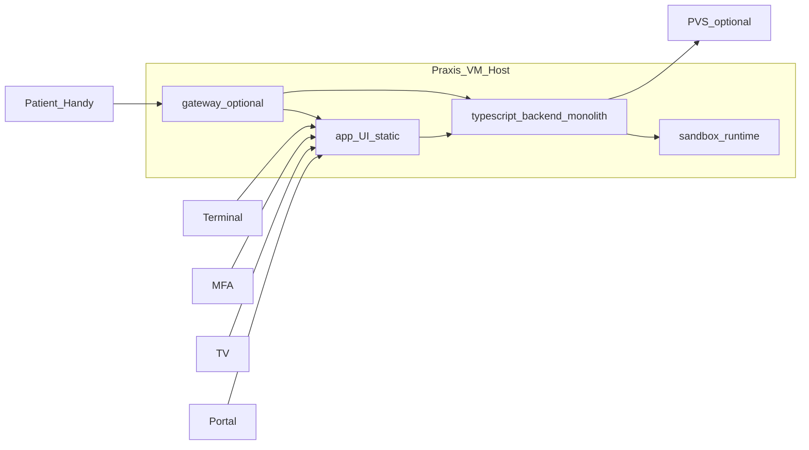
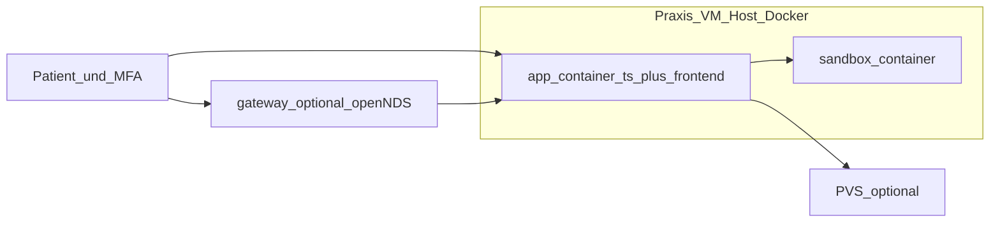

# Architekturentwurf (v1) - Praxis Flow

## Zielbild

Das System wird bewusst einfach und wartungsarm betrieben:

- Frontend: `Svelte + TypeScript + Vite`
- Backend: `TypeScript` (modularer Monolith, Node.js LTS)
- Runtime/Delivery: `Docker` (ohne Kubernetes)
- Captive Portal / Guest-WLAN:
  - Portal-UI und Session-API im `app`-Container (`/portal/*`)
  - Optionales Netzwerk-Gateway im `gateway`-Container (openNDS + dnsmasq)
  - Setup: `docs/gateway-captive-portal.md`
- SMS-Rueckruf: adapterfaehig, v1 mit `Vonage`

Fokus: kritische Daten logisch trennen von unkritischen Betriebsdaten.

## Domänenmodell (Wartenummer / Anmeldgrund / Aufrufziel)

Fachliche Referenz und Umsetzungsplan: **`docs/domain-model.md`**.

Kurzfassung:

- **Nummernkreis** (`laneCode`): bestimmt die Wartenummer-Serie pro Tag.
- **Anmeldgrund** (`topic`): Terminal-Kacheln, MFA-Text, Standard-Aufrufziel — nicht die Zählung.
- **Aufrufziel** (`room`): wird beim **Aufruf** am Queue-Eintrag als Snapshot gesetzt; Check-in ohne Raum.

Mehrere Anmeldgründe dürfen denselben Nummernkreis teilen (z. B. Termin-Varianten → `A`).

## Schutzbedarfsklassen

### Kritisch (PII/medizinisch)

- Name
- Mobilnummer
- Geburtsdatum
- Anamnese-Daten
- Dokumente und Dokumentenvorschau

### Intern sensibel (Grenzfall)

- Besuchsgrund/Thema (z. B. Labor, Rezept, offene Sprechstunde)

### Unkritisch

- Wartenummer
- Queue-Status ohne Namen
- Wartezimmer-TV-Anzeige ohne Namen
- Betriebsparameter (Zeitfenster, Terminal an/aus)

## Logische Komponenten

Fachliche Schichten — keine 1:1-Ordnerstruktur, kein Microservice-Schnitt. Details in `docs/flows.md`.

| # | Komponente | Schutz | Kurz |
| - | ---------- | ------ | ---- |
| 1 | **Frontend Gateway** | unkritisch | Terminal, MFA, TV, Portal (`ui/` → `app/dist/ui-static`); SSE Queue + Ops — `docs/realtime-streams.md` |
| 2 | **Check-in & Ticket** | unkritisch | Terminal-Check-in, Wartenummer (`laneCode`), Portal-Session-Bindung; keine Klarnamen in Queue |
| 3 | **Queue & Aufruf** | unkritisch | Status, TV-Liste, Rückhol-Fenster, optionales Aufrufziel (`roomId`) |
| 4 | **Identity** | kritisch | PII-Zuordnung für MFA (Mobil, DOB, später eGK) |
| 5 | **Dokumente** | kritisch | Upload, Anamnese-Output, Export auf Host; Vorschau nur via Sandbox |
| 6 | **Sandbox Adapter** | kritisch, isoliert | Preview-Custody; keine Rohdatei an MFA-Client — `docs/sandbox-interface.md` |
| 7 | **Tagesbetrieb & Reset** | querschnittlich | Check-in-Sperre, Day-Close/Reset, Ops-Settings, Notfall |
| 8 | **SMS Adapter** | extern | Rückhol-SMS; v1 Vonage, austauschbar |
| 9 | **Guest-WLAN Gateway** | optional | openNDS + Bridge; Portal-UI bleibt in (1) — `docs/gateway-captive-portal.md` |

Kein separater TV-Read-Service; TV nutzt `GET /queue` mit Rolle `tv`. Domänen trennen sich über `routes/` und `shared/`, nicht über Service-Grenzen.

## Systemkontext (einfach gehalten)

## Laufzeitarchitektur (keep it simple)

### Container

1. `app` - TypeScript API + Businesslogik + statische Frontend-UIs (Terminal, MFA, TV, Portal) + SQLite
2. `sandbox` - isolierte Dokumentenvorschau
3. `gateway` _(optional)_ - Guest-WLAN: openNDS, DHCP, Auth-Bridge; `network_mode: host` auf Linux

Kein separater DB-Container in v1. SQLite liegt auf persistentem Volume im `app`-Container.

## Ist-Stand Code (2026-06)

Monorepo (npm workspaces): `app`, `ui`, `sandbox`, `setup`.

### Backend (`app/src/`)

| Bereich    | Pfad         | Rolle                                                                                       |
| ---------- | ------------ | ------------------------------------------------------------------------------------------- |
| HTTP       | `routes/`    | Fastify-Registrars pro Domäne (checkin, queue, documents, ops, sessions, …)                 |
| Fachlogik  | `shared/`    | Queue, Documents, Forms, Ops, Contacts, Logging                                             |
| Persistenz | `shared/db/` | `CoreDatabase`-Fassade; SQL in `database-*.ts` (queue, documents, checkin-sessions, ops, …) |
| Auth       | `auth/`      | Client-Rollen (`ROUTE_ACCESS_RULES`) + Session-Token für Portal                             |
| Fehler     | `http/`      | `domain-error-codes.ts`, API-Error-Mapping                                                  |

**Domäne → Routes (Auszug):**

| Komponente           | Routes                                                             | Shared / DB                                                            |
| -------------------- | ------------------------------------------------------------------ | ---------------------------------------------------------------------- |
| Check-in & Ticket    | `routes/checkin-routes.ts`, `routes/sessions-routes.ts`            | `shared/checkin*`, `shared/db/database-checkin-sessions.ts`            |
| Queue & Aufruf       | `routes/queue-routes.ts`                                           | `shared/queue/`, `shared/db/database-queue.ts`                         |
| Identity             | `routes/identity-routes.ts`                                        | Check-in/Sessions-DB, Contacts                                         |
| Dokumente            | `routes/documents-routes.ts`, `routes/patient-documents-routes.ts` | `shared/documents/`, `shared/forms/`, `database-documents.ts`          |
| Tagesbetrieb & Reset | `routes/ops/*`                                                     | `shared/ops/`, `database-day-lifecycle.ts`, `database-ops-settings.ts` |
| Session (Portal)     | `routes/session-auth.ts` (preHandler)                              | Patient-Session in Check-in-DB                                         |

Kein separates `src/modules/*/controller|service|repository`-Layout — bewusst ein Fastify-Monolith für Single-Praxis-Betrieb.

### Frontend (`ui/src/`)

- `routes/` — SvelteKit SPA (`ssr: false`): Terminal, MFA, TV, Portal, Ops
- `lib/` — API-Clients, Domain-Helper, Komponenten
- OpenAPI-Codegen: `lib/ops/openapi-types.ts`, `lib/queue/openapi-types.ts`, `lib/documents/openapi-types.ts` (aus `openapi/*.yaml`)

### Qualität & Verträge

- `npm run typecheck` — tsc, `check-openapi-types-sync`, `check-app-openapi-types-sync`, `check-bundle-sync`, `check-fastify-schemas-sync`, `check-openapi-route-sync`, `check-auth-route-rules`
- `npm run test` — app `node:test` + ui vitest
- `npm run smoke:*` — integrative Fach-Flows
- **OpenAPI-first (Option A):** `openapi/*.yaml` ist die Schema-Quelle; `npm run generate:api` erzeugt `openapi/bundle.json`, Fastify-Schemas (`app/src/api/generated/*.fastify-schemas.ts`), Backend-Typen (`app/src/api/*-openapi-types.ts`) und UI-Typen. Swagger UI: `/api/docs` (standardmäßig außerhalb `production`, `OPENAPI_DOCS_ENABLED` override). Migriert: Check-in, Queue, Identity, Sessions, Ops; Contract-Smoke: `npm run smoke:openapi-contract` gegen `bundle.json`.

### Echtzeit (Pub/Sub)

Leitdokument: **`docs/realtime-streams.md`**.

- **Queue:** `queue-stream-hub` → `GET /queue/stream` (MFA + TV) — implementiert.
- **Ops (Ist):** `ops-event-hub` → `GET /ops/stream` (MFA) — getrennte SSE-Events fuer Notfall, Geraete-Presence, Pairing-Prompt; ersetzt REST-Polling und den separaten Emergency-Stream. Device-Liveness: TV `GET /queue/stream`, Terminal `GET /ops/device/stream`.
- **Regel:** Schnell sichtbar = SSE-Push; tun = REST. Presence (offline) und Pairing (PIN noetig) sind getrennte States.

### Bewusst nicht umgesetzt (Single-Praxis)

- CoreDatabase vollständig in Service/Repository-Schichten zerlegen
- Patient-documents / MFA-Dokument-Routes noch mit Hand-Schemas (`documents.yaml` — Setup-Domain wird nicht weiter ausgebaut)
- Horizontale Skalierung (z. B. SSE-Hub über Redis)

## Persistenzmodell

Das System ist crash-resilient, aber absichtlich fluechtig:

- Tagsueber persistiert das System Zustand und Dokumente (Crash-Sicherheit)
- Bei kontrolliertem Praxisschluss wird bewusst geloescht
- Danach startet der naechste Tag bei `0`

### Persistiert waehrend Laufzeit

- Queue-/Session-State
- Notwendige Zuordnungen fuer laufenden Betrieb
- Temporaere Dokumente

### Nicht als Langzeitarchiv

- Dokumente
- Anamnese
- Tagesdaten

## Praxisschluss-Prozess (kontrollierter Reset)

1. Neue Check-ins sperren
2. Offene Aufrufe sichtbar abschliessen/markieren
3. Optionales Kurzprotokoll (ohne medizinische Inhalte) erzeugen
4. Dokumenten-Volume leeren
5. Runtime-Laufzeitdaten in SQLite leeren (Tickets/Queue/Sessions/Dokument-Metadaten, Outbox; **Settings bleiben** in `ops_settings`)
6. Sandbox-Intake leeren (purge + Container-Restart)
7. Export-Ordner auf dem Host bleiben unangetastet (Verantwortung nach Export)

Ergebnis: naechster Tag ohne Ticket-/Queue-Altlasten, aber tagsueber stabile Crash-Recovery. Die SQLite-Datei wird nicht geloescht.

### Day-Close vs. Business-Day-Reset (v1)

Zwei getrennte Konzepte:

- **Tagesabschluss** (`POST /ops/day-close/start`): Phase `dayClosePhase=started`, Check-in gesperrt. API bleibt fuer kuenftigen Export-/Archiv-Flow. Kein Runtime-Reset.
- **Tagesreset** (`POST /ops/day-lifecycle/reset`): MFA „Neuen Tag starten“. Loescht Tickets/Outbox, setzt `lastResetBusinessDay`, Sandbox purge/restart. Kein vorheriger Day-Close noetig.

### Reset denied (Schutzfaelle)

`ops/day-lifecycle/reset` ist bewusst ein direkter Reset — keine Zwei-Schritt-Bestaetigung ueber Day-Close. Der alte `confirm-reset`-Pfad wurde entfernt.

## Crash-/Neustartverhalten

- Nach Absturz wird aus letzter persistierter Laufzeit wiederhergestellt
- Ziel: kein Verlust des aktuellen Wartezimmer-Status
- Bewusster Tagesreset nur ueber MFA `POST /ops/day-lifecycle/reset` (loescht Tickets/Outbox); Crash-Recovery loescht nichts

## Technische Schulden & Remediation

E2E-Review (2026-06-08): priorisierte Pakete und Sprint-Reihenfolge sind in **`todo.md`** (Abschnitt Remediation-Plan) konsolidiert. Outbox/Event-Ist-Stand v1: **`docs/events.md`**.

## Entschieden (v1)

- **Portal-Session-Lebensdauer:** Formular → sofort revoke; Upload → TTL 30 Min (kein Submit nach Upload-Erfolg). Details: `docs/flows.md` § Portal-Session-Lebensdauer — **bewusstes Modell, kein Bug.**

## Offene Entscheidung

- Guest-WLAN HTTPS (lokales Zertifikat vs. HTTP-only LAN v1)
- Referenz-Netzwerkdesign pro Praxis (Gast-VLAN, AP-Anbindung)

## TypeScript (Ist-Stand)

- Fastify-Monolith: `routes/*` + Fachlogik in `shared/*`
- Verträge aus `openapi/*.yaml` (Codegen)
- Domain-Fehler: `http/domain-error-codes.ts`
- Route-Handler dünn; UI-Typen aus OpenAPI (`npm run generate:api`), nicht handkopiert

## Sandbox / Dokumente

- `docs/sandbox-interface.md` — Intake-Custody, Preview-Session, Scan, Löschregeln
- `docs/sandbox-container.md` — Containergrenzen, Pipeline, Health
