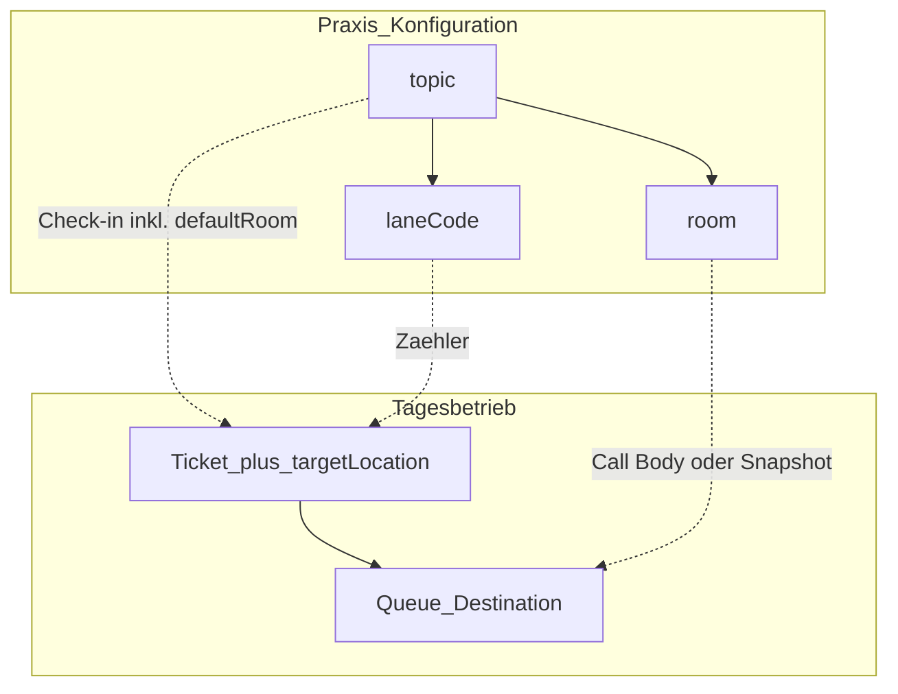

# Domäne — Nummernkreis, Thema, Raum & Catalog

Stand: 2026-08-31 · Ist am Code (`lane-code.ts`, Ops-Settings, flow-core Sync)

**Scope:** Fachregeln für `laneCode` / topics / rooms; `ops_settings` vs. Catalog-Projektion.  
Nicht: Patientenflows → [`../flows.md`](../flows.md) · API-Rollen → [`apis.md`](apis.md) · Backup → [`../operations/backup.md`](../operations/backup.md)

**Leitidee (Ist):** Die Wartenummer gehört zum **Nummernkreis**, nicht zum Anmeldgrund.

## 1. Begriffe

| Fachlich | Code | Frage |
| --- | --- | --- |
| **Nummernkreis** | `laneCode` (A–Z) | Welche Serie? |
| **Anmeldgrund** | `topic` | Warum ist der Patient da? |
| **Aufrufziel** | `room` / Visit-`targetLocation` | Wohin? oft ab Check-in, Call kann überschreiben |

| Ebene | Inhalt |
| --- | --- |
| Praxis-Konfiguration | Themen/Räume/Journeys in `ops_settings` — überlebt den Tag |
| Tagesbetrieb | Tickets + Queue — weg bei Tagesreset ([`system.md`](system.md) §5) |



## 2. Invarianten

1. Pro Geschäftstag + Nummernkreis höchstens eine Laufnummer (z. B. `20260602-A-017`).
2. Mehrere Anmeldgründe dürfen denselben Nummernkreis teilen.
3. Anmeldgrund steuert Terminal/MFA-Text — **nicht** die Zählung.
4. Aufrufziel: Visit trägt `targetLocationId` oft **schon ab Check-in** (Catalog/Themen-`defaultRoomId` → flow-core). Queue zeigt `destinationRoomId`/`destinationRoomLabel` daraus. Call/`check_in_room` können Body-Raum setzen oder Snapshot übernehmen — **nicht** „Raum erst beim Aufruf“.
5. Reserviert: Thema/`laneCode` **`M`** für MFA-Hilfe — nicht im Themen-Editor (`MFA_ASSIST_LANE_CODE`).
6. Am Ticket immutable nach Check-in: `laneCode`, `sequence`, `topicLabel` (Katalog-Änderungen ändern alte Tickets nicht).
7. Topic-Supersede (MFA): neues Ticket + neue Nummer, altes soft `cancelled`, Verkettung `supersedes`/`superseded_by`; erlaubt bei Core-`waiting`|`directed`; `checkedInAt` bleibt.

Schema: Baseline `app/src/shared/db/migrations/001_baseline.sql` (kein Migrationsverlauf).

## 3. Aufrufziel beim Call (Ist)

`POST /queue/:id/transition` mit `type: call`.

**Server** (`resolveCallRoomForVisit`):

1. Explizite Body-Felder `roomId` / `roomLabel` (wenn gesetzt)
2. sonst Visit-/Ticket-Destination-Snapshot (`targetLocationId` + Label)
3. sonst `null` (kein stiller Fallback auf Themen-Default oder `defaultCallTarget` in dieser Funktion)

**MFA-Client** (`resolveCallRoomTarget` / `call-room-target.ts`): sendet nur den Queue-Destination-Snapshot des Tickets — **kein** Quicksettings-Raumwahl-Pfad im Call.

`defaultCallTarget` bleibt Settings-Feld (Raumliste / Boards), steuert den Call-Transition **nicht**. Themen-`defaultRoomId` wirkt über Catalog-Routing **beim Check-in** auf `targetLocation`, nicht als Call-Prio-3.

TV/MFA zeigen den gespeicherten Destination-Snapshot, nicht live den Katalog.

`check_in_room` / `check_out_room`: Snapshot ergänzen/überschreiben. Raum-Panel: serverseitiger Scope (`visitTargetsRoom`); MFA ohne `actingRoomId`. Konflikt → `QUEUE_ROOM_MISMATCH` (409). Reassign in anderen Raum bei `in_room` → zurück auf `called`.

## 4. Entitäten (kompakt)

**Topic:** `topicId`, `label`, `iconId`, `sortOrder`, `enabled`, `laneCode`, `defaultRoomId`, optional Zeitfenster.

**Room:** `roomId`, `roomLabel`, `enabled`, optional `defaultCallTarget` (Settings/UI, nicht Call-Resolver), optional `maxOccupancy` (`called`+`in_room`).

**Ticket / Visit:** `laneCode`, `sequence`, `topicId`, `topicLabel`; oft schon `targetLocationId` ab Check-in. Anzeige Nummer: `laneCode`+`sequence`.

**Queue:** Statusmaschine; `destinationRoomId`/`destinationRoomLabel` (bzw. Anzeige-Felder) aus Visit-Ziel; optional `triageLevel` (`red`|`yellow`|`green`, MFA-only, nicht TV).

MFA-Warteliste: rote Linie ab **≥ 25 Min.** (`LONG_WAIT_THRESHOLD_MINUTES` in der UI — kein Settings-Feld).

## 5. Catalog-Wahrheit

| Was | Wahrheit | Wer schreibt |
| --- | --- | --- |
| Themen / Räume / Journeys / Routing | `ops_settings.*_json` / Spalten | Ops-API → `updateOpsSettings` |
| flow-core-Catalog | **Projektion** | **nur** `syncCatalogFromOpsSettings()` |

Produktions-App: kein Catalog-DML außerhalb des Sync-Moduls (`catalog-write-guard.test.ts`).  
Manager/Setup: keine Fach-SQLite-Writes.  
Backup: Catalog **nicht** exportiert — nach Import neu syncen ([`../operations/backup.md`](../operations/backup.md)).

```text
Ops PATCH ops_settings
  → syncFlowCoreCatalog
  → syncCatalogFromOpsSettings
  → topics, locations, queues, surfaces, routing_rules, journey_*
  → validateCatalogIntegrity
```

App-Start: `initializeFlowCore()` aus gelesenen `ops_settings`.  
Einziger App-Writer: `app/src/shared/flow-core/sync-catalog-from-ops-settings.ts`.  
Außerhalb der App (PoC/Tests): `packages/flow-core` admin/seed — kein Produktionspfad.

Reservierte System-IDs (`pf_`, MFA-Assist, …) im Sync-Modul.

## 6. Verweise

| Thema | Dokument |
| --- | --- |
| API-Felder / Rollen | [`apis.md`](apis.md) |
| Check-in / MFA-Flows | [`../flows.md`](../flows.md) |
| System / Tagesreset | [`system.md`](system.md) |
