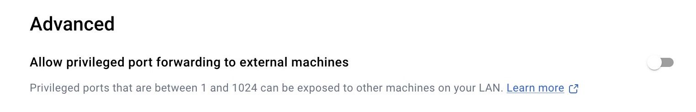

# Entscheidungsvorlage für Docker-Portfreigaben im Wartezimmer Manager

**Beschlussvorschlag · 16. November 2026.** Der Manager soll vor einer Installation oder Betriebsänderung anzeigen, welche Dienste auf welchen Adressen erreichbar werden. Das Setup-Backend soll jede neu benötigte, freie Hostbindung mit Docker erproben, bevor es die laufende Installation verändert. Ein Hindernis führt zurück zur Einrichtung und zur erneuten Prüfung. Die Entscheidung über eine Docker-weite LAN-Freigabe trifft der Nutzer. Praxis- und Patientenzugang behalten ihre gezielten IP-Bindungen.

## Beschlossen und im Manager umgesetzt

Der Manager prüft alle freien Zielbindungen gleichzeitig mit einem Prüfcontainer. So fällt auch auf, wenn Docker den Praxis- und Patientenzugang auf zwei verschiedenen IPs nur einzeln auf Port 443 freigeben kann. Bereits vom Wartezimmer belegte Ports kennzeichnet er für den Nachtest beim Wechsel. Erkennt Docker auf dem Mac die fehlende LAN-Freigabe, zeigt der Dialog die Anleitung mit einem lokalen Screenshot. Der Nutzer kann mit derselben Auswahl erneut prüfen. Nach erfolgreicher Prüfung startet die gewählte Aktion über eine eigene Schaltfläche. Ungelesene Befunde sind auch nach einem Neustart zugänglich. [Portdialog](../../manager/src/renderer/PortCheckDialog.svelte) · [Bindungstest](../../setup/src/port-check.ts)

Am 16. November 2026 bestätigte der Test mit Docker Desktop 4.99.0 die beiden hohen Praxisports im Testentwurf. Für die Patientenbindung `192.168.0.83:443 → 444/tcp` meldete Docker ausdrücklich die fehlende Freigabe. Der Test verwendete temporäre Container. Der Dialogablauf einschließlich Wiederholung, ausdrücklicher Bestätigung und Wiederanzeige des Befunds wurde in Electron mit einem simulierten Setup-Dienst geprüft. Windows und Linux wurden für diesen Ablauf nicht auf einem realen Host abgenommen.

Am 17. November erkannte die gemeinsame Vorprüfung mit Docker Desktop 4.99.0 den Konflikt zwischen `192.168.0.100:443` (Praxis) und `192.168.0.83:443` (Patienten). Der laufende HTTP-Stack blieb während der Prüfung gesund. Docker meldete für den Patientenzugang `listen tcp4 0.0.0.0:443: bind: address already in use`.

Nach einem Prozessabbruch beim Nachtest wartet Setup beim Wiederanlauf kurz auf das Ende des eigenen Prüfcontainers. Im isolierten Docker-Test auf dem Mac lief der zuvor gestoppte Container nach 31 Sekunden wieder. Scheitert der Nachtest beim Restore, lässt sich dieselbe Sicherung nach bestätigtem Wiederanlauf erneut prüfen. Den Restore startet der Nutzer anschließend ausdrücklich. Das Anzeigen einer bestehenden DNS-Anfrage und das Verwerfen einer noch inaktiven HTTPS-Vorbereitung sind auch bei belegtem Port möglich.

## Ausgangslage vor der Änderung

Die Backup-Vorschau prüft Archiv, Einstellungen, TLS-Metadaten und gegebenenfalls den eingebetteten TLS-Inhalt. Sie validiert die Einstellungen über die lokale Maintenance-API. Beim eigentlichen Restore bildet Setup den Zielzustand aus Backup und Host und prüft unmittelbar vor dem Stopp die Netzwerkkonfiguration beider Zustände. Das erkennt etwa eine fehlende Praxis-IP oder eine Patienten-IP auf dem falschen Adapter. Ob Docker auf diesem Rechner den Zielport veröffentlichen kann, bleibt offen. [Backup-Vorschau](../../setup/src/settings-backup-inspect.ts) · [Restore und Zielkonfiguration](../../setup/src/settings-backup-restore.ts) · [Bestehende Vorprüfung](../../setup/src/maintenance-staff-binding.ts)

Danach stoppt Setup den Stack, sichert den Rückfallzustand, startet App und Sandbox, importiert und prüft die Einstellungen und startet erst dann den vollständigen Stack. Dadurch kann eine gültige Sicherung bereits importiert sein, wenn der Proxy an `192.168.0.83:443` scheitert. Der erfolgreiche Rollback ist das berichtete Ergebnis dieses Vorfalls. Aus der Adresse allein lässt sich weder die Rolle des Listeners noch die Fehlerursache ablesen. [Startreihenfolge](../../setup/src/fresh-db-settings-cutover.ts)

Beim Speichern von Netzwerk- oder Setup-Einstellungen schrieb der Manager bisher die Zielwerte bereits in die Live-`.env`. Je nach Aktion prüft er anschließend `compose config --quiet` und das Proxy-Image. Ein Journal erlaubt die Rückkehr zur alten Konfiguration. Die laufenden Dienste werden bereits anhand ihrer tatsächlichen Docker-Publishes und mit Verbindungsprüfungen kontrolliert. Diese Prüfungen liefern weiterhin die Abnahme _nach_ dem Start. [Netzwerkänderung](../../setup/src/host-state.ts) · [Docker-Aufrufe](../../setup/src/docker.ts) · [Laufzeitaudit](../../setup/src/network-bindings.ts)

## Welche Hostbindungen zählen

Quell- und Delivery-Compose ergeben für den Produktbetrieb dieselben Veröffentlichungen. Die Tabelle ist kumulativ für die jeweils aktiven Dienste. Die Kollisionsprüfung vergleicht Host-IP, Host-Port und Protokoll. Dienst und Container-Port erklären, welcher Zugang betroffen ist. [Basis](../../docker-compose.delivery.yml) · [HTTP](../../docker-compose.proxy.delivery.yml) · [HTTPS](../../docker-compose.proxy-tls.delivery.yml) · [Patientenzugang](../../docker-compose.proxy-restricted.delivery.yml)

| Dienst und Betriebsart                           | Host-IP                                          | Host-Port → Container-Port                    |
| ------------------------------------------------ | ------------------------------------------------ | --------------------------------------------- |
| App im direkten HTTP-Betrieb                     | `APP_BIND_ADDRESS`, im Manager regulär `0.0.0.0` | `8080 → 8080/tcp`                             |
| App mit Proxy, auch bei HTTPS                    | `127.0.0.1`, durch das Proxy-Overlay ersetzt     | `8080 → 8080/tcp`                             |
| Maintenance in beiden Betriebsarten              | `127.0.0.1`                                      | `8082 → 8082/tcp`                             |
| Praxis-HTTP bei aktivem Proxy, auch neben HTTPS  | `SETUP_LAN_APP_IP`                               | `PROXY_HTTP_PORT` (Standard 80) → `80/tcp`    |
| Praxis-HTTPS mit TLS-Overlay                     | dieselbe Praxis-IP                               | `PROXY_HTTPS_PORT` (Standard 443) → `443/tcp` |
| Separater Patientenzugang mit Restricted-Overlay | `SETUP_RESTRICTED_APP_IP`                        | fest `443 → 444/tcp`                          |

Ein TLS-Zustand ungleich `off` kann bei aktivem Proxy das TLS-Overlay schon während der HTTPS-Einrichtung auswählen. Das Prüfen oder Beziehen eines Zertifikats kann den Proxy bereits neu erstellen. Auch bei Praxis-HTTPS auf 9443 benötigt der Patientenzugang weiterhin Port 443 auf seiner eigenen IP. Die TLS-Vorbereitung und das Einspielen passender TLS-Daten setzen den Praxis-HTTPS-Port heute ausdrücklich bzw. per Standardwert auf 443. Die Vorschau muss diesen tatsächlich geplanten Wert zeigen und Abweichungen von gespeicherten Ports sichtbar machen. [Overlay-Auswahl](../../setup/src/docker.ts) · [TLS-Einrichtung](../../setup/src/host-tls.ts) · [TLS-Hostwerte](../../setup/src/proxy-tls.ts)

Im optionalen TLS-Labor des Quellprojekts kommen für die tatsächlich gestarteten Labordienste folgende Loopback-Bindungen hinzu. Alle vier Host-Portwerte sind konfigurierbar. Das zusätzliche Proxy-Labor-Overlay ergänzt Mounts. [TLS-Labor](../../docker-compose.tls-lab.yml) · [Labor-Proxy](../../docker-compose.tls-lab-proxy.yml)

| Dienst                | Host auf `127.0.0.1` → Container                                                                       |
| --------------------- | ------------------------------------------------------------------------------------------------------ |
| CoreDNS               | `TLS_LAB_DNS_HOST_PORT` (9053) → 53, jeweils UDP und TCP                                               |
| acme-dns API          | `TLS_LAB_ACME_DNS_API_HOST_PORT` (8053) → 80/TCP                                                       |
| Pebble und Management | `TLS_LAB_PEBBLE_HOST_PORT` (14000) → 14000/TCP und `TLS_LAB_PEBBLE_MGMT_HOST_PORT` (15000) → 15000/TCP |

Sandbox-Port 8081 ist nur im Container-Netz exponiert. Der Gateway-Brückenport 9100 gehört zu älteren Konfigurations- und Diagnosepfaden. Die aktuellen Produkt-Overlays veröffentlichen ihn nicht. Die lokale Manager-Setup-API lauscht als Hostprozess auf Loopback und kann wie jeder Hostprozess bei einem tatsächlichen Portkonflikt relevant sein. [Produktdienste](../../setup/src/docker.ts) · [Setup-API](../../setup/src/server.ts)

## Wie der Nutzer durch den Vorgang kommt

1. **Ziel ansehen.** Nach Auswahl von Paket, Backup bzw. Netzwerkänderung zeigt der Manager die betroffenen Zugänge mit Adresse und Port. Beim Restore stehen „Backup geprüft“ und „Portfreigaben auf diesem Rechner“ als zwei eigene Ergebnisse. Bei einer Neuinstallation mit Backup erscheinen sowohl der erste HTTP-Betrieb als auch das spätere Backup-Ziel.
2. **Am laufenden System prüfen.** Der Manager zeigt je Zugang „Mit Docker geprüft“, „Wird bereits von dieser Installation verwendet“, „Handlung erforderlich“ oder „Prüfung nicht möglich“. Blockierte oder ungeklärte neue Bindungen sperren die Ausführung. Ein bereits belegter eigener Port, den die Operation erneut anfordern muss, erhält den Zusatz „Erneute Bindung erst beim Wechsel prüfbar“. Ein normaler Statusabruf startet keine Prüfcontainer.
3. **Ursache beheben.** Für den gemeldeten Mac wäre bei passendem Berechtigungsfehler die Meldung **„Docker konnte 192.168.0.83:443 für diesen Zugang nicht freigeben. Öffnen Sie Docker Desktop → Settings → Advanced und aktivieren Sie ›Allow privileged port forwarding to external machines‹. Kehren Sie dann zum Manager zurück und wählen Sie ›Erneut prüfen‹.“** Der Dialog ergänzt den aus dem Plan bekannten Zugang. Er erklärt, dass der Schalter Docker-weit die LAN-Veröffentlichung niedriger Ports ermöglicht, auch für andere Container, und für diese Einstellung kein Administratorpasswort erforderlich ist. Eine Router-Portweiterleitung ist hierfür entbehrlich. Falls Docker beim Übernehmen einen Neustart anbietet, weist der Manager auf die mögliche Unterbrechung laufender Container hin. [Docker für Mac](https://docs.docker.com/desktop/setup/install/mac-permission-requirements/#binding-privileged-ports) · [Docker-Einstellungen](https://docs.docker.com/desktop/settings-and-maintenance/settings/#advanced-mac-only)
4. **Erneut prüfen.** „Docker-Anleitung öffnen“ und „Erneut prüfen“ lassen den Entwurf und die Backup-Auswahl bestehen. Die Wiederholungsaktion wartet auf einen erreichbaren Daemon und führt nur die Vorprüfung erneut aus. Erst „Wiederherstellen“, „Installieren“ bzw. „Änderung übernehmen“ löst den Vorgang mit seinen bestehenden Bestätigungen aus. Kann der Host eine Backup-IP nicht bereitstellen, führt die Hilfe zur Adapterwahl bzw. zur Einrichtung durch die Praxis-IT. Jede gewünschte Neuzuordnung braucht eine neue Vorschau einschließlich DNS, TLS und Trennung der Zugänge.
5. **Ergebnis bestätigen.** Vor dem Stopp lautet die Rückmeldung „Vorgang vor dem Stoppen angehalten“. Nach einer Änderung zeigt der Manager den ursprünglichen Fehler und das geprüfte Ergebnis der Wiederherstellung getrennt. Bei unvollständiger Wiederherstellung führt der nächste Schritt zur vorhandenen Recovery.

## Was die Vorprüfung nachweisen kann

**Den Zielzustand berechnen.** Eine gemeinsame Backend-Funktion erhält den Installationsentwurf, das gewählte Release und die effektiv zusammengeführten Hostwerte. Sie nutzt dieselbe Overlay-Reihenfolge, Dienst- und Abhängigkeitsauswahl, Projektidentität und Variablenauflösung wie der spätere Start. Aus `docker compose config --format json` übernimmt sie nur `services.*.ports`. Dazu die Overlay-Auswahl von der bisher direkt gelesenen Live-`.env` entkoppeln und die Kandidatenkonfiguration getrennt rendern. Arbeitsverzeichnis, relative Pfade und Compose-Umgebung müssen bei Vorschau und Ausführung übereinstimmen. Geerbte Shell-Werte dürfen den bestätigten Portplan beim Start nicht verändern. [Compose-Modell](https://docs.docker.com/reference/cli/docker/compose/config/) · [Heutige Compose-Auflösung](../../setup/src/docker.ts)

**Konfiguration und Belegung prüfen.** Docker-Kontext und lokalen Daemon identifizieren, Compose-Mindestversion 2.24.4 für `!override` prüfen und Host-Ports als ganze Zahlen von 1 bis 65535 validieren. Die konkreten lokalen IPv4-Adressen und die gespeicherte Adapteridentität prüfen. Praxis- und Patienten-IP müssen verschieden sein. Bestehende Hinweise für gleiche Netzwerkkarte oder überlappende Netze gelten weiter. Die Sicherheitsregeln für App, Maintenance und beide Proxy-Zugänge auch am aufgelösten Modell prüfen. Ein unbekannter Remote-Daemon kann mit der Adapterliste des Manager-Rechners nicht verlässlich geprüft werden. [Bindungsregeln](../../setup/src/docker.ts) · [Patientennetz](../../setup/src/restricted-network.ts)

Für jede gleichzeitig anzufordernde Bindung die aktiven Veröffentlichungen im gesamten Ziel-Daemon betrachten. Eigentum anhand Projekt, Dienst und Containeridentität nachweisen. Host-Listener und gegebenenfalls Reservierungen ergänzen die Diagnose. Zwei verschiedene lokale IPs dürfen beide 443/TCP verwenden. Ein überlappender Wildcard-Listener auf `0.0.0.0` oder ein wirksamer IPv6-Dual-Stack-Listener kann dagegen beide blockieren. TCP und UDP getrennt behandeln. Ein erfolgreicher TCP-Verbindungsaufbau zeigt nur, dass etwas antwortet. Ein fehlgeschlagener Verbindungsaufbau oder ein erfolgreicher Host-Socket-Test beweist keine Docker-Freigabe. [Docker-Portveröffentlichungen](https://docs.docker.com/engine/network/port-publishing/)

**Die freie Bindung mit Docker testen.** Einen kurzlebigen Prüfcontainer mit `--pull=never` im selben lokalen Docker-Kontext mit den vorgesehenen Host-IP-, Host-Port-, Protokoll- und Zielportwerten auf einem passenden Bridge-Netz _starten_. Ein bereits lokal verfügbares, vom Manager geprüftes Image mit einem inerten Prozess verwenden, ohne Produktdienst, Volumes oder Secrets. Die tatsächlichen Publishes per Inspect verifizieren. Der Prozess bietet keine fachliche Anwendung auf dem Port an. Nach Erfolg, Fehler, Timeout oder Abbruch den eigenen Prüfcontainer zuverlässig entfernen. Eindeutige Labels und ein zeitlich begrenzter Prozess erlauben das Aufräumen nach einem Manager-Absturz. Ein fehlendes Prüfimage, ein nicht erreichbarer Daemon oder ein fehlerhaftes Aufräumen erhalten einen eigenen technischen Befund. `compose config`, ein reines Container-`create` und ein Lauf ohne veröffentlichte Ports reichen hier nicht. [Docker-Containerstart](https://docs.docker.com/reference/cli/docker/container/run/) · [Port-Publishing](https://docs.docker.com/engine/network/port-publishing/)

**Eigene laufende Bindungen behandeln.** Eine bereits aktive identische Bindung wird per Inspect nachgewiesen. Für einen fortlaufenden Dienst genügt das. Wird der Dienst ersetzt oder überlappt ein eigener heutiger Wildcard-Publish das künftige Loopback-Binding, kann auch Docker die exakte Neubindung erst nach dem Freigeben testen. Vorab alle anderen freien Zielbindungen prüfen und diese Ausnahme in der Bestätigung nennen. Beim notwendigen Wechsel nur die betroffenen Dienste freigeben, soweit der Vorgang es zulässt. Aufgeschobene Bindungen so früh wie möglich nachtesten, bei einer Neuinstallation vor der Volumenlöschung. Bei Fehlern den vorherigen Betrieb wieder anfordern und den Erfolg prüfen. Eine Vorprüfung reserviert keinen Port. Auch ein Rollback kann an inzwischen geänderten Hostrechten scheitern.

## Vor welcher Änderung die Prüfung liegen muss

| Vorgang                                                        | Verbindlicher Zeitpunkt                                                                                                                                                                                                                                                                                                                                                                                                                                                                                                          |
| -------------------------------------------------------------- | -------------------------------------------------------------------------------------------------------------------------------------------------------------------------------------------------------------------------------------------------------------------------------------------------------------------------------------------------------------------------------------------------------------------------------------------------------------------------------------------------------------------------------- |
| Erstinstallation und Neuinstallation                           | IP, HTTP-Modus und gegebenenfalls Backup vor der letzten Paketbestätigung festlegen. Aus gepinnten Paketvorlagen zuerst die HTTP-Konfiguration, dann separat das künftige Backup-Ziel bilden. Vor `markInstallOperationInstalling` und `factoryResetInstallation` prüfen. Für erst nach dem Stopp prüfbare eigene Bindungen das heutige `down --volumes` in einen rücknehmbaren Stopp und einen späteren destruktiven Schritt aufteilen. Die fachliche Online-Validierung der Sicherung braucht weiterhin die neue, gesunde App. |
| Manueller Restore, Restore vor Update und nach Neuinstallation | In der Backup-Vorschau denselben Zielkonfigurationsplan wie bei der Ausführung nutzen, einschließlich erhaltener lokaler HTTPS-Identität bei einem Backup ohne aktives HTTPS, TLS-Inhalt und Patientennetz. Unmittelbar vor Restore-Journal und Stack-Stopp im Backend neu prüfen. Auch die Bindungen für den vorgesehenen Rückweg berücksichtigen.                                                                                                                                                                              |
| Praxis-IP ändern, HTTP-Proxy ein-/ausschalten oder reparieren  | Kandidat im Netzwerktab prüfen, spätestens vor dem Schreiben der Live-`.env`, Entfernen des bisherigen Proxys oder Neuerstellen der App. Auch der Wechsel zwischen globalem und lokalem App-Port 8080 zählt. Bei nur gespeicherten Änderungen den geplanten Start gesondert ausweisen und beim späteren Start wieder prüfen.                                                                                                                                                                                                     |
| HTTPS und Patientenzugang                                      | Früh beim Vorbereiten und verbindlich vor der ersten Konfigurationsänderung oder Proxy-Neuerstellung, die die Bindung auslöst. Dazu gehören Zertifikatsbezug/-prüfung, TLS-Übernahme, Reparatur, Rückbau sowie Aktivieren/Entfernen des Patientenlisteners. Beim Entfernen nur die künftig benötigten Bindungen als Ziel verlangen. DNS, Zertifikat, Listener-Isolation und die echte Abnahme aus den jeweiligen Netzen bleiben eigene Prüfungen.                                                                                |
| Start, Neustart, Softwareupdate, Rebuild und Recovery          | Alle Pfade mit `up`, Recreate oder geplantem Stopp und anschließendem Start einbeziehen, auch Wartungsaktionen wie Ordneränderungen und PIN-Reset mit Neustart. Im Update die Vorlagen des Zielreleases verwenden. Recovery prüft den tatsächlich wiederherzustellenden Zustand und bewahrt bei einem Hindernis das Journal. Ein reiner Stopp oder eine Statusabfrage braucht keine positive Portprobe.                                                                                                                          |

Die Ausführung prüft unter der vorhandenen Sperre für Hoständerungen erneut. Eine geänderte Netzwerkauswahl, ein anderes Backup oder Paket, ein geänderter Docker-Kontext oder zwischenzeitlich neu belegte Ports entwerten das Vorschauergebnis. Nach dem Start bleiben Soll/Ist-Vergleich, Gesundheitsprüfung und gegebenenfalls positive und negative Listener-Tests maßgeblich. Ein erfolgreicher Docker-Bind beweist keine Erreichbarkeit vom Gerät im Praxis- oder Patientennetz. [Installationsablauf](../operations/reinstall-recovery.md) · [Reset](../../setup/src/factory-reset.ts) · [Host-Sperre](../../setup/src/host-mutation-lock.ts) · [Abnahme](../../setup/src/runtime-postcondition.ts)

## Diagnose und Einrichtung je Plattform

| Befund                                                                                         | Aussage und nächste Aktion                                                                                                                                                                                                                                                                                                                                                                                                                                                                                                                                                                                                                                                                                                  |
| ---------------------------------------------------------------------------------------------- | --------------------------------------------------------------------------------------------------------------------------------------------------------------------------------------------------------------------------------------------------------------------------------------------------------------------------------------------------------------------------------------------------------------------------------------------------------------------------------------------------------------------------------------------------------------------------------------------------------------------------------------------------------------------------------------------------------------------------- |
| Ungültige Adresse, fehlende lokale IP, mehrdeutiger oder geänderter Patientenadapter           | Adresse und Rolle nennen, lokale Auswahl anbieten. `EADDRNOTAVAIL` bzw. Windows 10049 ist Anlass, Adapter und Kontext erneut einzulesen. Eine andere Praxis- oder Patienten-IP wird nur nach bewusster Auswahl übernommen.                                                                                                                                                                                                                                                                                                                                                                                                                                                                                                  |
| Fremder, überlappender Publisher oder `EADDRINUSE`, „port is already allocated“, Windows 10048 | „Port auf dieser Adresse bereits belegt.“ Ermittelten Container oder Dienst nennen, sonst den Beleger als unbekannt ausweisen. Nutzer kann den Konflikt beseitigen oder einen fachlich konfigurierbaren Host-Port wählen. Patienten-443 und die Loopback-Grenze für Maintenance bleiben fest.                                                                                                                                                                                                                                                                                                                                                                                                                               |
| Explizite Docker-Meldung zur externen privilegierten Portfreigabe                              | Bei lokalem Docker Desktop für Mac ab 4.97 und passendem LAN-Port den konkreten Einstellungsdialog anbieten. Meldet Docker nur `permission denied` oder `operation not permitted`, die Einstellung als mögliche Ursache nennen. Versionsnummer, Portnummer und ein allgemeines „Ports are not available“ allein belegen keine ausgeschaltete Option.                                                                                                                                                                                                                                                                                                                                                                        |
| Andere Verweigerung, Systemreservierung oder technischer Prüffehler                            | Den beobachteten Fehler mit Adresse und Plattform ausgeben. Unter Windows kommen exklusive Listener oder ausgeschlossene Portbereiche in Betracht, insbesondere bei 10013. Unter Linux bei einer Rootless Engine die Berechtigung für niedrige Ports prüfen lassen. DNS-/Firewall- und TLS-Probleme bei erfolgreichem Bind als Erreichbarkeitsfehler behandeln. [Microsoft Winsock](https://learn.microsoft.com/en-us/windows/win32/winsock/windows-sockets-error-codes-2) · [Windows-Portreservierungen](https://learn.microsoft.com/en-us/troubleshoot/windows-server/networking/error-10013-wsaeacces-is-returned) · [Docker Rootless](https://docs.docker.com/engine/security/rootless/tips/#exposing-privileged-ports) |

**macOS.** Auf dem geprüften Mac melden App-Bundle und Desktop-CLI-Plugin 4.99.0. Ab 4.97 dokumentiert Docker für die neue LAN-Option den Bereich 1–1024 und ein passwortfreies Umschalten. Niedrige Loopback-Ports brauchen diese LAN-Option nicht. Bis einschließlich 4.88 beschreibt Docker den früheren, passwortpflichtigen Mechanismus. Für 4.89–4.96 und bei unklarer Version gilt das Ergebnis des Bindungstests mit versionsgerechter Hilfe. Ab 4.98 ist `com.docker.vmnetd` entfernt. Sein Vorhandensein eignet sich weder zur Diagnose noch als Reparaturziel. Engine-, Compose-, CLI-Plugin- und Desktop-Version getrennt erfassen. [Docker Desktop 4.97](https://docs.docker.com/desktop/release-notes/#4970) · [Docker Desktop 4.98](https://docs.docker.com/desktop/release-notes/#4980) · [Versionsgrenzen der Mac-Einstellungen](https://docs.docker.com/desktop/settings-and-maintenance/settings/#advanced-mac-only)

**Windows und Linux.** Unter Windows x64 kann der Manager ein Backup mit aktivem Patientenzugang wiederherstellen. Vor dem Stopp prüft er die übernommenen Speicherpfade, die lokalen IP-Adressen, die Zuordnung des Patientenadapters und die Portbindungen über das lokale Linux-Container-Backend. Nach dem Start prüft er die veröffentlichten Adressen und die Trennung von Praxis- und Patientenzugang. Unter Linux sind die unterstützten Praxis-Betriebsarten mit der tatsächlichen Engine prüfbar. Der separate Patientenzugang ist dort im Manager gesperrt. Auf beiden Plattformen führen Berechtigungsfehler zur passenden Hostdiagnose. [Plattformvertrag](../../setup/src/restricted-platform.ts) · [Backup und Wiederherstellung](../operations/backup.md) · [Docker Desktop unter Windows](https://docs.docker.com/desktop/setup/install/windows-permission-requirements/)

**Dokumentierte Einrichtungshilfe.** Der Dialog beschreibt den Weg über das Docker-Symbol in der macOS-Menüleiste zu Settings → Advanced. „Docker-Anleitung öffnen“ öffnet die Herstelleranleitung im Browser. Die Desktop-CLI bietet u. a. Status und Start. Weder in der untersuchten CLI von 4.99.0 noch in der dokumentierten CLI- und Settings-Management-Referenz ist ein unterstützter Lese-/Schreibbefehl bzw. Policy-Schlüssel für genau diesen Schalter ausgewiesen. Daher manuelle Auswahl mit anschließender Verhaltensprüfung. Bei einer gesperrten Einstellung an die verwaltende IT verweisen. Direkte Änderungen an `settings-store.json`, interne Desktop-Sockets, `sudo` und Neuinstallation des Helpers gehören nicht zum Einrichtungspfad. [Desktop-CLI](https://docs.docker.com/desktop/features/desktop-cli/) · [Dokumentierte verwaltbare Einstellungen](https://docs.docker.com/desktop/enterprise/hardened-desktop/settings-management/settings-reference/)

## Fehler bis zur Bestätigung

Im aktuellen Arbeitsstand zeigen Installations- und Restore-Assistent einen Fehlerdialog mit „OK“. Die Restore-Zusammenfassung verbindet bereits Fehlerphase, Einzelmeldungen und Rollback-Ergebnis. Dieser Dialog hängt an der jeweiligen Ansicht und identifiziert eine Meldung über ihren Text. „Erneut versuchen“ im Restore-Assistenten stößt bei zulässigem Zustand bereits den Restore an. Für die Portprüfung braucht der Manager eine eigenständige Aktion. [Fehlerdialog](../../manager/src/renderer/ErrorDialog.svelte) · [Restore-Steuerung](../../manager/src/renderer/restore-wizard-controller.ts)

Vorgeschlagen ist ein gemeinsamer Befund je Versuch mit eindeutiger ID. Setup speichert lokal bis zur ausdrücklichen Bestätigung den Zugang, Host-IP und -Port, Zielport/Protokoll, Phase, Zeitpunkt, Plattform/Version, Fehlercode, einen begrenzten bereinigten Docker-Fehlerauszug und das getrennte Recovery-Ergebnis. Der Speicher muss einen erfolgreichen Rollback und den Neustart des Managers überdauern. Technische Details bleiben aufklappbar und kopierbar. Status-Polling, Tabwechsel und ein später erfolgreicher Test quittieren den ursprünglichen Fehler nicht. „Gelesen“ bestätigt nur den Befund. Ein offenes Recovery-Journal bleibt bis zum fachlichen Abschluss wirksam. Vollständige Compose-Konfigurationen, Umgebungsvariablen, Tokens und Backup-Inhalte gehören nicht in diesen Bericht.

## Änderungen am Manager und Abnahme

- **Setup und gemeinsame API.** Einen gemeinsamen Prüfaufruf für Vorschau und Ausführung bereitstellen. Er gibt pro Bindung den Zweck, den beobachteten Zustand, die Sicherheit der Diagnose und eine passende Nutzeraktion zurück. Auch echte Startfehler nach erfolgreicher Vorprüfung durchlaufen dieselbe Fehlerzuordnung. Eine Docker-Einstellung ist Hostzustand. Bestehende Installationen und unterstützte Backups werden bei Bedarf auf dem Zielrechner geprüft. Das Backup-Format braucht dafür kein neues Feld.
- **Installation und Restore.** Die vorhandene Berechnung der Restore-Zielwerte für die Vorschau wiederverwenden. Paket und ausgewählte Sicherung bleiben über ihre bestehende Identität an den Entwurf gebunden. Eine Änderung von IP, Port oder Betriebsart macht vor der Bestätigung auch die neuen Geräteadressen sichtbar. Nur der ausdrücklich gewählte direkte App-Modus sieht eine Wildcard-Bindung vor. Praxis- und Patientenproxy erhalten immer ihre konkrete IP. Einen unterstützten abweichenden Praxisport oder einen Betrieb ohne Patientenzugang wählt der Nutzer ausdrücklich.
- **Oberfläche und Desktop-Anbindung.** Assistent, Netzwerk und Wartung verwenden dieselbe Ergebnisansicht und dieselben Aktionen. Der bestehende Electron-Aufruf für externe URLs erlaubt Web- und Mail-Links. Die Herstelleranleitung kann über den vorhandenen Weblink geöffnet werden. [Electron-Anbindung](../../manager/src/main/index.ts)

**Abnahmekriterien.** Der gemeldete Restore mit freier, aber für Docker gesperrter `192.168.0.83:443` muss vor dem ersten Stopp enden. Nach der Freigabe muss dieselbe Backup-Auswahl erneut prüfbar sein. Dieselben Vorbedingungen gelten vor einem Neuinstallations-Reset. Weitere Abnahmefälle sind ein fremder Wildcard-Listener, zwei getrennte IPs mit Port 443, ein bereits eigener Port beim Recreate, ein verschwundener Adapter, hohe Praxisports bei festem Patientenport, Windows-Reservierungen, Linux Rootless sowie TCP und UDP im Labor. Ein gezielt erst nach erfolgreicher Vorprüfung auftretender Bindefehler muss weiterhin den ursprünglichen Fehler und das verifizierte Recovery-Ergebnis bis zur Bestätigung zeigen.
