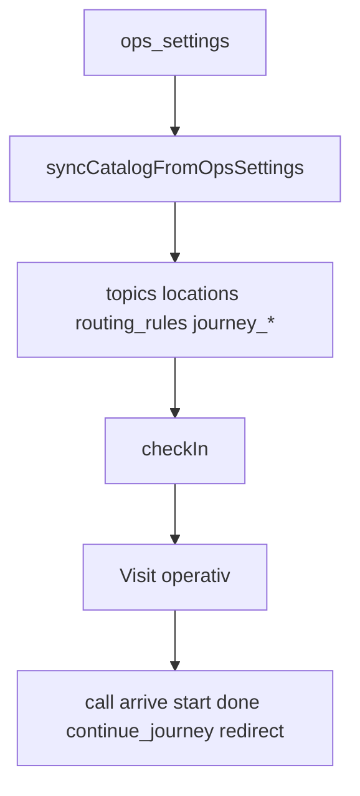

# Routing — Modi, Catalog-Regeln, Journeys

Stand: 2026-09-04 · Ist am Code (`sync-catalog-from-ops-settings`, `flow-core` Visit-/Journey-Flow)

**Scope:** Wie ein Check-in zum operativen Ziel wird; `simple` vs. `complex`; Journey-Autopilot; Redirect; Mode-/Lizenz-Guards.  
Nicht: Nummernkreis/Themen-Editor-Detail → [`domain.md`](domain.md) · Call-Raum-Resolver → [`domain.md`](domain.md) §3 · Fachflows UI → [`../flows.md`](../flows.md) · Package-API → `packages/flow-core/README.md`

**Stil:** Architecture-Docs beschreiben den **Ist-Stand**.

## 1. Leitidee

| Ebene                | Wahrheit                                                                  |
| -------------------- | ------------------------------------------------------------------------- |
| Praxis-Konfiguration | `ops_settings` (`routingMode`, Topics/`defaultRoomId`, `journeySettings`) |
| Catalog              | **Projektion** — nur `syncCatalogFromOpsSettings()`                       |
| Visit                | **operative Wahrheit** — Status, Ziel, Queue, Movement, Journey-Cursor    |

Zwei Wege zur ersten Route:

1. **Single-step** — `RoutingRule.initial_*` (Wartezimmer → Themen-`defaultRoomId`, Movement `call`)
2. **Journey** — Rule trägt `journeyTemplateId`; Check-in nimmt **nur Step 0**; `initial_*` wird ignoriert



## 2. `routingMode`: simple vs. complex

Gespeichert: `ops_settings.routing_mode` (`'simple' | 'complex'`).  
Fachliche Autorität: **Ops Settings** — nicht MFA. Manager/Setup dürfen den lokalen technischen Kompatibilitätspfad nur für Host-/Restore-Abläufe verwenden (`ops-settings-patch-by-role.ts`).

|                           | **simple**                                     | **complex**                                                    |
| ------------------------- | ---------------------------------------------- | -------------------------------------------------------------- |
| Catalog-Sync              | nur `syncSimpleRoutingRulesFromOpsSettings`    | + Journey-Templates + `syncComplexRoutingRulesFromOpsSettings` |
| Topic-`journeyTemplateId` | wird **nicht** in die Rule geschrieben         | verknüpft, wenn Template existiert und `active`                |
| UI Journey-Designer       | aus (`features.journeyDesigner`)               | an, **nur wenn lizenziert**                                    |
| Host-Default ohne Journey | Rule: waiting → defaultRoom, `call`, `visible` | gleich, wenn kein Template am Topic                            |

**Wichtig:** `complex` allein aktiviert keine Mehrschritt-Routen. Ohne Templates bleiben Rules single-step-förmig.

### Lizenz & Capabilities

`resolveRoutingCapabilities` (`app/src/shared/ops/routing-capabilities.ts`):

- `complexRouting` / `journeyDesigner` = Mode `complex` **und** `isComplexRoutingLicensed()`
- Lizenz-Stub: Env `COMPLEX_ROUTING_LICENSED=true|false`, sonst standardmäßig lizenziert (`packages/server-shared/src/routing-license-stub.ts`)
- `routingSimulator: true` immer (Capability-Flag; keine eigene Produktfläche dokumentiert)

Wechsel **nach** `complex` bei explizitem Opt-out → `COMPLEX_ROUTING_NOT_LICENSED`.
Offene Visits (Status ∉ `done` \| `cancelled` \| `no_show`) → Mode-Wechsel blockiert (`ROUTING_MODE_CHANGE_BLOCKED`).

## 3. Catalog-Entitäten (Routing-relevant)

| Entität                           | Rolle                                                                                                |
| --------------------------------- | ---------------------------------------------------------------------------------------------------- |
| **Topic**                         | Anmeldgrund; Host: `defaultRoomId`, optional `journeyTemplateId`                                     |
| **Location**                      | Ort (`pf_entrance`, `pf_waiting`, Praxis-Räume, …)                                                   |
| **Queue**                         | Host-Sync: eine `pf_general_queue` (Package-Modell erlaubt mehr)                                     |
| **Surface**                       | Terminal / TV / MFA / Raum-Panel; Scope & Redirect-Fähigkeit                                         |
| **RoutingRule**                   | Policy pro Topic: Escort, `allowRedirect`, Terminal-Scope; **entweder** `initial_*` **oder** Journey |
| **JourneyTemplate / JourneyStep** | Mehrschritt; Step: Ziel, Queue, `movementMode`, `publicDisplayMode`, `completedWhen`                 |

Typen: `packages/flow-core/src/shared/types.ts`. Schema: `packages/flow-core/db/schema.sql`.

### Movement & Display

| Typ                 | Werte                                 | Wirkung (Auszug)                                                                                                              |
| ------------------- | ------------------------------------- | ----------------------------------------------------------------------------------------------------------------------------- |
| `MovementMode`      | `self_go` \| `call` \| `pickup`       | Check-in/Hop: `self_go` → Status `directed`; `call`/`pickup` → `waiting`. `call`-Transition nur bei `movementMode === 'call'` |
| `PublicDisplayMode` | `visible` \| `hidden` \| `call_only`  | TV/public_display; Staff-Panels nutzen `surface_display_rules`, nicht Visit-Display-Mode                                      |
| `EscortPolicy`      | `none` \| `recommended` \| `required` | kann Movement auf `pickup` heben; `required` blockiert Redirect mit `self_go`                                                 |
| `completedWhen`     | `arrive` \| `start` \| `done`         | wann der aktuelle Journey-Step als erledigt gilt                                                                              |

## 4. Sync (Host → Catalog)

Einziger Produktions-Writer: `app/src/shared/flow-core/sync-catalog-from-ops-settings.ts`.

```text
Ops PATCH / updateOpsSettings
  → validateComplexRoutingLicenseChange (bei Mode→complex)
  → validateRoutingModeChange (offene Visits)
  → syncFlowCoreCatalog → syncCatalogFromOpsSettings
  → Topics/Locations/Queue/Surfaces
  → syncRoutingRulesFromOpsSettings (simple | complex+journeys)
  → validateCatalogIntegrity
```

**Simple-Rule** (`buildSimpleRoutingRuleRow`):

- `initialLastKnown` = `pf_waiting`
- `initialTarget` = enabled `defaultRoomId`, sonst Wartezimmer
- `initialQueueId` = `pf_general_queue`
- `initialMovementMode` = am Wartezimmer `'call'`, bei einem Raumziel `'self_go'`; `publicDisplayMode` = `'visible'`
- Systemthema M: `initialLastKnown` = Eingang, Ziel folgt dem Standard-Aufrufziel, `allowRedirect: false`

**Complex mit Journey** (`buildJourneyRoutingRuleRow`): Rule verknüpft Template; `initial_*` werden weiter befüllt, aber Check-in ignoriert sie.

Entfernte Topics/Locations/Rules: **soft deactivate** (FK-sicher zu historischen Visits).

App-Start: `initializeFlowCore()` synct aus gelesenen `ops_settings`. Backup exportiert Catalog **nicht** — nach Import neu syncen ([`../operations/backup.md`](../operations/backup.md)).

## 5. Check-in → erste Route

`createVisitService().checkIn` (`packages/flow-core/src/server/visit-service.ts`):

1. Topic auflösen (`mfa_assist` → Assist-Topic)
2. `ruleForTopicAtSurface(catalog, topicId, surfaceId)` — aktive Rule am Terminal
3. Snapshot `allowRedirect` + Escort von der Rule
4. `needsAssistance` beziehungsweise `mfa_assist` hebt den effektiven Escort auf `required`; dadurch wird `self_go` operativ zu `pickup`
5. **Mit Journey:** Steps laden; Step 0 Pflicht (`JOURNEY_STEP_MISSING`); Route aus `stepToVisitPatch`; `journeyState: 'active'`, Index `0`; Confidence am Check-in `'assumed'`
6. **Ohne Journey:** `resolveCheckInRouting` kopiert `initial_*`, Escort→Movement, Terminal-Instruction

Ticket-Felder (`laneCode`, Sequence, `topicLabel`) sind danach immutable; Ziel/Queue/Movement bleiben über Transitions änderbar.

## 6. Journey-Laufzeit

```text
Step abgeschlossen (completedWhen matcht Transition)
  → completeJourneyStepPatch
      → nächster Step self_go? sofort startNext…
      → sonst journeyStepCompletedAt setzen
  → Staff: callVisit / continue_journey → start_next_journey_step
```

Besonderheiten:

- **H7:** `lastKnownLocationId ===` nächstes Ziel → Status direkt `arrived` (kein waiting/call-Zyklus)
- Letzter Step fertig → `journeyState: 'completed'`, Index `null`
- `return_to_waiting` hält Journey **active** (kein Redirect)
- Redirect / Cancel → Journey `abandoned` (Redirect nullt Step-Cursor)

Host-Bridge: `app/src/shared/flow-core/visit-queue-bridge.ts` — u. a. `callVisit` führt zuerst `start_next_journey_step` aus, wenn `journeyStepCompletedAt` gesetzt ist.

MFA-Drag-&-Drop auf einen Raum startet bei abgeschlossenem Hop denselben nächsten Journey-Step wie „Weiter“, übergibt aber den gewählten Raum als operatives Ziel für diesen Hop. Spätere Journey-Steps bleiben unverändert.

Die explizite Platzierung wird im Host-Workflow `placeVisitInRoom` (`app/src/shared/queue/place-visit-in-room.ts`) komponiert: optionaler Journey-Start, Call/Reassign und Arrival laufen unter einer gemeinsamen SQLite-Transaktion. `CoreDatabase.checkInRoom()` bleibt dagegen die einfache Ankunftsbestätigung, wie sie insbesondere Raum-Panels und die begleitete Ankunft in `pf_waiting` benötigen. Nach außen meldet der Platzierungsworkflow genau einen Übergang vom Status vor der Benutzeraktion zum finalen Status; die einzelnen Flow-Core-Events bleiben für das Audit erhalten.

Ein normaler Aufruf und eine explizite Platzierung akzeptieren serverseitig nur aktuell aktivierte Praxisräume. Das gilt auch, wenn dieselbe Ziel-ID bereits am Visit gespeichert ist. `pf_waiting` ist ausschließlich als Ziel der begleiteten Wartezimmer-Ankunft zulässig und nie als Ein-Klick-Aufrufziel.

Queue-HTTP: Transition-Typ `continue_journey` (`queue-visit-transitions.ts`).

## 7. Redirect

Voraussetzungen (`validateRedirectRequest`):

- Surface `supportsRedirect` (Host-MFA-Dashboard ja; Raum-Panels nein)
- Visit `allowRedirect` (Assist: false)
- Escort `required` → kein Redirect auf `self_go`

Wirkung: neues operatives Ziel/Movement/Queue; Call-/Arrive-/Start-Zeiten clear; Journey abandoned.  
`reassignTarget` (Raumwechsel in call/arrive/in_progress) ist **kein** Redirect und abandoned die Journey nicht von allein.  
**Host/MFA:** nur Reassign verdrahtet; Redirect-API am Queue bewusst noch nicht (siehe Kommentar an `reassignVisitRoom`).

## 8. Konfiguration & Guards (nichtfunktional)

| Guard                                   | Wann                      | Code                                                       |
| --------------------------------------- | ------------------------- | ---------------------------------------------------------- |
| Offene Visits global                    | Mode-Wechsel              | `ROUTING_MODE_CHANGE_BLOCKED`                              |
| Lizenz                                  | Mode → complex            | `COMPLEX_ROUTING_NOT_LICENSED`                             |
| Offene **aktive** Journeys pro Template | Journey speichern/löschen | `JOURNEY_TEMPLATE_LOCKED` (nur `journey_state = 'active'`) |
| Topic↔Template                          | Ops-JSON                  | `validateTopicJourneyAssignments`                          |
| Catalog-Integrität                      | nach Sync                 | u. a. keine überlappenden aktiven Rules pro Topic+Surface  |

Rollen:

- MFA: Topics + `journeySettings` (wenn Capabilities)
- Ops: `routingMode`; die Manager-API bleibt nur als Kompatibilitätsroute bestehen

Transaktionen: Check-in / Transition / Redirect / Cancel mit `BEGIN IMMEDIATE` (flow-core).  
Tagesreset leert Visits; Mode, Topics, Journeys bleiben ([`system.md`](system.md) §5).

### Bekannte Drift-/Rest-Risiken (Ist)

1. **stale `journey_*` nach Wechsel auf simple:** Rules verlieren `journeyTemplateId`; Journey-Tabellen werden im Simple-Zweig nicht deaktiviert — Integrity prüft nur noch aktive Templates.
2. Bei Simple Routing wird für ein echtes Raumziel `self_go` und für das Wartezimmer `call` verwendet.

## 9. Code-Karte

| Pfad                                                                                | Verantwortung                     |
| ----------------------------------------------------------------------------------- | --------------------------------- |
| `app/src/shared/flow-core/sync-catalog-from-ops-settings.ts`                        | Catalog-Projektion simple/complex |
| `app/src/shared/ops/routing-capabilities.ts`                                        | Feature-Flags für UI              |
| `app/src/shared/ops/routing-mode-guard.ts`                                          | Mode + Open-Visit                 |
| `app/src/shared/ops/journey-template-guard.ts`                                      | Template-Lock                     |
| `app/src/shared/journey-settings.ts`                                                | Ops-JSON Journeys                 |
| `app/src/shared/flow-core/visit-queue-bridge.ts`                                    | Queue-Ops ↔ Core-Transitions      |
| `packages/flow-core/src/shared/{journey,visit-flow,redirect-flow,routing-scope}.ts` | Domain-Algorithmen                |
| `packages/flow-core/src/server/visit-service.ts`                                    | Check-in / Transition / Redirect  |
| `setup/src/routing-mode.ts` · Manager Maintenance                                   | Mode lesen/setzen                 |
| `ui/.../mfa/settings/topics-rooms/journeys/`                                        | Journey-Designer                  |

Tests mit hoher Signalstärke: `sync-catalog-from-ops-settings.test.ts`, `routing-mode-guard*.test.ts`, `packages/flow-core/test/integration/runtime.test.ts`, `journey*.test.ts`, `visit-queue-bridge.test.ts`.

## 10. Beispiele

**Simple — Thema Blut → Labor**

1. Topic `defaultRoomId: labor`, Mode `simple`
2. Sync: Rule waiting→labor, `call`, kein Journey
3. Check-in: Visit `waiting`, Ziel Labor
4. MFA `call` → Panel arrive/start/done

**Complex — Empfang dann Labor**

1. Mode `complex` + Lizenz; Template Step0 Empfang (`call`, `completedWhen: arrive`), Step1 Labor
2. Topic verknüpft Template → Check-in nur Step0
3. Arrive schließt Step0 → `journeyStepCompletedAt` → `continue_journey` / Call startet Step1
4. Redirect mittendrin → neue operative Route, Journey `abandoned`

## 11. Verweise

| Thema                        | Dokument                                             |
| ---------------------------- | ---------------------------------------------------- |
| Catalog-Wahrheit / Call-Raum | [`domain.md`](domain.md)                             |
| API-Rollen Settings-PATCH    | [`apis.md`](apis.md)                                 |
| System / Tagesreset          | [`system.md`](system.md)                             |
| Backup Catalog-Resync        | [`../operations/backup.md`](../operations/backup.md) |
| Package-Domain kurz          | `packages/flow-core/README.md`                       |
