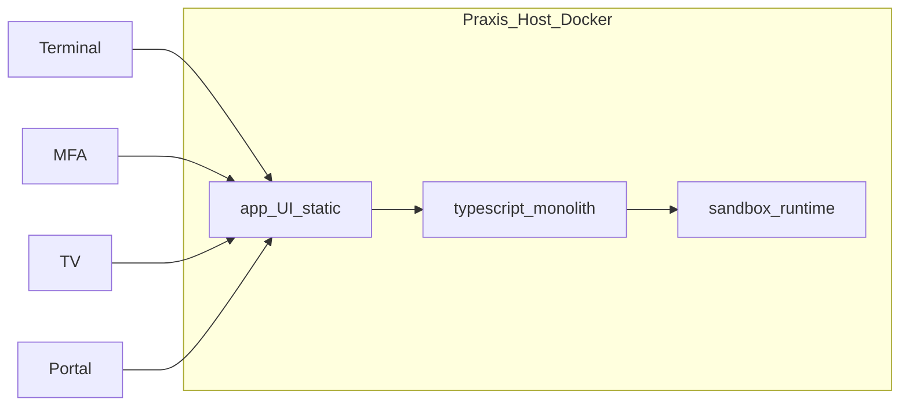

# System — Container, Module, Persistenz

Stand: 2026-09-01 · Ist am Code

**Scope:** Stack, logische Komponenten, Code-Schnitt, Persistenz, Tagesreset, Schutzklassen.  
Nicht: Domänendetail → [`domain.md`](domain.md) · SSE → [`realtime.md`](realtime.md) · Sandbox-Detail → [`documents.md`](documents.md) · Compose/Ports → [`../operations/runtime.md`](../operations/runtime.md)

**Stil:** Architecture-Docs beschreiben den **Ist-Stand**. Kein „Zielbild“ / „Leitdokument“ für Umgesetztes; Ausblick nur klar als Nicht-Produkt oder Discovery kennzeichnen.

## 1. Stack

- Frontend: Svelte + TypeScript + Vite (`ui/` → statisch in `app`)
- Backend: TypeScript-Monolith (Node LTS) im `app`-Container
- Runtime: Docker, kein Kubernetes — Auslieferung [`../operations/delivery.md`](../operations/delivery.md)
- Portal (`/portal/*`) + Session-API im `app`; Captive-/WLAN-Hardware liefert Praxis Flow **nicht** ([`../operations/integrations.md`](../operations/integrations.md))
- SMS-Rückruf: Provider `seven` / `mock` (Ops)

Kritische Daten bleiben logisch von unkritischen Betriebsdaten getrennt (§2).

**Domäne (Kurz):** Nummernkreis `laneCode` · Anmeldgrund `topic` · Aufrufziel `room` (Visit-`targetLocation` oft schon ab Check-in aus Themen-`defaultRoomId`; Anzeige/Call nutzen den Snapshot) — Detail [`domain.md`](domain.md).

## 2. Schutzbedarfsklassen

| Klasse              | Beispiele                                            |
| ------------------- | ---------------------------------------------------- |
| **Kritisch**        | Name, Mobil, DOB, Anamnese, Dokumente/Vorschau       |
| **Intern sensibel** | Besuchsgrund/Thema (Labor, Rezept, …)                |
| **Unkritisch**      | Wartenummer, Queue-/TV ohne Namen, Betriebsparameter |

## 3. Logische Komponenten

Fachliche Schichten im Monolithen — kein Microservice-Schnitt. Abläufe: [`../flows.md`](../flows.md).

| #   | Komponente           | Schutz                    | Kurz                                                                      |
| --- | -------------------- | ------------------------- | ------------------------------------------------------------------------- |
| 1   | Frontend Gateway     | unkritisch                | Terminal, MFA, TV, Portal, Raum-Panel; SSE → [`realtime.md`](realtime.md) |
| 2   | Check-in & Ticket    | unkritisch                | Wartenummer (`laneCode`), Portal-Session; keine Klarnamen in Queue        |
| 3   | Queue & Aufruf       | unkritisch                | Status, TV, Rückhol-Fenster, optional `roomId`                            |
| 4   | Identity             | kritisch                  | PII für MFA (Mobil, DOB; eGK nur Discovery)                               |
| 5   | Dokumente            | kritisch                  | Upload, Anamnese-Output, Host-Export; Vorschau nur Sandbox                |
| 6   | Sandbox Adapter      | kritisch, isoliert        | Preview-Custody — [`documents.md`](documents.md)                          |
| 7   | Tagesbetrieb & Reset | quer                      | Check-in-Sperre, Day-Close/Reset, Ops, Notfall                            |
| 8   | SMS Adapter          | extern                    | Rückhol-SMS über Messaging-Provider                                       |
| 9   | WLAN-/Captive        | extern, **nicht Produkt** | später erweiterbare schlanke Adapter + Manager-Auswahl — kein Gateway-Produkt |

TV nutzt `GET /queue` mit Rolle `tv` — kein eigener Read-Service. Trennung über `routes/` + `shared/`.

### Container (Produkt)

| Service            | Inhalt                                                     |
| ------------------ | ---------------------------------------------------------- |
| `app`              | API + Businesslogik + UI-Static + SQLite                   |
| `sandbox`          | isolierte Vorschau / ClamAV                                |
| `proxy` (optional) | Caddy — Ops [`../operations/tls.md`](../operations/tls.md) |

Kein separater DB-Container. Historisches openNDS-Lab (Stack aus dem Repo entfernt): [`../archive/gateway-captive-portal.md`](../archive/gateway-captive-portal.md).

## 4. Code-Schnitt (Monorepo)

Workspaces u. a. `app`, `ui`, `sandbox`, `setup`, `manager`, `packages/*`.

### Backend (`app/src/`)

| Bereich    | Pfad         | Rolle                                                                                   |
| ---------- | ------------ | --------------------------------------------------------------------------------------- |
| HTTP       | `routes/`    | Fastify-Registrars (checkin, queue, documents, ops, sessions, …)                        |
| Fachlogik  | `shared/`    | Queue, Documents, Forms, Ops, Contacts, flow-core, …                                    |
| Persistenz | `shared/db/` | `CoreDatabase`; SQL in `database-*.ts`                                                  |
| Auth       | `auth/`      | Rollen (`ROUTE_ACCESS_RULES`); Staff-Sessions MFA/OPS; Gerätefreigaben TV/Terminal/Panel (`session-grants`) |
| Fehler     | `http/`      | Domain-Error-Codes, API-Mapping                                                         |

| Komponente       | Routes (Auszug)                                | Shared / DB                                      |
| ---------------- | ---------------------------------------------- | ------------------------------------------------ |
| Check-in / Visit | `checkin-routes`, `sessions-routes`            | `flow-core-checkin`, `database-checkin-sessions` |
| Routing / Journey| Catalog-Sync + Visit-Bridge                    | [`routing.md`](routing.md); `sync-catalog-from-ops-settings` |
| Queue            | `queue-routes`                                 | `shared/queue/`, Visit-Bridge                    |
| Identity         | `identity-routes`                              | Sessions/Contacts                                |
| Dokumente        | `documents-routes`, `patient-documents-routes` | `shared/documents/`, `shared/forms/`             |
| Tagesbetrieb     | `routes/ops/*`                                 | day-lifecycle, ops-settings                      |
| Portal-Auth      | `session-auth` (preHandler)                    | Patient-Session                                  |

### Frontend (`ui/src/`)

- `routes/` — SvelteKit SPA (`ssr: false`)
- `lib/` — API-Clients, Domain-Helper; Typen aus OpenAPI-Codegen

### Verträge & Qualität

- SoT: `openapi/*.yaml` → `npm run generate:api` (Bundle, Fastify-Schemas, App-/UI-Typen)
- Checks: `typecheck` (inkl. OpenAPI/Auth-Sync), `test`, `smoke:*`
- Swagger: `/api/docs` nur Dev/local (`OPENAPI_DOCS_ENABLED`); nicht im Production-Image

Echtzeit: [`realtime.md`](realtime.md) — SSE beobachten, REST tun.

**Nicht im Scope dieses Monolithen:** horizontale SSE-Skalierung (Redis); klassische Repository-Schichten; Setup-Domain weiter in OpenAPI ausbauen.

## 5. Persistenz & Tagesreset

Crash-resilient tagsüber, absichtlich flüchtig über den Praxistag:

| Bleibt nach Tagesreset                                                   | Wird geleert                                                      |
| ------------------------------------------------------------------------ | ----------------------------------------------------------------- |
| Settings (`ops_settings`), **Gerätefreigaben** (`device_authorizations`) | Queue, Patient-Sessions, Dokumente, Anamnese, sonstige Tagesdaten |

**Tagesabschluss** (`POST /ops/day-close/start`): Phase gestartet, Check-in gesperrt — kein Runtime-Reset (API für späteren Export-/Archiv-Flow).

**Tagesreset** (`POST /ops/day-lifecycle/reset`, MFA „Neuen Tag starten“): Tickets/Outbox leer, `lastResetBusinessDay`, Sandbox purge/restart; **Settings und Gerätefreigaben bleiben**. SQLite-Datei bleibt. Export-Ordner auf dem Host unangetastet. Kein vorheriger Day-Close nötig.

Nach Crash: Wiederherstellung aus persistierter Runtime — Reset nur bewusst über MFA.

Catalog = Projektion aus Settings — [`domain.md`](domain.md) § Catalog · Backup [`../operations/backup.md`](../operations/backup.md).

## 6. Festgelegt / Abgrenzung

| Thema                              | Stand                                                                            |
| ---------------------------------- | -------------------------------------------------------------------------------- |
| Portal-Session-TTL                 | Formular → sofort revoke; Upload → 30 Min — [`../flows.md`](../flows.md)         |
| LAN-TLS                            | Produkt — [`../operations/tls.md`](../operations/tls.md)                         |
| Internet-Portal / Captive-Hardware | nicht Produkt — [`../operations/integrations.md`](../operations/integrations.md) |
