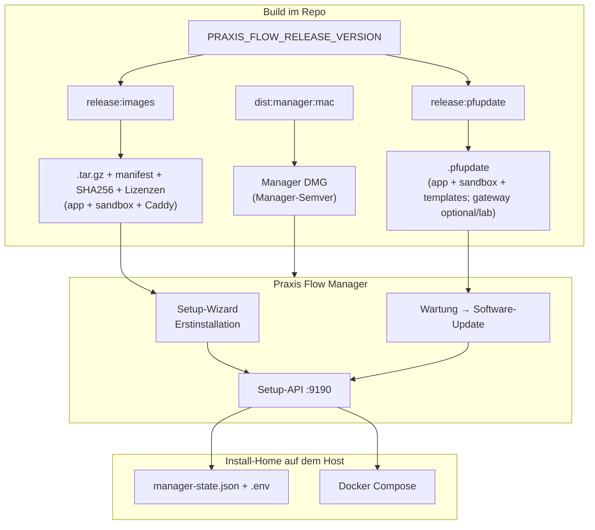

# Build, Installation & Release

Stand: 2026-08-24

Zentrale Doku für **wie Praxis Flow gebaut, installiert und aktualisiert wird**.  
Runtime-Betrieb (Volumes, Logs, Compose): [`deployment-docker.md`](deployment-docker.md).  
Manager-Architektur & Setup-API: [`../manager/README.md`](../manager/README.md).

---

## Überblick



**Prinzip:** Der Stack wird als **versionierte Container-Images** ausgeliefert. In der Praxis wird nicht lokal gebaut — nur Images laden, `.env` pflegen und per Compose starten/aktualisieren. Der **Praxis Flow Manager** (Electron) ist die operative Hülle: Erstinstallation, Status, Wartung und Updates.

---

## Drei verschiedene „Versionen“

| Begriff                   | Beispiel | Wo definiert           | Wofür                                                         |
| ------------------------- | -------- | ---------------------- | ------------------------------------------------------------- |
| **Manager-Version**       | `0.3.0`  | `manager/package.json` | Electron-App, DMG-Name, `minimumManagerVersion` beim Update   |
| **Stack-Release-Version** | `0.3.0`  | `--version` beim Build | Docker-Image-Tags, `manager-state.json`, `.pfupdate`-Manifest |
| **Monorepo-Version**      | `0.3.0`  | Root-`package.json`    | npm-Workspaces — **nur Default**, wenn `--version` fehlt      |

Stack-Release und Monorepo-Version sind **nicht gekoppelt**. Für Kunden-Releases immer explizit setzen:

```bash
export PRAXIS_FLOW_RELEASE_VERSION=0.3.0
npm run release:pfupdate -- --version "$PRAXIS_FLOW_RELEASE_VERSION"
```

**Anzeige (keine vierte Version):** `PRAXIS_FLOW_STACK_VERSION` wird beim App-`docker build` auf denselben Wert wie `--version` gesetzt. Beide Release-Skripte nutzen `scripts/release-app-image.mjs`. Die UI liest den Wert über `GET /api/v1/ops/health` (`stackVersion`). Lokal/Dev bleibt das Feld leer.

**Empfehlung:** Stack-Tag als **Semver** (`MAJOR.MINOR.PATCH`) — unabhängig von der Manager-Semver. Der Manager kann öfter patchen (`0.2.1`) ohne neues Stack-Paket. Major bei Breaking Changes am Stack/API/Images.

---

## Zwei Auslieferungsartefakte

| Artefakt                | Build                      | Manager-Flow                          | Inhalt                                                                                    |
| ----------------------- | -------------------------- | ------------------------------------- | ----------------------------------------------------------------------------------------- |
| **`.tar.gz` + Sidecar** | `npm run release:images`   | Setup-Wizard → „Release-Paket wählen" | app + sandbox + `caddy:2.11.4`, Manifest mit Digests, Checksummen und Caddy-Lizenz        |
| **`.pfupdate`**         | `npm run release:pfupdate` | Wartung → Software-Update             | Manifest mit Digests, Checksummen, Images (app+sandbox+caddy), Templates und Caddy-Lizenz |

Updates laufen **nur** über `.pfupdate`. Der Wizard nutzt das ältere Sidecar-Format (Erstinstallation, kein Cutover/Rollback).

**Drittes Artefakt (separater Zyklus):** Manager-DMG via `npm run dist:manager:mac` — Setup-Server und Templates eingebettet, selten neu ausgeliefert.

**Proxy:** `caddy:2.11.4` wird mitgeliefert (~85 MB Image / ~22 MB als `docker save | gzip`), startet aber **nicht** automatisch. Aktivierung bleibt optional über Setup/Manager (`PROXY_ENABLED`). Compose verwendet `pull_policy: never`: Praxis-Systeme laden Caddy weder beim Start noch bei der TLS-Aktivierung aus einer Registry nach.

Der Release-Build zieht Caddy ausschließlich über den freigegebenen, unveränderlichen Registry-Digest. Das Manifest dokumentiert zusätzlich die im Archiv enthaltene Docker-Image-ID und Plattform. Ein Caddy-Upgrade erfolgt daher bewusst durch Änderung des Pins, Review, Tests und ein neues Praxis-Flow-Release — niemals automatisch beim Kunden.

Standalone prüfen (ohne App-Stack): `npm run smoke:proxy` — nutzt `proxy/Caddyfile` gegen einen Throwaway-Upstream (`app:8080`). Zum Ausprobieren: `npm run smoke:proxy -- --keep` (danach `curl http://127.0.0.1:18080/`, Aufräumen mit `--cleanup`).

---

## Docker-Images

### Repositories und Tags

```
praxis-flow/app:<releaseVersion>
praxis-flow/sandbox:<releaseVersion>
praxis-flow/gateway:<releaseVersion>   ← optional (`--with-gateway`, Lab/openNDS; nicht Produkt-Default)
caddy:2.11.4   # optional offline reverse proxy (PRAXIS_FLOW_PROXY_IMAGE)
```

Freigegebener Upstream-Pin:

```text
caddy:2.11.4@sha256:df7f1c2fb114453b951de51a98efc010db1655a92c2e86be6706714e2417a78d
```

`<releaseVersion>` muss **identisch** sein mit `manifest.releaseVersion`, allen **gesetzten** versionierten `manifest.images.*` (`app`/`sandbox` Pflicht; `gateway` optional/lab, strikt in `pfupdate.ts` wenn vorhanden) und `manager-state.json` → `release.releaseVersion`. `images.proxy` ist optional und, wenn gesetzt, fest auf `caddy:2.11.4`.

### Lokale Dev-Tags

```bash
docker compose build   # praxis-flow/app:local, sandbox:local (+ gateway:local nur Lab)
npm run release:pfupdate:current   # packt :local in .pfupdate ohne Rebuild
```

---

## Build (intern)

### npm-Scripts (Root)

| Script                     | Zweck                                                     |
| -------------------------- | --------------------------------------------------------- |
| `release:images`           | Images bauen + Erstinstallations-Archiv packen            |
| `release:images:pack`      | Nur packen (Images existieren lokal)                      |
| `release:images:current`   | `:local`-Tags als Erstinstallations-Archiv                |
| `release:pfupdate`         | Images bauen + `.pfupdate` packen + Roundtrip-Validierung |
| `release:pfupdate:pack`    | Nur packen                                                |
| `release:pfupdate:current` | `:local`-Tags als `.pfupdate`                             |
| `dist:manager:mac`         | Manager-DMG bauen                                         |

### Erstinstallation (`scripts/build-release-images.mjs`)

1. `docker build` → `praxis-flow/app:<version>` + `praxis-flow/sandbox:<version>` (SBOM + Provenance)
2. `docker pull caddy:2.11.4@sha256:…` → freigegebenen Caddy-Digest laden, als `caddy:2.11.4` taggen und Image-ID/Plattform prüfen
3. `docker save | gzip` → `praxis-flow-<version>-images.tar.gz`
4. `manifest.json` + `SHA256SUMS.txt` (inkl. `imageDigests.proxy`)
5. `THIRD_PARTY_NOTICES.txt` + `licenses/caddy/LICENSE.txt`

**Ausgabe:** `dist/releases/praxis-flow-<version>/`

Gateway ist **nicht** enthalten — nur app + sandbox (+ optional Caddy).

### Stack-Update (`scripts/build-pfupdate.mjs`)

1. `docker build` → app + sandbox; optional `--with-gateway` → **gateway** (Lab); gepinnter Digest-Pull → **caddy:2.11.4**
2. `docker save` → unkomprimiertes `images/praxis-flow-images.tar`
3. Compose-Templates inkl. Proxy-Overlay + `proxy/Caddyfile` + `.env.example` (Image-Tags gesetzt)
4. Manifest mit `minimumManagerVersion` (= aktuelle `manager/package.json`-Version), optional `images.proxy`, optional `images.gateway` (nur `--with-gateway`)
5. Drittanbieterhinweis und vollständige Apache-2.0-Lizenz für Caddy
6. `tar czf` → `dist/releases/praxis-flow-update-<version>.pfupdate`
7. Roundtrip-Validierung via `validatePfupdatePackage()`

**Layout nach Extraktion:**

```
manifest.json
SHA256SUMS.txt
images/praxis-flow-images.tar
templates/docker-compose.delivery.yml
templates/docker-compose.gateway.delivery.yml   ← nur mit `--with-gateway` / Legacy-Pakete
templates/docker-compose.proxy.delivery.yml
templates/proxy/Caddyfile
templates/.env.example
THIRD_PARTY_NOTICES.txt
licenses/caddy/LICENSE.txt
```

Ältere `.pfupdate`-Pakete ohne Proxy- und/oder Gateway-Felder bleiben gültig (v1-kompatibel); Gateway ist Lab-only (`--with-gateway`).

### Manager-DMG (`manager/package.json` → `dist:mac`)

1. `prepare:packaged` — Setup-Server kompilieren, `server-shared` vendoren, Delivery-Templates nach `build-resources/`
2. `electron-vite build` — Main, Preload (CJS), Renderer (Svelte 5)
3. `electron-builder --mac dmg` → `manager/dist/Praxis Flow Manager-<managerVersion>-<arch>.dmg`

Gepackter Manager startet Setup-API aus `resources/setup/` und nutzt standardmäßig `~/Library/Application Support/PraxisFlow` als Install-Home. Aktuell unsigned/nicht notarisiert (interne Tests).

### CI

`.github/workflows/release-images.yml` — baut `release:images` bei Tag `v*` oder manuell. Lädt `dist/releases/praxis-flow-<version>/` als Artifact hoch. **Nicht:** `.pfupdate` oder Manager-DMG.

---

## Erstinstallation

### Install-Home

| Override           | Default (macOS)                            |
| ------------------ | ------------------------------------------ |
| `PRAXIS_FLOW_HOME` | `~/Library/Application Support/PraxisFlow` |

Beim ersten Start kopiert die Setup-API `.env.example` und Delivery-Compose-Templates ins Install-Home, falls noch nicht vorhanden.

### Manager Install-Wizard (Kundenweg)

1. **Voraussetzungen** — Docker läuft; ggf. Release-Paket laden
2. **Release-Paket** — `.tar.gz` wählen → `POST /api/setup/host/images/load`
   - SHA256 gegen Sidecar prüfen
   - `docker load`
   - `manager-state.json` + `.env`-Image-Keys schreiben
3. **Netzwerk** — LAN-IP wählen
4. **Praxis** — Anzeigename + Routing-Modus
5. **Gateway** (optional) — Gast-WLAN
6. **Import/Export-Ordner**
7. **Vorschau** — `POST /plan` → Geräte-URLs
8. **Anwenden** — `POST /apply` mit `runCompose: true`

### CLI-Alternative

```bash
npm run setup                    # interaktiver Terminal-Wizard
npm run setup:reset -- --yes     # Install-Home zurücksetzen
```

### Dev-Iteration

```bash
export PRAXIS_FLOW_HOME=/tmp/pf-dev-001
export PRAXIS_FLOW_COMPOSE_PROFILE=dev
npm run setup:reset -- --yes
npm run dev:manager
```

---

## Software-Update

### Ablauf (Manager → Wartung → Software-Update)

1. `.pfupdate`-Datei wählen
2. **Inspect** — `POST /api/setup/host/update/inspect`
   - Paket extrahieren, Manifest + Checksummen prüfen
   - Manager-Version, Settings-Format, Release-Vergleich
3. **Bestätigen** — Hinweis: automatisches `.pfbackup` vor Cutover; Queue geht verloren
4. **Apply** — `POST /api/setup/host/update/apply` (Timeout 15 min)

Stack muss für das Settings-Backup laufen (Maintenance-App auf `127.0.0.1:8082`).

### Kompatibilitätsprüfungen

| Prüfung                           | Quelle                                                |
| --------------------------------- | ----------------------------------------------------- |
| Paket strukturell + Checksummen   | `packages/server-shared/src/pfupdate.ts`              |
| Manager ≥ `minimumManagerVersion` | Manager sendet Version automatisch                    |
| Settings-Format                   | Maintenance-App oder Build-Default                    |
| DB-Schema nach Cutover            | `targetSchemaVersion: 1` → Fresh DB + Settings-Import |

**Regel:** `build-pfupdate.mjs` setzt `minimumManagerVersion` auf die aktuelle Manager-Version. Ein Stack-Paket darf keine höhere Mindest-Manager-Version verlangen als die Manager-DMG, mit der es getestet wurde.

### Update-Phasen (`settings-backup-update.ts`)

| Phase                       | Aktion                                               |
| --------------------------- | ---------------------------------------------------- |
| `validate_package`          | Struktur + Kompatibilität                            |
| `create_settings_backup`    | `.pfbackup` via Maintenance-App                      |
| `load_images`               | `docker load`                                        |
| `stop_stack`                | `compose stop`                                       |
| `backup_rollback_state`     | Snapshot `.env`, `manager-state.json`, Templates, DB |
| `install_templates`         | Compose-Templates aus Paket                          |
| `write_release_state`       | Image-Tags + `releaseVersion` atomar                 |
| Fresh-DB-Cutover            | Settings aus Pre-Update-Backup importieren           |
| `health_check` / `complete` | Stack hoch, Cleanup                                  |

Bei Fehler nach Rollback-Artefakten: `executeUpdateRollback()` stellt vorherigen Zustand wieder her. Pre-Update-`.pfbackup` liegt unter `<install-home>/backups/`.

Details zu erhaltenen Settings: [`settings-backup-classification.md`](settings-backup-classification.md).

### Manifest (Auszug)

```json
{
  "updateFormatVersion": 1,
  "releaseVersion": "2.1.0",
  "minimumManagerVersion": "0.2.0",
  "supportedSettingsFormatVersions": [1],
  "targetSchemaVersion": 1,
  "images": {
    "app": "praxis-flow/app:2.1.0",
    "sandbox": "praxis-flow/sandbox:2.1.0",
    "proxy": "caddy:2.11.4"
  },
  "imageDigests": {
    "proxy": {
      "registryDigest": "sha256:df7f1c2fb114453b951de51a98efc010db1655a92c2e86be6706714e2417a78d",
      "archiveImageId": "sha256:<plattformabhängige Docker-Image-ID>",
      "platform": "linux/arm64"
    }
  }
}
```

---

## Versionen zur Laufzeit

| Ort                  | Feld                      | Bedeutung                   |
| -------------------- | ------------------------- | --------------------------- |
| Manager UI → Wartung | Software-Update „Aktuell" | `HostStatus.deliveryImages` |
| `manager-state.json` | `release.releaseVersion`  | Aktives Stack-Release       |
| `.env`               | `PRAXIS_FLOW_*_IMAGE`     | Aktive Compose-Image-Refs   |
| `.pfbackup`          | Settings + manager-state  | Stand vor Restore/Update    |

---

## Release-Checkliste

1. **Manager-Version** prüfen: `minimumManagerVersion` im Paket ≤ ausgelieferte Manager-DMG?
2. **`PRAXIS_FLOW_RELEASE_VERSION`** setzen (nicht nur Root-`package.json`)
3. `npm run release:pfupdate -- --version …` — Ausgabe „Package validation OK"
4. Optional: `npm run release:images` für Erstinstallations-Archiv
5. Manifest prüfen: Caddy-Registry-Digest entspricht dem freigegebenen Pin; Image-ID und Plattform sind gesetzt
6. `THIRD_PARTY_NOTICES.txt` und `licenses/caddy/LICENSE.txt` sind im Paket/Release-Ordner enthalten
7. Optional: `npm run dist:manager:mac` bei Manager-Änderungen
8. `.pfupdate` (und ggf. DMG) an Kunden
9. Kunde: Manager → Wartung → Update-Paket wählen (Stack muss laufen)

---

## Häufige Fehler

| Symptom                      | Ursache                                                |
| ---------------------------- | ------------------------------------------------------ |
| „Manager-Version … zu alt"   | `.pfupdate` verlangt höhere `minimumManagerVersion`    |
| „images.gateway muss … sein" | Legacy/`--with-gateway`: `--version` weicht vom Tag ab |
| Update bricht bei Backup ab  | Stack nicht erreichbar (Maintenance `:8082`)           |
| Wizard findet kein Gateway   | Gateway ist Lab-only; Produkt-`.pfupdate` ohne gateway |
| SHA256-Fehler beim Laden     | Sidecar passt nicht zur `.tar.gz`                      |

---

## Verwandte Dokumente

| Datei                                                                                    | Inhalt                               |
| ---------------------------------------------------------------------------------------- | ------------------------------------ |
| [`deployment-docker.md`](deployment-docker.md)                                           | Compose, Volumes, Logs, Tagesbetrieb |
| [`../manager/README.md`](../manager/README.md)                                           | Manager-Architektur, Setup-API, Dev  |
| [`settings-backup-classification.md`](settings-backup-classification.md)                 | Was beim Update erhalten bleibt      |
| [`../packages/server-shared/src/pfupdate.ts`](../packages/server-shared/src/pfupdate.ts) | Format-Validierung (Source of Truth) |
