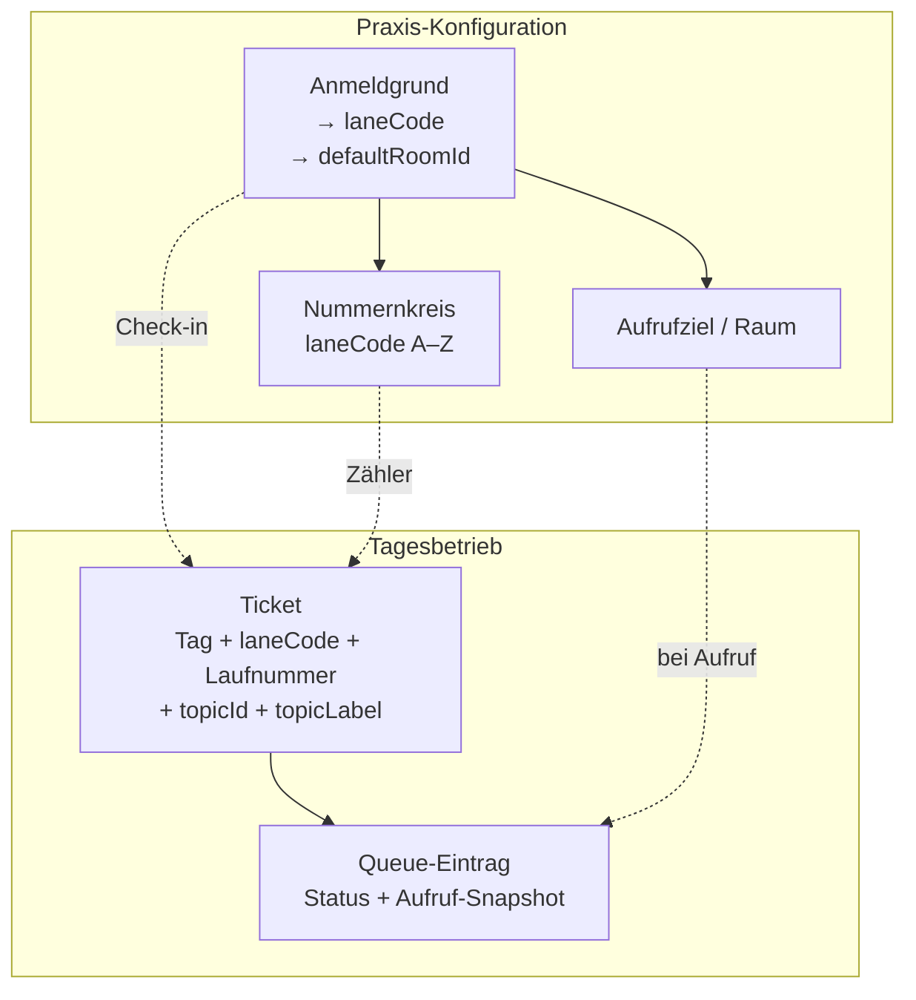

# Domänenmodell — Wartenummer, Anmeldgrund, Aufrufziel

**Status:** Arbeitsdokument (Basisentwicklung)  
**Stand:** 2026-06-17  
**Bezug:** `docs/architecture.md`, `docs/apis.md`, `docs/flows.md`

Dieses Dokument ist die **fachliche Referenz** für die Entkopplung von Themen/Räumen und die Umsetzung im Code. Bei Widersprüchen zu älteren Abschnitten in anderen Docs gilt hier das Zielbild.

---

## Historische Ausgangslage (vor laneCode-Migration, erledigt 2026-06)

Vor der Einführung konfigurierbarer **Themen** (`topics[]`) und **Räume** (`rooms[]`) in `ops_settings` waren mehrere Konzepte vermischt — **heute im Code/OpenAPI bereinigt**:

| Symptom (früher)                                            | Technisch                                            | Stand heute                                  |
| ----------------------------------------------------------- | ---------------------------------------------------- | -------------------------------------------- |
| „Thema“ und „Buchstabe der Wartenummer“ wirken wie ein Ding | `topics[].prefix` steuerte Zähler und Anzeige        | ✅ `laneCode` in Settings, DB, API           |
| Zwei Termin-Themen teilen `A`                               | Absicht, aber nicht als **Nummernkreis** modelliert  | ✅ explizit als `laneCode`                   |
| Offene Sprechstunde doppelt                                 | DB-Spalten `openConsultation*` **und** Thema `offen` | ✅ nur noch Thema `offen`                    |
| Raum am falschen Ort gedacht?                               | Raum stand **nicht** am Ticket bei Check-in          | ✅ unverändert korrekt — Snapshot bei Aufruf |
| Labels für Themen                                           | Katalog in Settings, Fallback i18n                   | ✅ `topicLabel`-Snapshot am Ticket           |

**Schema:** Einmalige Baseline `app/src/shared/db/migrations/001_baseline.sql` (kein Migrationsverlauf). Bestehende SQLite-Datei löschen und App neu starten.

---

## Zielbild (Soll)

### Leitidee

> **Die Wartenummer gehört zum Nummernkreis (Buchstabe), nicht zum Anmeldgrund.**

| Begriff (fachlich) | Code-Zielname                               | Frage                           |
| ------------------ | ------------------------------------------- | ------------------------------- |
| **Nummernkreis**   | `laneCode` (ersetzt konzeptionell `prefix`) | Welche Serie? (`A`, `L`, `O` …) |
| **Anmeldgrund**    | `topic`                                     | Warum ist der Patient da?       |
| **Aufrufziel**     | `room`                                      | Wohin bei Aufruf? (Snapshot)    |

### Grenzen

- **Praxis-Konfiguration** (Katalog): Nummernkreise/Themen/Räume inkl. optionaler Themen-Zeitfenster — überlebt konzeptionell den Tag (persistiert in Settings).
- **Tagesbetrieb**: Tickets + Queue — Reset bei Praxisschluss (`docs/architecture.md`).

### Invarianten

1. Pro **Geschäftstag + Nummernkreis** höchstens eine Laufnummer (`20260602-A-017`).
2. Mehrere **Anmeldgründe** dürfen denselben Nummernkreis nutzen (z. B. beide Termin-Varianten → `A`).
3. **Anmeldgrund** steuert Terminal und MFA-Text, **nicht** die Zählung.
4. **Aufrufziel-Snapshot** am Queue-Eintrag: primär bei **Aufruf** (`called`); optional bei **Check-in im Raum** (`type: check_in_room`), wenn noch kein Ziel gesetzt — kein Raum am Ticket bei Terminal-Check-in.
5. Reserviert: Anmeldgrund `mfa` / Nummernkreis `M` für MFA-Hilfe — nicht im Themen-Editor; konfigurierbare Themen dürfen `M` nicht als `laneCode` wählen.
6. **Immutabilität am Ticket:** `laneCode`, `sequence`, `topicLabel` werden beim Check-in gesetzt und ändern sich nicht, wenn der Katalog später geändert wird.
7. **Topic-Supersede (MFA):** Falsches/zu klärendes Thema → neues Ticket mit neuer Nummer, altes soft `cancelled`, 1:1-Verkettung (`supersedes`/`superseded_by`). Erlaubt bei Core-`waiting`|`directed` (Wartelogik vor Ankunft). Wartezeit-Anker (`checkedInAt`) bleibt. Kein In-Place-Update von Lane/Seq.

---

## Fachdiagramm



---

## Aufrufziel-Auflösung (beim Aufruf)

Entkoppelt von Check-in und Thema:

| Priorität | Quelle                                               | Bedeutung                                         |
| --------- | ---------------------------------------------------- | ------------------------------------------------- |
| 1         | MFA **Session-Aufrufziel** (Quicksettings-Chip)      | Überschreibt für Aufrufe in dieser Session        |
| 2         | **`defaultCallTarget`** in der Raumliste             | Persistierte MFA-Vorauswahl (ein Raum pro Praxis) |
| 3         | **Standard-Raum** des Anmeldgrunds (`defaultRoomId`) | Themen-Katalog, wenn Quicksettings leer           |
| 4         | _(optional später)_ explizit pro Zeile               | API erlaubt `roomId`/`roomLabel` pro Call         |

**Ist-Implementierung:** `ui/src/lib/queue/call-room-target.ts` + `POST /api/v1/queue/:ticket/transition` mit `type: 'call'` und optionalem Raumziel.

**TV/MFA-Anzeige:** immer gespeicherter Snapshot am Queue-Eintrag, nicht live aus dem Katalog.

### Entscheidung offen: Server vs. Client

**Ist:** MFA sendet `roomId`/`roomLabel` aus Quicksettings (Session-Override oder `defaultCallTarget`). Backend `resolveCallRoomForVisit` fällt ohne Body auf Themen-`defaultRoomId` zurück. MFA-Client `resolveCallRoomTarget`: Quicksettings-Raum → `defaultCallTarget` → Themen-Default.

### `type: check_in_room` / `type: check_out_room`

Ergänzt oder überschreibt den Raum-Snapshot, wenn die MFA „Check-in“ im Behandlungsraum auslöst (`resolveRoomTargetForCheckIn`: zuerst bestehender Queue-Snapshot, sonst Quicksettings-Raum).

**Raum-Scope (Raum-Panel):** Raum-Panel-Transitions prüfen Scope serverseitig (`visitTargetsRoom`, Session-`roomId` + `placement`). MFA sendet kein `actingRoomId` und bleibt ohne Einschränkung. Fehler: `QUEUE_ROOM_MISMATCH` (409) bei Scope-Konflikt.

**Reassign + Check-in:** War der Patient `in_room` und MFA weist einen **anderen** Raum zu → Status zurück auf `called` (Ankunft muss im neuen Raum erneut bestätigt werden). Gleicher Raum → `in_room` bleibt.

---

## Entitäten (kompakt)

### Nummernkreis (`Lane`)

- `laneCode`: ein Buchstabe A–Z.
- Optional später: Anzeigename in Settings (`lanes[]`); v1 kann aus Themen abgeleitet werden.

### Anmeldgrund (`Topic`)

- `topicId`, `label`, `iconId`, `sortOrder`, `enabled`
- `laneCode` → Nummernkreis
- `defaultRoomId` → Standard-Aufrufziel (muss aktiver Raum sein)
- `availableFrom` / `availableTo` optional (z. B. Blut nur vormittags)

### Aufrufziel (`Room`)

- `roomId`, `roomLabel`, `enabled`
- `defaultCallTarget` — genau ein aktiver Raum; Vorauswahl für MFA-Quicksettings (Session kann kurz überschreiben)
- `maxOccupancy` — optional; `null`/fehlend = unbegrenzt. Zählt `called` + `in_room` mit diesem `roomId`. Unbekannte Raum-IDs in API-Body unterliegen keiner Kapazitätsregel.

### Ticket

| Feld                      | Pflicht                                                    | Anmerkung                        |
| ------------------------- | ---------------------------------------------------------- | -------------------------------- |
| `businessDay`             | ja                                                         |                                  |
| `laneCode`                | ja                                                         | zum Check-in aus Thema aufgelöst |
| `sequence`                | ja                                                         | Laufnummer im Kreis              |
| `topicId`                 | ja                                                         |                                  |
| `topicLabel`              | **neu**                                                    | Snapshot beim Check-in           |
| `authPath`, `identityRef` | technische Anmeldevariante + Anzeigename/Zuordnungshinweis |                                  |

Anzeige Patient/TV: `laneCode` + `sequence` (z. B. A-017).

### Queue-Eintrag

- Statusmaschine unverändert (`waiting` → `called` → `in_room` → …).
- `roomId` / `roomLabel`: gesetzt bei Aufruf (und ggf. bei Check-in im Raum).
- **`triageLevel`** (`queue_entries.triage_level`): optional `red` | `yellow` | `green` — MFA-only visueller Merker ohne feste Semantik; nicht auf TV; Tagesreset.

---

## Settings-Struktur (logisch)

Trennung Katalog vs. Betriebsparameter (kann weiter eine Tabelle / ein PATCH bleiben):

```text
practiceCatalog:
  topics[]    # laneCode, defaultRoomId, …
  rooms[]

practiceOps:
  returnWindowMinutes (Rückhol einheitlich),
  emergencyEnabled, checkin lock, CSV lookup, …
```

**MFA-Warteliste:** rote Soll-Linie bei **≥ 25 Min.** Wartezeit (`LONG_WAIT_THRESHOLD_MINUTES` in der UI, kein Settings-Feld).

**Entfernen (Ziel):** Legacy-Felder `openConsultationEnabled/From/To` — nur noch Thema `offen` mit Zeitfenster.

---

## Umsetzungsplan (Arbeitspakete)

Reihenfolge für kohärente Basis; jeweils Docs/OpenAPI mitziehen.

### A — Dokumentation & Vertrag

- [x] Dieses Dokument (`docs/domain-model.md`)
- [x] `docs/architecture.md`: Verweis + Kurzabschnitt Domäne
- [x] `docs/flows.md`: Terminologie Nummernkreis / `laneCode`
- [x] `docs/apis.md`, `docs/architecture.md` (Terminologie / laneCode)
- [x] `openapi/*.yaml`: Umbenennung + Sync-Checkliste (siehe Matrix unten)

### B — Backend / Persistenz

- [x] Umbenennung gemäß **Rename-Matrix** (Settings-JSON, `tickets.lane_code`, API-Responses, Outbox)
- [x] Ticket: Spalte `topic_label` — Snapshot in `createTicketInDb`; MFA-Snapshot `topicLabel`
- [x] Legacy `openConsultation*` aus API/Types entfernt; DB-Spalten nur noch intern gespiegelt
- [x] `validateTopicSettings`: reserviertes `laneCode` `M` für konfigurierbare Themen
- [x] Topics-Parse und Rooms-Parse: gleiche Strenge
- [x] Server-Resolver für Aufrufziel in `createVisitCheckInInDb` (`resolve-call-room.ts`)

### C — UI

- [x] `practice-catalog.ts` + Laden in `mfa/+layout.svelte`
- [x] Queue/Ticket-Anzeige nutzt `laneCode` + `topicLabel` vom Server
- [x] Settings-UI: Feld `laneCode` (i18n-Texte „Präfix/Nummernkreis“ folgen in Paket A)
- [x] MFA Dokumente: `topicLabel`-Snapshot in Session-Context

### D — Optional / später

- [ ] Explizites `lanes[]` in Settings (v1: **nicht** — Ableitung nur aus `topics[].laneCode`)
- [ ] Pro-Zeile-Raumwahl beim Aufruf
- [ ] Smoke-Liste: zwei `A`-Themen, MFA-Assist `M`, `type: call` mit/ohne Raumziel, `type: check_in_room`, Day-Close

### Rename-Matrix (Ziel)

| Bereich             | Heute            | Ziel                                         |
| ------------------- | ---------------- | -------------------------------------------- |
| Settings `topics[]` | `prefix`         | `laneCode`                                   |
| DB `tickets`        | `prefix`         | `lane_code`                                  |
| API Ticket/Queue    | `prefix`         | `laneCode` (Breaking — UI/Clients mitziehen) |
| Ticket-ID-String    | `20260602-A-017` | unverändert (Buchstabe bleibt)               |
| Terminal/Identity   | `topicId`        | + `topicLabel` wo Anzeige                    |

---

## Plan-Review (Subagent, 2026-06-02)

**Urteil: kohärent mit Lücken** — fachliches Zielbild passt zum Code (Zähler pro Buchstabe, Raum-Snapshot in Queue, MFA-Override). Vor Umsetzung klären:

| Priorität | Punkt                                                                                |
| --------- | ------------------------------------------------------------------------------------ |
| Hoch      | `topicLabel` End-to-End (DB, Create, MFA-Liste, Dokumente)                           |
| Hoch      | Rename-Matrix vollständig (nicht nur Settings-JSON)                                  |
| Hoch      | Server vs. Client bei Aufrufziel (leerer Call-Body → TV ohne Raum)                   |
| Mittel    | Invariante Check-in im Raum vs. „nur bei Aufruf“ (im Plan präzisiert)                |
| Mittel    | `laneCode` `M` reservieren; Mid-day-Katalog-Änderung vs. Ticket-Snapshot             |
| Mittel    | ~~Legacy `openConsultation*` + `docs/apis.md`~~ erledigt; `docs/flows.md` bei Bedarf |
| Niedrig   | `lanes[]` v1 explizit weglassen; i18n `prefixMeaning*` aufräumen                     |

Vollständiger Review-Bericht: Agent-Transcript / Chat 2026-06-02.

---

## Abgleich mit bestehendem Code

| Ziel                       | Ist (Stand 2026-06-02)                          |
| -------------------------- | ----------------------------------------------- |
| Raum erst bei Aufruf       | ✅ `createVisitCheckInInDb` setzt Room-Snapshot |
| Themen-Default-Raum        | ✅ `defaultRoomId` + `resolveCallRoomTarget`    |
| MFA überschreibt Raum      | ✅ Quicksettings `selectedRoom` vor Default     |
| `topicLabel` am Ticket     | ❌ nur `topicId`                                |
| `laneCode` Benennung       | ✅ API/OpenAPI; DB intern `lane_code`           |
| Legacy offene Sprechstunde | ❌ noch Spiegel-Spalten                         |
| Ein Label-Resolver UI      | ❌ fragmentiert                                 |

---

## Changelog

| Datum      | Änderung                                                                         |
| ---------- | -------------------------------------------------------------------------------- |
| 2026-06-02 | Erstdokument Ausgangslage, Ziel, Umsetzungsplan                                  |
| 2026-06-02 | Subagent-Review eingearbeitet; Invarianten, Rename-Matrix, offene Entscheidungen |
