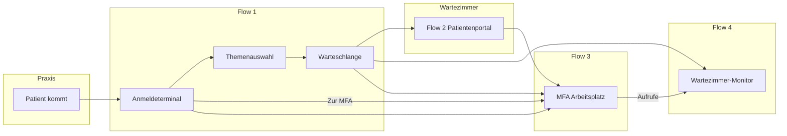

# Flows — Fachliche Abläufe

> Runtime-UI deckt Happy Paths ab. Betrieb/TLS: [`operations/`](operations/).

## Funktionsübersicht der Runtime-UI

Die Tabelle beschreibt die vorhandenen Oberflächen. Als geplant oder Discovery bezeichnete Punkte sind keine Produktzusage; [offene Fragen](open-items.md#fachliche-fragen-und-optionale-produktideen) werden getrennt geführt.

| Bereich             | In Runtime-UI                                                                                                                                                                                                                                                                                                                                                                                                                     | Nur Backend/Mocks                                        |
| ------------------- | --------------------------------------------------------------------------------------------------------------------------------------------------------------------------------------------------------------------------------------------------------------------------------------------------------------------------------------------------------------------------------------------------------------------------------- | -------------------------------------------------------- |
| Terminal Happy Path | Phone/DOB (+49 fest), **Nachname+DOB** (optional per Ops), Themen, Bestätigung, MFA-Assist, Notfall, Terminal gesperrt, Themen-Zeitfenster (Backend-Filter), optional Bon-Druck (Kiosk), Sprachen de/en/tr/ru/uk (Patienten-UI; MFA wählt sichtbare Sprachen, Default nur DE)                                                                                                                                                     | Empfangs-Ausweg bei nicht verfügbarer Anmeldung / Themen |
| Portal              | Wartenummer → Menü → Upload **und** Erstanamnese; Session-Abschluss (Formular → revoke, Upload → TTL 30 Min); Captive-Authorize-Hook (Lab)                                                                                                                                                                                                                                                                                        | Captive-Adapter später; Fragenkatalog-Review             |
| MFA                 | Warteliste (SSE), Zonen, **Raum-Board** (grüne Spalte), **DnD** (WZ↔Räume), **Triage-Merker**, persistierter Anzeigename (`identity-ref`), Dokument-Vorschau (inkl. Deep-Link), Notfall (Ops-Stream), Quicksettings (**Terminal sperren**, Aufrufziel, Geräte-Presence/Pairing), Betrieb-Settings (WLAN-Promo, `returnWindowMinutes`), Rückhol-SMS, Themen-Reihenfolge per Drag, **Raum-Panel-Settings** (Tür + im Raum pro Raum) | Queue-Summary, Identity/Patient-Detail, PVS-Spalten      |
| Raum-Panel          | Login pro Placement (`/room-panel`), Live-Snapshot (SSE), Ankunft/Entlassen/Aufruf aus `actions`, getrennte `callCandidates`-Liste                                                                                                                                                                                                                                                                                                | —                                                        |
| TV                  | SSE, Aufruf, Chime, Pagination, Device-Pairing                                                                                                                                                                                                                                                                                                                                                                                    | —                                                        |

**Echtzeit-Vertrag:** `docs/architecture/realtime.md` — Presence (offline) und Pairing (Code) sind getrennte SSE-Events; REST nur fuer Aktionen.

Details und offene fachliche Punkte siehe Abschnitte pro Flow unten.

**Bekanntes Verhalten (2026-10-07):** Erneutes Einchecken zum selben Thema erzeugt
derzeit auch bei einem bereits offenen Visit eine weitere Wartenummer, am
Terminal wie im MFA-Desktop. Kein Showstopper; ein Schutz mit Hinweis auf die
bestehende Wartenummer wird für später empfohlen. Mehrere unterschiedliche
Themen sollen weiterhin möglich sein. Einbaupunkt und Grenzen der
Patientenerkennung: [Check-in-Guards](architecture/apis.md#bekanntes-verhalten-mehrfach-check-in-zum-selben-thema).

## Produktprinzipien (Kurz)

- **Lokal:** keine Cloud, Daten bleiben in der Praxis
- **Portal:** Wartenummer vom Terminal → Upload (TTL 30 Min) oder Anamnese (Session sofort zu)
- **MFA:** Metadaten + Vorschau/Export/Verwerfen — kein Patient-Download im Portal
- **SMS:** nur beim MFA-Rückholen (optional), nicht am Standard-Check-in
- **Betrieb ≠ Patienten-Flow:** Manager und optionaler Proxy sind Host-/Netz-Hülle — siehe [Betrieb](#betrieb--manager-proxy-gateway); Captive-Hardware und Gateway-Container sind **nicht** Produktkern ([`integrations.md`](operations/integrations.md))

### SMS — wo ja, wo nein

| Bereich                                     | SMS?              | Vorgehen                                                                                       |
| ------------------------------------------- | ----------------- | ---------------------------------------------------------------------------------------------- |
| **Check-in / Warteschlange** (Standard)     | **Nein**          | Rufnummer + Geburtsdatum reicht; falscher Treffer stört die Queue kaum                         |
| **Portal / optional Captive**               | **Nein**          | Nummer **nur vom Terminal** → Patient gibt sie **im Portal** ein (kein weiteres Feld)          |
| **Offene Sprechstunde — Patient kurz raus** | **Ja** (optional) | MFA **Rückholen** in der Warteliste — SMS/WhatsApp wenn Nummer vorhanden; kein SMS am Terminal |

**Hinweis falsche Nummer (Standard-Check-in):** Die Eingabe ist eine Zuordnungshilfe, kein Nachweis — für Reihenfolge oft OK; PVS-Zuordnung nur mit Vorsicht.

**Wichtige Präzisierung „kein Einsehen“:**

- Im **Patient-Portal**: keine Vorschau/Download durch Praxis — korrekt.
- Am **MFA-Dashboard**: Metadaten + Liste, Übernahme/Verwerfen — das ist der geplante Abschluss (Phase 4 in der Journey).

---

## Flow 1 — Digitaler Check-in (Anmeldeterminal)

**Vorbild:** Typische Anmeldeterminals (z. B. Russland) — großes Touch-UI, wenig Tippen, klarer Ausstieg zum Menschen.

**Ziel:** Warteschlange und Anliegen sind erfasst → Reihenfolge im Wartezimmer ist nachvollziehbar, Stress sinkt.

### Terminal-Betrieb: Kiosk + optional Drucker (Bon)

| Komponente             | Pflicht?      | Zweck                                                                                                      |
| ---------------------- | ------------- | ---------------------------------------------------------------------------------------------------------- |
| **Kiosk-Modus**        | ja (Zielbild) | Vollbild, kein Browser-Chrome, kein Wegklicken, nach Timeout → Start (Idle später)                         |
| **Thermo-/Bondrucker** | **optional**  | Wartenummer + Kurzinfo auf **Bon** — Patient hat etwas in der Hand, besonders bei `A-…` / `M-…` ohne Namen |

**Bon-Inhalt (Skizze):** Praxisname, Wartenummer (groß), Anliegen (Themen-Kachel-Text) bzw. **„Empfang“** beim Pfad „Zur MFA“ (`M-…`) — nicht der interne Topic-Slug `mfa`, Uhrzeit/Datum. **Keine** Diagnose, minimal DSGVO.

**Verhalten:**

- **Drucker da:** nach Bestätigung automatisch drucken (still im Hintergrund, ohne Bon-Hinweis am Display) + Nummer weiter groß am Display
- **Kein Drucker / Fehler:** kein Bon — Wartenummer bleibt groß sichtbar (kein dynamisches Fehler-Feedback am Display, da Browser keinen Druck-Erfolg meldet)
- Konfiguration am Terminal-PC (Papierbreite, Kiosk-Launcher) — kein Ops-Setting in v1

Technik (Runtime): Kiosk-Chromium mit `--kiosk-printing`, clientseitiges Print-CSS (`window.print()` auf Bestätigungs-Screen), Papierbreite 58/80 mm in `localStorage` (Long-Press unten links → Testdruck). Kein Backend-Print-Agent in v1.

### Screen-Ablauf (Happy Path)

```text
Anmeldung (Start) ──┬── Rufnummer + Geburtsdatum ──┐
                    ├── Nachname + Geburtsdatum ───┤
                    └── Krankenkassenkarte einstecken ┘
                    └── [Immer sichtbar] Direkt zur MFA
    → Themenauswahl (ein Anliegen)
    → Bestätigung + Wartehinweis (Wartenummer)
```

> Kein separater „Willkommen“-Screen — ein Tap weniger. Optional später: **Idle/Banner** am physischen Terminal (Logo, „Bitte berühren“), ohne eigenen Prozess-Schritt.

### Terminal sperren (MFA, Quicksettings)

- **Wann:** z. B. bei Überlast oder wenn die MFA keine neuen Terminal-Anmeldungen mehr möchte — keine neuen Wartenummern mehr
- **Wo:** Flow 3 **Quicksettings** (rechts oben) — Schalter **Terminal deaktivieren** / wieder aktivieren (**nicht** auf der Wartelisten-Zeile, **nicht** unter Betrieb-Settings)
- **Terminal (Flow 1):** Vollbild „Keine Anmeldung am Terminal“ → **Empfang / MFA**; Notfall-Hinweis zum Empfang (kein Countdown-Notfall-Button)
- **Queue:** Bereits eingecheckte Patienten bleiben in der Warteliste und werden aufgerufen
- **Wieder an:** „Terminal wieder aktivieren“ in den Quicksettings

### Schritt 1 — Anmeldung wählen (Start)

- **Start-Screen UX:** Oben **Standard-Anmeldung** (Telefon, Nachname+DOB und/oder eGK — per Ops-Toggle) — das ist der Hauptweg. Unten getrennt **Notfall**: Text + rote Leiste (3-Sek.-Countdown → Alarm, Abbrechen) → **„MFA wurde informiert — Bitte warten Sie hier.“** (Absicherung + klare Vorgabe; Terminal in MFA-Sichtweite). Keine Symptom-Liste (simpel).
- **Sprachauswahl:** DE / EN / TR über Flaggen (`PatientLangPicker`); Terminal- und Portal-Texte über i18n (en/tr partiell); Themen-Labels aus MFA-Settings (Deutsch), optional per Browser-Translator
- **Rufnummer + Geburtsdatum**, **Nachname + Geburtsdatum**, **Gesundheitskarte** oder **Zur MFA** (welche Kacheln sichtbar sind, steuert MFA unter Betrieb → Terminal-Anmeldung)
- Kein vorgeschalteter Willkommens-Screen (redundant)
- **Datenschutzhinweis** auf Start-Screen (Kurz + Modal): Verantwortlicher und Betroffenenrechte aus Ops-Praxisprofil (`ui/src/lib/privacy/practice-privacy-copy.ts`, geladen via `/practice/profile`)

**Ausstieg Mensch (jederzeit auf den Eingabe-Screens):**

- Button: **„Zur Anmeldung — MFA hilft“**
- Fälle: neuer Patient, keine Lust auf Digital, Karte vergessen, Fehler, Begleitung, Sprachbarriere `?`
- **Auch hier: Wartenummer ausgeben** (eigene MFA-Queue, z. B. Nummernkreis `M` → `M-042`) — Patient geht **ins Wartezimmer** und wird **mit der Nummer aufgerufen** (gleiche Sprache wie digitaler Check-in); MFA sieht Eintrag im Dashboard (Flow 3)
- Kein Name nötig; optional später durch MFA ergänzen

### Schritt 2 — Zuordnungshilfe (eine von)

| Variante | Eingabe                                                                                                                         | Ops-Toggle                   |
| -------- | ------------------------------------------------------------------------------------------------------------------------------- | ---------------------------- |
| A        | **Mobilnummer + Geburtsdatum** — Prefix **+49** fest (keine Plus-Taste); Ziffern nur im Suffix; ←/Löschen bearbeitet den Suffix | `terminalAuthPhoneEnabled`   |
| B        | **Nachname + Geburtsdatum** — Buchstabentastatur (A–Z, Umlaute, ß, Bindestrich, Leerzeichen); Geburtsdatum wie Variante A       | `terminalAuthNameDobEnabled` |
| C        | **Gesundheitskarte (eGK) einstecken**                                                                                           | `terminalAuthEgkEnabled`     |

→ System sucht nach einem passenden bekannten Patienten (CSV-Stamm / PVS später).
→ **Ohne CSV-Treffer:** Check-in läuft trotzdem — Wartenummer wird vergeben. Bei Nachname+DOB sieht MFA den getippten Nachnamen (`identityRef`); bei Rufnummer bleibt der Name leer bis MFA nachpflegt. Rückhol-SMS: MFA kann die Rufnummer in der Warteliste nachtragen (`callbackPhone`).

### Schritt 3 — Themenauswahl (Pflicht nach der Eingabe)

Patient wählt **ein** Hauptanliegen (große Kacheln):

| ID               | Anzeige                      | Warteschlangen-Logik (Skizze)                                                        |
| ---------------- | ---------------------------- | ------------------------------------------------------------------------------------ |
| `blut`           | **Blutabnahme**              | Verfuegbarkeit ueber Themen-Settings (`enabled` + Zeitfenster)                       |
| `termin-habe`    | **Ich habe einen Termin**    | Verfuegbarkeit ueber Themen-Settings (`enabled` + Zeitfenster)                       |
| `termin-brauche` | **Ich brauche einen Termin** | Verfuegbarkeit ueber Themen-Settings (`enabled` + Zeitfenster)                       |
| `offen`          | **Offene Sprechstunde**      | Verfuegbarkeit ueber Themen-Settings (`enabled` + Zeitfenster), Sonderlogik s. unten |
| `rezept`         | **Rezept / Ueberweisung**    | Verfuegbarkeit ueber Themen-Settings (`enabled` + Zeitfenster)                       |

### Schritt 4 — Bestätigung („Sie werden aufgerufen“)

- Anliegen in Klartext wiederholen
- **Terminal (immer):** große **Wartenummer** mit Nummernkreis zum Thema (z. B. `A-042` nach eGK mit Termin, `L-042` Labor) — **kein Name** auf dem Bildschirm (Datenschutz im Wartezimmer).
- **MFA (intern):** bei eGK oder CSV-Treffer sieht das Team **Name** + Nummer in der Warteliste; bei Nachname+DOB ohne Treffer mindestens der getippte Nachname.
- **Rufnummer ohne CSV-Treffer:** gleiche Terminal-Anzeige (nur Wartenummer); Name fehlt bis MFA nachpflegt.

| Anmeldung                    | Namenshinweis für MFA?              | Terminal zeigt                  |
| ---------------------------- | ----------------------------------- | ------------------------------- |
| **eGK**                      | ja (von Karte)                      | **Wartenummer** (z. B. `A-042`) |
| **Rufnummer + Geburtsdatum** | optional (CSV/PVS)                  | **Wartenummer**                 |
| **Nachname + Geburtsdatum**  | getippter Nachname oder CSV-Treffer | **Wartenummer**                 |
| **Zur MFA**                  | nein (optional später)              | **Wartenummer** (`M-…`)         |

- Wartenummer: eindeutig pro Check-in, Portal-Session, Wartezimmer-Anzeige; **optional Bon** (s. Kiosk + Drucker)
- Optional: Hinweis **Portal = Wartenummer eingeben** (Nummer nur vom Terminal, Flow 2; Captive nur wenn Praxis-IT das vorschaltet)

### Offene Sprechstunde — Betrieb (Entscheidung v1)

Patient weiß: **jetzt oder bald** ist offene Sprechstunde. Thema `offen` verhält sich am Terminal wie jedes andere Thema: Check-in → Wartenummer → Wartezimmer.

**Produktentscheidung (2026-06):** Ob das Wartezimmer „voll“ ist, entscheidet **immer die MFA** — nicht das Terminal. Es gibt **keinen** Terminal-Subflow mit drei Buttons (hier warten / in X Min. zurück / SMS am Terminal). Stattdessen:

| Situation                       | Vorgehen                                                                                                                                  |
| ------------------------------- | ----------------------------------------------------------------------------------------------------------------------------------------- |
| **Normal**                      | Patient checkt ein, wartet, wird aufgerufen                                                                                               |
| **Wartezimmer überlastet**      | MFA **sperrt das Terminal** (keine neuen Nummern) und/oder fängt Patienten am **Empfang** ab; bereits eingecheckte bleiben in der Queue   |
| **Patient kurz raus**           | MFA markiert abwesend (Gelb-Zone) und **Rückholen** — optional SMS/WhatsApp wenn Nummer vorhanden (`callbackPhone` oder Check-in-Telefon) |
| **Rückkehr-Fenster abgelaufen** | Backend setzt Ticket automatisch wieder auf `waiting` (gleiche Nummer, kein neuer Check-in)                                               |

**Rückhol (mit oder ohne SMS) — ein Zeitwert:**

- **`returnWindowMinutes`** (MFA unter Betrieb-Settings, Default 15 Min.) gilt **einheitlich** für:
  - Countdown bis `returnUntil` (Gelb-Zone),
  - SMS-/WhatsApp-Text („innerhalb von X Min. zurück“),
  - Rückkehr **ohne** Nummer (reines Warten auf Countdown).

**Rückhol-SMS (optional, wenn Nummer vorhanden):**

1. SMS/WhatsApp **nur** bei MFA-Aktion **Rückholen** — nicht beim Verlassen des Terminals.
2. Fehlgeschlagener Versand: Fehler am Ticket, MFA kann Nummer korrigieren und erneut senden.

**Rückkehr-Fenster abgelaufen:**

- Nach Ablauf von `returnUntil` landet die Wartenummer automatisch wieder in der Warteschlange (`waiting`).
- Kein separater Check-in-Schritt.
- MFA kann vor Ablauf manuell „Zurück ins Wartezimmer“ (`POST …/transition`, `type: return_to_waiting`) nutzen.

**Bewusst nicht in v1:** persistiertes Setting `waitingRoomFull`, Terminal-Anzeige „mindestens X Min.“, Handynummer-Erfassung am Terminal für Rückruf, Bon mit Wiederkomm-Hinweis; Terminal bei vollem WZ mit drei Patienten-Optionen.

Optionale Terminal-Anzeigen und Voraussetzungen für den SMS-Rollout: [offene fachliche Fragen](open-items.md#fachliche-fragen-und-optionale-produktideen).

### Prioritaet / Sortierung

- Basis: Reihenfolge und Aufruf liegen bei der MFA-Steuerung auf der Warteliste.
- Es gibt **kein automatisches Vordraengeln** ueber Themenprioritaeten.
- Bei **Zeitfenster abgelaufen** (Rückhol-Countdown): automatisch wieder `waiting` — siehe Gelb-Zone / Rückhol-Flow unten.

### Sonderfälle

- Unbekannte Rufnummer: Check-in läuft weiter; MFA sieht keinen Namen und kann bei Bedarf nachpflegen.
- Doppel-/Mehrfach-Check-in: kein Beta-Blocker; MFA sortiert doppelte oder falsche Zettel im Tagesbetrieb aus.
- Nicht verfügbare Themen / deaktivierte Anmeldung: Terminal führt zum Empfang.
- eGK-Lesefehler / abgelaufen: zurückgestellt mit eGK-Integration.

### Mögliche Ergänzungen zur Themenauswahl (Review)

| Vorschlag                                                    | Warum                                       |
| ------------------------------------------------------------ | ------------------------------------------- |
| **AU / Krankschreibung / Attest**                            | In DE sehr häufig, oft nicht nur „Rezept“   |
| **Akut — ich fühle mich akut unwohl**                        | Triage / Priorität, ggf. sofort MFA         |
| **Befund / Laborergebnis besprechen**                        | eigene Wartezeit, nicht „Labor abgeben“     |
| **Impfung / Spritze**                                        | eigener Slot / MFA-Vorbereitung             |
| **Verordnung / Hilfsmittel / Verband**                       | nicht immer „Rezept“ im Patienten-Sinn      |
| **Formulare / Unterlagen abgeben**                           | Überschneidung Flow 2 Upload — ggf. Verweis |
| **Administratives** (Überweisung mitbringen, Adresse ändern) | kurz, MFA-Queue                             |

→ Initiale Themenliste ist auf die aktuellen HTML-Demo-Kacheln festgelegt; Erweiterungen folgen spaeter gezielt pro Praxis.

---

## Flow 2 — Patientenportal (Upload / Erstanamnese)

**Ziel:** Optional Dokumente und Erstanamnese sicher übergeben — ohne dass Praxis-Personal Patientendaten am Portal _einsehen_ kann. Einstieg oft über Gast-WLAN der Praxis; **Captive-Hardware und Freischaltung sind nicht unser Produkt** ([`integrations.md`](operations/integrations.md)).

### Produktgrenze (WLAN / Captive)

| Wir liefern                                                                    | Wir liefern nicht                                                                                                               |
| ------------------------------------------------------------------------------ | ------------------------------------------------------------------------------------------------------------------------------- |
| Portal-UI (`/portal/*`), Wartenummer-Prüfung, Session-API                      | Router, APs, Captive-Portal-Hardware, eigenen Captive-Datenpfad                                                                 |
| später: erweiterbare schlanke Captive-Adapter (von uns) mit Auswahl im Manager | openNDS-`gateway`-Container als Produktkern (nur Lab: [`archive/gateway-captive-portal.md`](archive/gateway-captive-portal.md)) |

**Praxis-IT** stellt Gast-WLAN / Captive. Nach Freischaltung (oder ohne Captive: direkter Browser-Aufruf der Portal-URL) läuft unser Portal. Dev/Test ohne WLAN: `/portal` direkt im Browser. Kurzvertrag: [`integrations.md`](operations/integrations.md).

### Schritte (Screen-Ablauf)

**Prinzip:** **Wartenummer = Portal-Session.** Die Nummer wird **nur am Anmeldeterminal** ausgegeben (Display/Bon) — der Patient gibt sie **im Portal am Handy** ein. Kein Geburtsdatum o. Ä.; die Wartenummer reicht in v1 bewusst fuer Upload/Erstanamnese.

**Vorsorge:** Pro Ticket gibt es nur **eine aktive Patient-Session**. Nach **Formular-Absenden** wird die Session serverseitig geschlossen (`sessions/submit`); beim **Upload** endet sie per TTL (Standard 30 Min). Alter Token ungueltig, keine Wiederaufnahme der alten Upload-Liste. Ein erneuter Einstieg mit gleicher Wartenummer erzeugt technisch eine neue, leere Session. Innerhalb einer aktiven Session duerfen mehrere Dateien/Formular-Dokumente abgelegt werden; "einmalig" meint den Abschluss der Session, nicht genau eine Datei.

| Pfad                         | Ablauf                                                                     |
| ---------------------------- | -------------------------------------------------------------------------- |
| **Einstieg (optional)**      | Praxis-Gast-WLAN → fremdes Captive (IT/Vendor) → Redirect auf unser Portal |
| **Session**                  | Portal → **Wartenummer** (+ Nutzungsbedingungen) → Menü                    |
| **Dokumente / Erstanamnese** | Browser, Session = Nummer                                                  |

**Warum voller Browser für Upload?** Captive-Mini-WebViews sind oft eingeschränkt (Datei-Picker, Kamera). Nach Freischaltung: Redirect in Safari/Chrome — volle Upload-APIs. Ohne Captive reicht der direkte Portal-Aufruf (LAN oder später extern über Proxy-Whitelist).

| Screen      | Inhalt                                |
| ----------- | ------------------------------------- |
| Portal      | Nutzungsbedingungen + **Wartenummer** |
| Menü        | Upload \| Erstanamnese                |
| Form/Upload | ohne erneutes Ident                   |

**Begriffe:** **Erstanamnesebogen** / **Neupatientenfragebogen** = medizinisch-administrative Aufnahme beim **ersten** Praxisbesuch. **Anamnese** bei jedem Termin ist etwas anderes (kurz, heute). **Stammdatenblatt** eher Adresse/Versicherung (oft PVS/eGK).

1. (Optional) Gast-WLAN / Captive der Praxis → Redirect auf Portal-URL
2. Portal: **Wartenummer** → Menü: Upload / Erstanamnese
3. Session endet mit endgültiger Entlassung, Formular-Absenden (serverseitig `sessions/submit`), Upload-Ablauf (TTL, Standard 30 Min), oder Tagesreset — kein Wiederaufnehmen der alten Upload-Liste

### Portal-Session-Lebensdauer — bewusste Entscheidung (v1)

> **Kein Implementierungsfehler:** Upload ohne sofortiges Session-Submit und getrennte Behandlung von Formular vs. Datei sind **absichtliches v1-Modell**, nicht eine offene Lücke.

| Auslöser                                                | Verhalten                                                                                                         | Begründung                                                                                                         |
| ------------------------------------------------------- | ----------------------------------------------------------------------------------------------------------------- | ------------------------------------------------------------------------------------------------------------------ |
| **Endgültig entlassen** (`check_out_room` → `done`)     | Offene Dokumente werden nach Warnung im Entlassen-Dialog gelöscht; aktive Sessions werden widerrufen              | Nach der Entlassung sind keine weiteren Uploads möglich; exportierte Dateien bleiben erhalten                      |
| **Formular absenden** (`POST /patient-documents/forms`) | Session wird serverseitig revoked (`submitPatientSession` → Outbox `PatientSessionClosed`)                        | Formular ist ein klarer Abschluss-Schritt; Patient soll danach nicht weiter im Portal navigieren                   |
| **Datei-Upload**                                        | Session bleibt `active` bis TTL, Browser-Schließen (Client-Token weg), erneuter `resolve-ticket`, oder Tagesreset | Mehrere Dateien in einer Sitzung; „Danke — Seite schließen“ ist UX-Hinweis, kein technischer Session-Ende          |
| **Browser schließen** (Upload-Pfad)                     | `sessionStorage` leer; serverseitig Token noch bis TTL gültig                                                     | Akzeptiert: Patient ist fachlich fertig; Daten liegen am Ticket; MFA sieht Dokumente unabhängig vom Session-Status |
| **Erneuter Einstieg** (`resolve-ticket`)                | Alte aktive Session revoked, neue leere Session                                                                   | Portal-Liste leer; Dokumente des Tickets bleiben für MFA sichtbar (`ticket_id`)                                    |

**Empfohlene Patienten-Reihenfolge:** zuerst Upload, dann Formular — oder zwei getrennte Portal-Einstiege am selben Tag.

**Konfiguration:** `SESSION_TTL_MINUTES` (Default **30**). `POST /api/v1/portal/sessions/submit` bleibt als expliziter Endpunkt für künftige UI-Flows; v1 nutzt ihn intern nach Formular-Intake.

**Bewusst nicht in v1:** Upload-Erfolg ruft kein `sessions/submit` auf; kein zweiter Faktor neben Wartenummer (siehe `README.md`).

### Erstanamnesebogen → Dokument

Beim **Absenden** erzeugt das System automatisch ein **Dokument** (z. B. PDF) aus den Formularangaben — **kein separater Upload-Schritt** durch den Patienten.

| Wer              | Was                                                                                                |
| ---------------- | -------------------------------------------------------------------------------------------------- |
| **Patient**      | Formular ausfüllen & absenden (schließt die Session); Upload **vorher** oder in eigener Session    |
| **System**       | Bogen als Datei in derselben **Session/Wartenummer** ablegen                                       |
| **MFA (Flow 3)** | Wie bei Uploads: Symbol in Warteliste, **Dokumente bearbeiten** (Sandbox, PVS, Dateiname, löschen) |

Patient kann den **generierten** Bogen im Portal **nicht** erneut öffnen oder selbst löschen (nur zusätzlich hochgeladene Dateien verwalten).

### Regeln Dokumente

- Upload ja, Löschen ja (durch Patient) — **nur selbst hochgeladene** Dateien
- **Erstanamnese-PDF:** vom System erzeugt, Verarbeitung nur MFA
- Einsehen / Download durch Praxis im Portal: **nein**
- Exportierte Dokumente: Zielsystem und Aufbewahrung sind [offene fachliche Fragen](open-items.md#fachliche-fragen-und-optionale-produktideen); temporärer Intake folgt dem dokumentierten Tagesreset.

### Weitere Produktentscheidungen

Captive-Adapter, Limits und Fragenkatalog: [offene fachliche Fragen](open-items.md#fachliche-fragen-und-optionale-produktideen).

---

## Betrieb — Manager, Proxy und Integrationsgrenzen

Kein Patienten-Flow — Rahmen für Installation und Erreichbarkeit. Fachliche Screens bleiben Flow 1–5.

| Baustein                         | Rolle                                                                                                                                          |
| -------------------------------- | ---------------------------------------------------------------------------------------------------------------------------------------------- |
| **Manager** (Electron)           | Host-Setup, Status, Netzwerk, Wartung, Updates — [`../manager/README.md`](../manager/README.md)                                                |
| **Proxy / TLS** (optional Caddy) | Port 80 HTTP und/oder LAN-HTTPS 443 — [`operations/tls.md`](operations/tls.md); Internet-Portal weiterhin nicht Produkt                        |
| **Gateway** (openNDS)            | **Nicht** Produktkern — Lab-Referenz; Delivery-Default ohne Gateway — [`archive/gateway-captive-portal.md`](archive/gateway-captive-portal.md) |

Mit aktivem Proxy/TLS sind Geräte-/Portal-URLs über `CANONICAL_BASE_URL` kanonisch; App-Port 8080 bleibt lokal für Setup-Probes. Details: [`operations/tls.md`](operations/tls.md), Manager-Doku — nicht in den Patienten-Abläufen.

---

## Flow 3 — MFA Arbeitsplatz

**Ziel:** Alles, was Check-in und Portal ausgelöst haben, ist sichtbar und bearbeitbar.

### Warteliste (Dashboard, vertikal)

- **Quicksettings (rechts):** **Terminal** ein/aus · Geräte-Presence/Pairing
- **Raum-Board:** Im Simple Routing kann ein Raum temporär als Aufrufziel nach dem Wartezimmer markiert werden; der ausgewählte Raum ist hervorgehoben.
- **Überlast (Offene Sprechstunde):** Terminal sperren — keine neuen Check-ins; Empfang + gelbe Zone/Rückholen für laufende Fälle

1. **Grün — noch in der Praxis:** nach **Aufrufen** nacheinander **Check-in** (ein Button) → **Check-out** (ersetzt Check-in, mit Rückfrage-Modal); mehrere Räume möglich. **Ausnahme:** MFA kann Patient **zurück ins Wartezimmer** (Warteschlange) — z. B. Rückfrage, falsches Zimmer, nochmal warten (s. unten). **MFA darf Check-in/out ohne Raum-Einschränkung**; Raum-Panel nur im zugewiesenen Raum (s. unten).
2. **Gelb — abwesend / rausgegangen:** MFA markiert abwesend (`absent_wait_here` / `absent_return_later`); **Rückholen** startet optional Rückhol-SMS und Countdown bis `returnUntil`. **Nach Ablauf des Countdowns** verschiebt das Backend die Wartenummer automatisch wieder in die **Warteschlange** (`waiting`) — kein Check-in, Patient muss physisch erscheinen und wird dann normal aufgerufen.
3. **Warteschlange:** **Längste Wartezeit oben** (Eintreffen) — MFA **Aufrufen** pro Zeile (Monitor), bewusst nicht nur strikt der Reihe nach
4. **Rote Soll-Linie** (fest **25 Min.** in der UI, nicht konfigurierbar): alle **darüber** = länger wartend → reagieren

**Nummernkreis** (`laneCode`) farbig einmal, in der Zeile nur **Nummer** (042). Terminal zeigt weiter `L-042`.

**Anzeigename:** Doppelklick auf Name in der Warteliste → `PATCH …/identity-ref`; persistiert technisch in `identityRef` (gleicher Anzeigename wie CSV/eGK), überlebt Refresh, Tagesreset.

**Upload-Symbol:** deutliches blaues Dokument-Icon mit Anzahl — Dateien über Portal **oder** Erstanamnese nach Absenden (Flow 2). Klick → **Dokumente bearbeiten** (Vorschau Sandbox, ins PVS speichern, löschen). Deep-Link `/mfa?visitId=…&documentId=…` öffnet Vorschau-Overlay direkt. Symbol verschwindet nach Verarbeitung.

**Notfall-Alarm:** rotes Banner oben (Terminal-Meldung) — MFA **quittiert** nach Reaktion; Banner verschwindet (neuer Alarm am Terminal würde erneut erscheinen). Notfall am Terminal ist nur aktiv, wenn das Feature in den Einstellungen aktiviert ist und das Terminal nicht deaktiviert wurde.

### Zurück ins Wartezimmer (von grün)

Kommt vor, auch nach Check-in — Patient soll **nochmal im Wartezimmer warten** (Rückfrage an MFA, Labor unklar, Arzt braucht später nochmal, Patient am falschen Ort).

| Aspekt                 | Regel                                                                                                                                     |
| ---------------------- | ----------------------------------------------------------------------------------------------------------------------------------------- |
| **Wer**                | MFA (Warteliste oder Patient-Detail)                                                                                                      |
| **Aktion**             | z. B. **„Zurück ins Wartezimmer“** — Eintrag verlässt **grün**, landet wieder in **Warteschlange** (sortiert nach Wartezeit / Eintreffen) |
| **Wartenummer**        | **gleiche Nummer** — kein erneutes Terminal-Einchecken                                                                                    |
| **Monitor**            | Aufruf-Anzeige beendet / Nummer wieder „wartend“ (Detail Phase 4)                                                                         |
| **Check-in/Check-out** | Zustand zurücksetzen: wieder **Aufruf möglich** aus der Queue; Check-in/Check-out-Zyklus startet beim nächsten Durchlauf neu              |
| **Nicht**              | nicht in **abwesend** (gelb) — Patient ist physisch in der Praxis, nur wieder in der Schlange                                             |

**Mock (Phase 1):** Ghost-Button **„Wartezimmer“** unter Check-in/Check-out in grün — verschiebt Patient zurück in die Warteschlange (gleiche Nummer, **Aufrufen** wieder möglich).

### Raum-Board und Drag & Drop (Ist)

- **Grüne Spalte:** `ActiveRoomBoard` — gruppiert nach `enabled` Räumen (leere Räume sichtbar), plus Unassigned-Bucket
- **DnD** (`@dnd-kit/svelte`): WZ → Raum = `type: call`; aktiv Raum ↔ Raum = `type: reassign_room` (bei `in_room` → zurück auf `called`); aktiv → WZ = `type: return_to_waiting`; Gelb-Zone ohne DnD
- Griff-Handle auf Queue-Zeile; Aktions-Buttons von Drag ausgenommen

### Nummernkreise (in Einstellungen konfigurierbar)

Die fünf Demo-Themen sind **Start-Defaults** — in MFA unter **Themen & Räume** beliebig anpassbar (hinzufügen, umbenennen, deaktivieren, entfernen, **Reihenfolge per Drag** → `sortOrder`). Terminal-Kacheln kommen aus `GET /checkins/topics`.

| Nummernkreis `laneCode` (Default) | Terminal-Thema                                                     |
| --------------------------------- | ------------------------------------------------------------------ |
| **A**                             | Termin habe / brauche (beide Kacheln teilen sich den Nummernkreis) |
| **L**                             | Blutabnahme                                                        |
| **R**                             | Rezept / Überweisung                                               |
| **O**                             | Offene Sprechstunde                                                |
| **M**                             | MFA-Schalter (fest, nicht in Settings)                             |

Nummernkreis je Thema in MFA unter **Themen & Räume** editierbar (ein Buchstabe A–Z, Feld `laneCode`). **Icon** optional (Lucide-Katalog im Modal); ohne Icon zeigt das Terminal den **ersten Buchstaben** des Namens. **Kein reservierter O-Nummernkreis** — „außer Haus“ auf dem TV kommt aus dem Queue-Status (`absent_*`), nicht aus dem Buchstaben.

Anzeige z. B. **L-042** — Patient tippt dieselbe Nummer im Portal. Beim nächsten Labor-Check-in vergibt das System **L-043** atomar (keine manuelle „nächste Nr.“ in den Einstellungen).

### Aufrufziel (Raum)

Jedes Terminal-Thema hat ein **Standard-Aufrufziel** (`defaultRoomId`). `defaultCallTarget` bleibt der allgemeine Katalog-Fallback, falls ein Themenziel nicht nutzbar ist. Für Themen, die im Simple Routing bewusst im Wartezimmer (`pf_waiting`) beginnen, wird zusätzlich **„Standardaufrufziel nach Wartezimmer“** (`postWaitingCallTargetId`) gespeichert. Im Raum-Board kann die MFA dieses Ziel für ihre Browser-Session temporär überschreiben. Complex Routing und `needsAssistance` verwenden diesen Komfortpfad nicht; Drag & Drop bleibt immer eine explizite Zielwahl.

**Raum-Guards** (`ROOM_BLOCKED_TOPICS` / `ROOM_BLOCKED_QUEUE` / `ROOM_BLOCKED_CAPACITY`):

| Aktion                          | Themen (`defaultRoomId`)                                                                            | Aktive Wartenummern (`room_id`)             | Kapazität (`maxOccupancy`)                             |
| ------------------------------- | --------------------------------------------------------------------------------------------------- | ------------------------------------------- | ------------------------------------------------------ |
| **Löschen** / **ID umbenennen** | Blockiert — zuerst in Terminal-Themen ändern                                                        | Blockiert — zuerst in der Queue umverteilen | —                                                      |
| **Deaktivieren**                | Erlaubt — Themen werden beim Speichern auf `defaultCallTarget` bzw. anderen aktiven Raum umgestellt | Blockiert — wie oben                        | —                                                      |
| **Kapazität senken**            | —                                                                                                   | —                                           | Blockiert wenn mehr `called`/`in_room` als neues Limit |

**Laufzeit:** `type: call`, `type: reassign_room`, `type: check_in_room` (bei Raumzuweisung) werfen `ROOM_AT_CAPACITY` (409), wenn `maxOccupancy` erreicht ist. Quicksettings bleiben unverändert — voller Raum scheitert beim Aufruf.

### Check-in / Check-out — MFA vs. Raum-Panel

| Schritt                        | MFA                                                                       | Raum-Panel                                                               |
| ------------------------------ | ------------------------------------------------------------------------- | ------------------------------------------------------------------------ |
| **Check-in**                   | überall, kein `actingRoomId`                                              | nur im Panel-Raum (`check_in_room`); Scope serverseitig                  |
| **Check-out**                  | überall (Modal „Patient entlassen?“)                                      | nur `inside` + Modus `staff_full` (`check_out_room`)                     |
| **Aufrufen**                   | Warteschlange / DnD                                                       | nur `inside` + `staff_full` + `allowCalling` (`call`); WZ-TV muss online |
| **Umziehen (MFA)**             | `type: reassign_room` — bei Raumwechsel aus `in_room` zurück auf `called` | Panel zeigt danach kein Check-out mehr am alten Ort                      |
| **Zurückholen vor Entlassung** | MFA: zurück ins Wartezimmer / erneut aufrufen                             | —                                                                        |

**Backend:** `POST …/transition` mit `type: check_in_room`, `check_out_room` oder `call` (nur Raum-Panel-Freigabe). MFA sendet weiterhin die MFA-Transitions ohne Raum-Einschränkung. Raum-Panel nutzt **Snapshot-Actions** (`canArrive`, `canCheckOut`, `canCall`) — UI leitet Buttons daraus ab, Server antwortet bei Race/Guard mit 403/409.

**Scope vs. Aktion:** Gehört der Visit zu diesem Raum? (`visitTargetsRoom` über `targetLocationId`) — separat von: Darf dieses Placement etwas tun? (`capabilities` + Flow-Core). Status und `movementMode` steuern nur Darstellung und erlaubte Aktionen.

**Nicht im Panel:** `reassign_room`, `return_to_waiting`, Triage, Supersede, Pickup-Hops — bleiben MFA.

### MFA-Triage-Merker (Ist)

Ampel-Button auf jeder Queue-Karte (Button-Größe), Zyklus **Weiß → Grün → Gelb → Rot → Weiß**. Tooltip nur Farbname; **keine feste Bedeutung** — Praxis nutzt frei. Gespeichert als `triageLevel` am **Queue-Eintrag** (`queue_entries`), MFA-only, Stream-sync, Tagesreset.

**Typischer Konflikt:** Patient im Raum A per Panel eingecheckt → MFA verschiebt nach Empfang → Status `called` @ Empfang → Check-out in A blockiert (weder `in_room` noch passender Raum). Entlassung am Empfang nach erneutem Check-in, oder MFA holt vorher zurück.

### MFA — Dokumente (Uploads)

| Aktion                 | Bedeutung                                                                               |
| ---------------------- | --------------------------------------------------------------------------------------- |
| **Vorschau (Sandbox)** | Nur in isolierter Umgebung — nicht direkt auf MFA-PC öffnen                             |
| **Dateiname**          | Eingabefeld für den Namen **ohne Endung** (`.pdf` etc. fix) — Ordnung vor PVS-Speichern |
| **Ins PVS speichern**  | Klinische Übernahme ins Fachsystem (mit angepasstem Namen)                              |
| **Löschen**            | Datei verwerfen (Patient hatte im Portal auch Löschen)                                  |

**Sicherheit (Zielbild):** automatischer **Virenscan** vor Bearbeitung; Vorschau ausschließlich **Sandbox**. Portal (Flow 2): Patient sieht nur Dateinamen, keine Praxis-Vorschau.

### MFA-Aktionen (Patient-Detail)

- **Aufrufen** → rechts auf TV (Nummer + Ziel), links aus „Warten“; parallel mehrere Aufrufe möglich
- **Zurück ins Wartezimmer** von grün → wieder Warteschlange, gleiche Nummer (Rückfrage etc.)
- Uploads → eigener Screen (s. oben)
- **Überlast:** Terminal sperren (Quicksettings) — Patienten am Empfang; Rückhol-SMS über Gelb-Zone (**Rückholen**)

### Praxis-Einstellungen (MFA, kein System)

| Bereich                    | Inhalt                                                                                                                                                                                                                                                                        |
| -------------------------- | ----------------------------------------------------------------------------------------------------------------------------------------------------------------------------------------------------------------------------------------------------------------------------- |
| **Themen & Räume**         | Terminal-Themen (Label, Nummernkreis `laneCode`, Zeitfenster, aktiv, Reihenfolge per Drag) + Raumliste + **Tür-Panel / Raum-Panel** pro Raum (Expander, je Placement Modus, Texte, optional Namen/Aufruf) + Standard-Aufrufziel je Thema — **laufende Nummer nur vom System** |
| **Betrieb**                | WLAN-Promo, **Rückkehr-Fenster** (`returnWindowMinutes` — einziger MFA-Zeitwert für Rückholen, mit/ohne SMS); **nicht** Terminal sperren (nur Quicksettings)                                                                                                                  |
| **Terminal & Wartezimmer** | Notfall-Feature an/aus                                                                                                                                                                                                                                                        |

**Bewusst nicht:** Server, DB, Netzwerk, Updates.

### Eingänge (Querschnitt)

| Quelle   | MFA sieht                                             |
| -------- | ----------------------------------------------------- |
| Check-in | Anliegen, Wartenummer (`laneCode` + Laufnummer), Zeit |
| Portal   | Session, Upload, Erstanamnese                         |
| Terminal | Notfall-Alarm                                         |
| PVS `?`  | Termin, Raum                                          |

### Weitere Produktentscheidungen

PVS-Anbindung und klinische Zuständigkeit: [offene fachliche Fragen](open-items.md#fachliche-fragen-und-optionale-produktideen).

---

## Flow 4 — Wartezimmer-Anzeige (TV)

**Ziel:** Großer Monitor im Wartezimmer — aus der Ferne lesbar, **keine Namen**.

| Bereich                      | Inhalt                                                                                                      |
| ---------------------------- | ----------------------------------------------------------------------------------------------------------- |
| **Links — Warten**           | Nummern in der Warteschlange; **außer Haus** (z. B. O-012) **grau** mit Hinweis, bis Rückkehr               |
| **Rechts — Bitte weiter zu** | Liste: **Nummer + Hinweis wohin** (Empfang, Labor, Arztzimmer 3, …) — mehrere Einträge gleichzeitig möglich |

**Ansteuerung:** MFA **Aufrufen** → Eintrag rechts; Check-out / weg → raus. Außer Haus links **grau** (bis Rückkehr).

**Datenschutz:** wie Terminal — keine Namen.

---

## Flow 5 — Raum-Panel (Tablet)

**Route:** `/room-panel` · optional Deep-Link `?room=<roomId>&placement=outside|inside`

**Ziel:** Pro Raum zwei unabhängige Placements — **Tür** (`outside`) und **im Raum** (`inside`). Orientierung, optionale Ankunft, optional Entlassen/Aufruf — je nach Settings.

### Placements

| Placement            | PIN beim Enrollment            | Modus                                       | Namen    | Aufruf                            |
| -------------------- | ------------------------------ | ------------------------------------------- | -------- | --------------------------------- |
| **outside** (Tür)    | nein                           | `display_only` \| `arrival`                 | nie      | nie                               |
| **inside** (im Raum) | ja (gemeinsame Raum-Panel-PIN) | `display_only` \| `arrival` \| `staff_full` | optional | nur `staff_full` + `allowCalling` |

**Settings:** Panel-Modi und Texte: MFA → Themen & Räume → Raum-Expander. **Raum-Panel-PIN** (getrennt von MFA-/Ops-PIN): MFA → Betrieb — gilt für **innen**-Enrollment.

### Enrollment

- `GET /auth/room-panel/rooms` — ein Eintrag pro **aktivem Placement** (`roomId`, `roomLabel`, `placement`, `mode`, `requiresPin` aus Domain-Policy)
- `POST /auth/room-panel/login` — Body: `roomId` + `placement`; **PIN nur wenn `requiresPin`** (innen)
- Danach Cookie-Freigabe ohne PIN bis Widerruf, Relogin-Hotspot, Raum-/Placement-Deaktivierung, PIN-Wechsel oder Restore
- UI: „Labor – Tür“ / „Labor – im Raum“; URL-Placement wird beim Restore des Cookies bevorzugt

### Live-UI

- `GET /queue` + `GET /queue/stream` mit Rolle `room-panel` → **RoomPanelSnapshot**
- **Lead-Texte** aus Snapshot-Presets (`calledTextPreset`/`arrivedTextPreset` + optional Custom) — UI löst i18n (`roomPanel.text_*`)
- **Raum-Items** (`called`, `directed`, `in_room`) mit Actions
- **Aufruf-Liste** (`callCandidates`, Backend-FIFO) nur wenn `capabilities.canCall`; getrennt von Raum-Items
- Buttons nur bei `actions.canArrive` / `canCheckOut` / `canCall` — kein lokales Ableiten aus Modus; Aufruf disabled wenn `capabilities.callAnnouncementReachable` false (WZ-TV offline, Server-Presence)
- **409** (TV offline trotzdem versucht, Capacity, Race): Toast + Snapshot-Refresh · **403** Capability: Refresh ohne Logout · Enrollment nur bei 401 / Queue-403 / Revoke

### Device Presence

Device-ID: `room-panel:<roomId>:<placement>` — MFA-Settings zeigen „Tür online“ / „Raum offline“ pro Placement.

### Wenn kein bedienbares Panel

MFA behält die volle Primary-Action-Fläche (Aufrufen, Ankommen, Starten, …).

---

## Querschnitt



---

## Geräte: Pairing, Freigabe & Presence

TV und Terminal: Pairing-Code → MFA-Confirm (nur Registry) → Geräte-Poll schreibt die Freigabe. Raum-Panel: einmal PIN-Enrollment. Danach überleben die Cookies Sleep, App-Neustart und normale Updates; neu koppeln/enrollen nach MFA-Entkoppeln, Backup-Restore oder Origin-/Cookie-Verlust.

Presence (online/stale/offline) bleibt getrennt — siehe [`realtime.md`](architecture/realtime.md).
