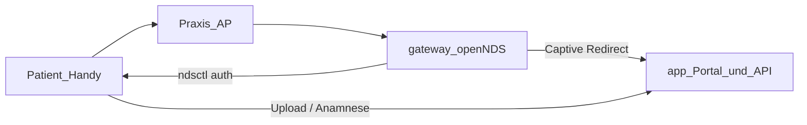

# Guest-WLAN & Captive Portal — Setup und Betrieb

End-to-End-Dokumentation für Flow 2 (Praxis-WLAN). Fachliche Regeln: `docs/flows.md`.

## Zielbild

| Baustein                  | Wo                              | Rolle                                           |
| ------------------------- | ------------------------------- | ----------------------------------------------- |
| **Access Point / Router** | Praxis-IT (nicht unser Produkt) | Gast-WLAN / VLAN; leitet Traffic zum Gateway    |
| **`gateway`-Container**   | optional, Profil `gateway`      | DHCP, openNDS, Firewall, Auth-Bridge            |
| **`app`-Container**       | Pflicht                         | Portal-UI (`/portal/*`), Session-API, Fachlogik |
| **`sandbox`-Container**   | Pflicht                         | Dokument-Scan, Form2PDF (intern)                |

Wir stellen **keinen Router**. Wir stellen **Gateway + Captive-Mechanik**; die Portal-Oberfläche läuft im `app`-Container.



## Patienten-Ablauf (Runtime)

1. Handy verbindet sich mit Praxis-Gast-WLAN.
2. openNDS leitet auf `/portal?clientip=…&clientmac=…` um.
3. Patient gibt **Wartenummer vom Terminal** ein (+ Nutzungsbedingungen).
4. App: `POST /api/v1/sessions/resolve-ticket` → Session-Token.
5. App: `POST /api/v1/sessions/captive-authorize` → Gateway-Bridge → `ndsctl auth` → Internet frei.
6. Portal-Menü: Upload, Erstanamnese, Surfen.

Ohne Gateway (nur `app`/`sandbox`): Schritte 1–2 entfallen; `/portal` direkt im Browser nutzbar (**nur Entwicklung/Test**). Für den Praxisbetrieb mit Patientenportal: Szenario 1 (Gast-WLAN + Gateway) — siehe unten.

## Betriebsarten (Empfehlung)

### Szenario 1 — Gast-WLAN mit Captive Portal

Empfohlen, wenn Patienten das Portal über Gast-WLAN nutzen sollen:

- **Dediziertes Gast-Netz / VLAN** für Gast-Traffic und die vom Portal erreichbaren Dienste
- **Firewall / ACL** der Praxis-IT: Gäste nur zum Portal (typisch App-Adresse/`/portal` + nötige API), nicht zu Ops, MFA, Terminal-Admin, Docker-Ports oder Host-Shares
- Praxis Flow ist nach bestem Wissen für den Praxisbetrieb entwickelt — es **ersetzt keine Netzwerksicherheit** und ist kein gehärtetes Perimeter-Produkt

Access Point / Router bleiben Sache der Praxis-IT (nicht unser Produkt).

### Szenario 2 — Nur Praxis-intern

Terminal, TV und MFA im Praxis-LAN; kein Gast-WLAN, kein `gateway`-Container.

**Patientenportal hier nicht produktiv nutzen.** `/portal` höchstens zur Entwicklung/zum Test im Browser. Wer Portal für Patienten will → Szenario 1.

## Voraussetzungen

### Hardware / Netzwerk

- **Linux-Host** (bare metal oder VM) mit Docker
- Dedizierte **Gast-LAN-NIC** (`GATEWAY_INTERFACE`, z. B. `eth1`)
- Gast-WLAN-Traffic muss dieses Gateway als **Default-Route** nutzen
- `app` auf erreichbarer IP/Hostname für Patienten (Walled Garden vor Auth)

### Nicht geeignet für echten Captive-Test

- **macOS Docker Desktop** — `network_mode: host` funktioniert nicht wie auf Linux
- Entwicklung ohne Gateway: Portal unter `http://localhost:8080/portal` (ohne WLAN-Freischaltung)

## Schnellstart (Lab)

### 1. Env vorbereiten

```bash
cp .env.example .env
```

Mindestens setzen (Beispielwerte anpassen):

```bash
# Pflicht (bereits für app/sandbox)
AUTH_KEY_CAPTIVE=…
EXPORTS_HOST_PATH=~/praxis-flow-exports

# Gateway (Gast-LAN)
GATEWAY_INTERFACE=eth1
GATEWAY_IP=192.168.88.1
GATEWAY_DHCP_RANGE_START=192.168.88.50
GATEWAY_DHCP_RANGE_END=192.168.88.250
APP_PORTAL_URL=http://192.168.88.10:8080/portal
APP_API_URL=http://192.168.88.10:8080
PORTAL_FQDN=portal.praxis.local
OPENNDS_FAS_KEY=…   # langer Zufallsstring, keine Anführungszeichen

# App → Gateway-Bridge (Linux Docker-Bridge-IP)
GATEWAY_AUTH_BRIDGE_URL=http://172.17.0.1:9100
```

`APP_PORTAL_URL` muss vom Handy **vor** voller Internet-Freischaltung erreichbar sein (openNDS Walled Garden).
`APP_API_URL` muss vom Gateway-Mini-PC erreichbar sein; die Auth-Bridge nutzt sie zur Ticket-Prüfung gegen die app.

### 2. Container starten

Entwicklung (Build aus Repo):

```bash
docker compose \
  -f docker-compose.yml \
  -f docker-compose.gateway.yml \
  --profile gateway \
  up -d --build
```

Kundenbetrieb (Images):

```bash
docker compose \
  -f docker-compose.delivery.yml \
  -f docker-compose.gateway.delivery.yml \
  --profile gateway \
  --env-file .env \
  pull && up -d
```

Ohne Gateway (Standard):

```bash
npm run docker:up
# bzw. docker compose up -d
```

### 3. Health prüfen

| Check                 | Befehl / URL                                    |
| --------------------- | ----------------------------------------------- |
| App                   | `GET http://<app-host>:8080/api/v1/ops/health`  |
| Gateway-Bridge (Host) | `curl -s http://127.0.0.1:9100/internal/health` |
| Portal                | Browser: `http://<app-host>:8080/portal`        |

### 4. Funktionstest (mit Gateway)

1. Terminal: Check-in → Wartenummer notieren.
2. Handy: Gast-WLAN → Captive-Fenster oder manuell `/portal`.
3. Wartenummer eingeben → Menü sichtbar, Internet surfbar.
4. Upload oder Anamnese testen; MFA zeigt Dokument-Counter.

## Env-Referenz

| Variable                   | Service       | Bedeutung                                          |
| -------------------------- | ------------- | -------------------------------------------------- |
| `GATEWAY_INTERFACE`        | gateway       | NIC zum Gast-WLAN                                  |
| `GATEWAY_IP`               | gateway       | Gateway-IP auf dieser NIC                          |
| `GATEWAY_DHCP_RANGE_*`     | gateway       | DHCP-Pool für Gäste                                |
| `APP_PORTAL_URL`           | gateway       | openNDS FAS → Splash (`/portal`)                   |
| `APP_API_URL`              | gateway       | Bridge → app `verify-ticket-code` (vom Gateway erreichbar) |
| `APP_PORTAL_MENU_URL`      | gateway       | Default-Redirect nach Auth                         |
| `PORTAL_FQDN`              | gateway       | Walled-Garden-Hostname                             |
| `OPENNDS_FAS_KEY`          | gateway       | FAS-Shared-Secret (openNDS)                        |
| `GATEWAY_AUTH_BRIDGE_PORT` | gateway       | Bridge-Port (Default `9100`)                       |
| `GATEWAY_AUTH_BRIDGE_BIND` | gateway       | Bind-Adresse (Default `0.0.0.0`)                   |
| `GATEWAY_AUTH_BRIDGE_URL`  | app           | App → Bridge (`http://172.17.0.1:9100` o. ä.)      |
| `AUTH_KEY_CAPTIVE`         | app + gateway | Bridge-Auth; **nicht** im Browser                  |

Vollständige Vorlage: `.env.example`.

## API-Schnittstellen

### Patient (Browser → app)

- `POST /api/v1/sessions/resolve-ticket` — `{ "ticketCode": "A-042" }`
- `POST /api/v1/sessions/captive-authorize` — Session-Bearer, Body:

```json
{
  "clientIp": "192.168.88.55",
  "clientMac": "aa:bb:cc:dd:ee:ff",
  "redirectUrl": "http://portal.praxis.local:8080/portal/menu"
}
```

Intern (app → gateway): Bridge prüft Ticket über `POST /api/v1/sessions/verify-ticket-code` (Rolle `captive`) — **ohne** Session-Rotation.

Ohne konfigurierte `GATEWAY_AUTH_BRIDGE_URL`: Antwort `{ "wlanAuthorized": false }` — Portal funktioniert trotzdem.

OpenAPI: `openapi/documents.yaml`.

### Intern (app → gateway)

`POST http://<bridge>/internal/nds-auth` mit `Authorization: Bearer <AUTH_KEY_CAPTIVE>`.

Details: `gateway/README.md`.

## Compose-Dateien

| Datei                                 | Zweck                               |
| ------------------------------------- | ----------------------------------- |
| `docker-compose.yml`                  | app + sandbox (Standard)            |
| `docker-compose.gateway.yml`          | + gateway (Profil `gateway`, Build) |
| `docker-compose.delivery.yml`         | Kunden-Images app + sandbox         |
| `docker-compose.gateway.delivery.yml` | + gateway-Image                     |

## Netzwerk-Topologie (Beispiel)

```text
[Internet]
    |
[Praxis-IT / Router / AP]  ← nicht unser Produkt
    |
[Gast-WLAN / Gast-VLAN 192.168.88.0/24]
    |
[Gateway-Mini-PC Linux]
  ├─ eth1 192.168.88.1  ← GATEWAY_INTERFACE/GATEWAY_IP, openNDS + dnsmasq
  └─ Route zur app      ← APP_PORTAL_URL / APP_API_URL

[Praxis-LAN]
    |
[Praxis-Flow-PC, oft Windows]
  └─ Docker Desktop
       ├─ app :8080     ← Portal-UI + Session-API
       └─ sandbox :8081 (intern)
```

Praxis-AP muss Gast-Clients die Route `192.168.88.1` als Gateway geben (DHCP durch unser dnsmasq oder AP-DHCP mit Gateway-Option). Das Gateway muss `APP_PORTAL_URL`/`APP_API_URL` erreichen; die app muss die Gateway-Bridge über `GATEWAY_AUTH_BRIDGE_URL` erreichen.

**Absicherung (Praxis-IT):** Gast-Netz vom Praxis-LAN trennen; Firewall so setzen, dass Gäste nur das Portal erreichen. Der Stack ersetzt keine Perimeter-Absicherung.

## Bekannte Grenzen (v1)

| Thema                          | Stand                                                                                                                                                   |
| ------------------------------ | ------------------------------------------------------------------------------------------------------------------------------------------------------- |
| HTTPS im Gast-WLAN             | HTTP only (`fas_secure_enabled 0`)                                                                                                                      |
| TLS / lokales Zertifikat       | später                                                                                                                                                  |
| Session-TTL (Upload-Pfad)      | **entschieden:** Default 30 Min (`SESSION_TTL_MINUTES`); Formular-Absenden schließt Session sofort — siehe `docs/flows.md` § Portal-Session-Lebensdauer |
| Mehrere Geräte pro Wartenummer | technisch nicht als parallele aktive Session: pro Ticket nur eine aktive Patient-Session; erneuter Einstieg nach Abschluss startet leer                 |
| Rate-Limits Wartenummer        | `resolve-ticket` rate-limited; Gateway-Bridge intern                                                                                                    |

## Weitere Dokumentation

- Gateway-Implementierung: `gateway/README.md`
- Docker-Betrieb allgemein: `docs/deployment-docker.md`
- Architektur: `docs/architecture.md`
- API-Blueprint: `docs/apis.md`
- Integrationen (eGK/PVS/WLAN): `docs/integrations.md`
