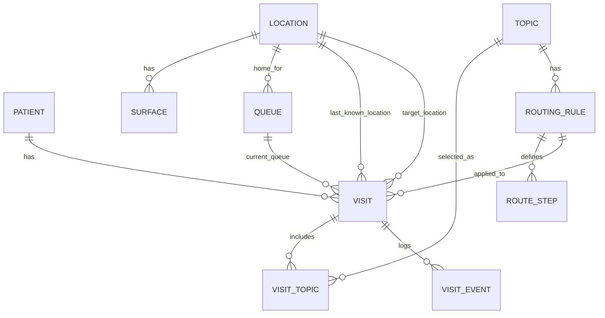

# Routing Core PoC — Arbeitsauftrag

**Status:** Arbeitsdokument fuer separaten PoC  
**Stand:** 2026-07-02  
**Zielgruppe:** Codex in einem neuen Chat / neuen Projekt  
**Bezug:** spaetere Rueckfuehrung in Praxis Flow (`Fastify + SQLite + Svelte`)

Dieses Dokument beschreibt einen bewusst kleinen Proof of Concept fuer das neue Routing-Kernmodell. Der PoC soll nicht das bestehende Projekt umbauen. Er soll isoliert zeigen, ob das fachliche Modell aus **Visit, Location, Queue, Surface, Topic und RoutingRule** traegt und ob die MFA-UI damit verstaendlich wird.

## Auftrag an Codex

Baue ein neues lokales PoC-Projekt fuer den Routing-Core.

Ziel ist nicht Produktpolitur, sondern ein belastbarer Eindruck:

- Wie fuehlt sich das generische Modell im Alltag einer Praxis an?
- Kann die MFA Patienten nach Arbeitsliste, Ort und Thema ueberblicken?
- Bleiben Terminal-Anweisung, Dashboard-Sortierung, Room Panels und Wartezimmer-TV konsistent?
- Laesst sich der bisherige Sonderfall "Wartezimmer" als normale Location modellieren?

Der PoC laeuft nur lokal auf `localhost`, ohne Login, ohne Rollen, ohne Security, ohne Mandantenfaehigkeit, ohne echte Patientendaten.

## Technische Leitplanken

Orientiere dich am spaeteren Zielstack von Praxis Flow, aber halte den PoC klein:

- TypeScript
- SQLite als lokale Datenbank
- Fastify oder ein sehr einfacher Node-HTTP-Server fuer API
- Svelte/SvelteKit fuer die UI, wenn schnell verfuegbar
- Alternativ Vite + Svelte, falls fuer den PoC schlanker
- Keine Authentifizierung
- Keine Docker-Pflicht
- Keine Netzwerkdienste ausser `localhost`
- Keine produktive Migration-Komplexitaet; eine initiale SQL-Datei reicht

Bevorzugt:

```text
routing-core-poc/
  package.json
  src/server/
  src/ui/
  src/shared/
  db/schema.sql
  README.md
```

Wenn ein Monorepo Overhead erzeugt, baue einfacher. Der Erkenntnisgewinn ist wichtiger als perfekte Struktur.

## Fachlicher Kern

Nicht vom Wartezimmer her denken.

Der Kern ist:

```text
Visit = heutiger Praxisdurchlauf
Location = physischer Ort / Station
Queue = Arbeitsliste / Zustaendigkeit
Surface = Anzeige oder Bedienoberflaeche
Topic = Anliegen
RoutingRule = angewendete Startentscheidung
VisitEvent = Historie
```

Wartezimmer ist nur eine Location, nicht das Grundmodell.

## Zentrale Fragen

Jede aktive Visit muss diese Fragen beantworten:

```text
Wo ist der Patient zuletzt bekannt oder angenommen?
Wohin soll er als naechstes?
Welche Arbeitsliste ist zustaendig?
Wie bewegt sich der Patient weiter?
Wo darf der Fall angezeigt werden?
Was sieht der Patient am Terminal?
```

## Datenmodell

### Patient

Person oder anonyme Wartemarke. Fuer den PoC minimal halten.

```ts
Patient {
  id: string
  displayName?: string
  isAnonymous: boolean
  createdAt: string
}
```

### Visit

Wichtigster State-Traeger. Eine Visit entsteht beim Check-in. RoutingRules erzeugen keine Visit, sie werden nur angewendet.

```ts
Visit {
  id: string
  patientId: string

  status:
    | "created"
    | "checked_in"
    | "waiting"
    | "directed"
    | "called"
    | "arrived"
    | "in_progress"
    | "blocked"
    | "done"
    | "cancelled"
    | "no_show"

  primaryTopicId?: string
  appliedRoutingRuleId?: string
  routingSnapshotJson?: string

  lastKnownLocationId?: string
  targetLocationId?: string
  queueId?: string
  lastSurfaceId?: string

  movementMode:
    | "self_go"
    | "call"
    | "pickup"
    | "stay_at_terminal"

  locationConfidence:
    | "instructed"
    | "assumed"
    | "confirmed"

  publicDisplayMode:
    | "visible"
    | "hidden"
    | "call_only"

  queueNumber: string
  queueNumberDate: string
  queueNumberScope: "global_day" | "queue_day"

  needsAssistance: boolean
  requiresPickup: boolean
  allowRedirect: boolean

  terminalInstruction: string
  staffNote?: string

  checkedInAt?: string
  calledAt?: string
  arrivedAt?: string
  startedAt?: string
  finishedAt?: string
  createdAt: string
  updatedAt: string
}
```

Hinweis: `lastKnownLocationId` ist bewusst vorsichtiger als `currentLocationId`. Das System weiss oft nur, wohin der Patient geschickt wurde, nicht sicher wo er wirklich ist.

### VisitTopic

Fuer den PoC darf eine Visit genau ein `primaryTopicId` haben. Lege aber optional bereits `visit_topics` an, damit Mehrfachanliegen spaeter nicht das Modell sprengen.

```ts
VisitTopic {
  id: string
  visitId: string
  topicId: string
  isPrimary: boolean
  status: "open" | "in_progress" | "done" | "cancelled"
  queueId?: string
  targetLocationId?: string
}
```

### Topic

Anliegen, das am Terminal gewaehlt wird.

```ts
Topic {
  id: string
  name: string
  category: string
  color: string
  defaultPriority: "low" | "normal" | "high" | "urgent"
  estimatedDurationMin?: number
  active: boolean
  sortOrder: number
}
```

### Location

Alles, was als Ort oder Station im Praxisablauf relevant ist.

```ts
Location {
  id: string
  name: string
  type:
    | "entrance"
    | "waiting_area"
    | "reception"
    | "treatment_room"
    | "lab"
    | "service_station"
    | "virtual"

  canWait: boolean
  canTreat: boolean
  canCheckIn: boolean
  staffOnly: boolean
  publicName?: string
  active: boolean
  sortOrder: number
}
```

Terminal-Frage:

- Sauberer langfristig: Terminal ist eine `Surface` an der Location `Eingangsbereich`.
- Fuer einen sehr schnellen PoC darf "Terminal 1" auch als eigene Location modelliert werden.
- Wenn Terminal als Surface modelliert wird, speichere bei der Visit `lastSurfaceId = terminal_1`.

### Surface

Anzeige oder Bedienoberflaeche. Eine Surface ist keine Queue.

```ts
Surface {
  id: string
  locationId: string
  name: string
  type: "terminal" | "public_display" | "staff_panel" | "dashboard"
  audience: "patient" | "staff" | "public"

  showsQueue: boolean
  supportsCalling: boolean
  supportsConfirmation: boolean
  supportsRedirect: boolean
  enabled: boolean
}
```

Optional fuer bessere Verprobung:

```ts
SurfaceDisplayRule {
  id: string
  surfaceId: string
  queueId?: string
  locationId?: string
  topicId?: string
  displayMode: "visible" | "hidden" | "call_only"
}
```

Beispiele:

- Wartezimmer-TV zeigt allgemeine Queue sichtbar.
- Wartezimmer-TV zeigt Labor-Queue nur beim Aufruf.
- Wartezimmer-TV zeigt Infekt-Queue nicht.
- Room Panel Impfraum zeigt Visits mit `targetLocationId = impfraum` oder `queueId = impfung_queue`.

### Queue

Arbeitsliste oder fachliche Zustaendigkeit. Eine Queue kann, muss aber nicht, an einer Location haengen.

```ts
Queue {
  id: string
  name: string
  homeLocationId?: string
  type: "location" | "service" | "reception" | "assistance" | "virtual"
  sortPolicy: "checkin_time" | "priority_then_time" | "manual"
  callPolicy: "manual" | "automatic" | "none"
  defaultMovementMode: "self_go" | "call" | "pickup" | "stay_at_terminal"
  active: boolean
  sortOrder: number
}
```

Wichtig:

- Nicht eine Queue pro Location erzwingen.
- Fuer MVP gerne Default-Queues je relevanter Location anlegen.
- Spaeter sind auch Service-Queues wie Labor, Empfang, Abholung moeglich.

### RoutingRule

Aktuelle Konfiguration fuer Initialrouting eines Topics. Eine Rule wird beim Check-in angewendet und als Snapshot an der Visit gespeichert.

```ts
RoutingRule {
  id: string
  topicId: string
  name: string

  initialLastKnownLocationId?: string
  initialTargetLocationId?: string
  initialQueueId?: string
  initialMovementMode: "self_go" | "call" | "pickup" | "stay_at_terminal"
  initialLocationConfidence: "instructed" | "assumed" | "confirmed"

  publicDisplayMode: "visible" | "hidden" | "call_only"
  terminalInstructionTemplate: string

  requiresReceptionConfirmation: boolean
  requiresPickup: boolean
  allowRedirect: boolean
  active: boolean
}
```

Name bewusst als `RoutingRule` oder `InitialRoutingRule` verwenden. Nicht versuchen, damit bereits komplexe mehrstufige Workflows zu modellieren.

Optional vorbereiten, aber nur bauen, wenn es den PoC nicht aufblaeht:

```ts
RouteStep {
  id: string
  routingRuleId: string
  sequence: number
  targetLocationId?: string
  queueId?: string
  movementMode: "self_go" | "call" | "pickup" | "stay_at_terminal"
  publicDisplayMode: "visible" | "hidden" | "call_only"
  requiresConfirmation: boolean
}
```

### VisitEvent

Audit, Debugging und Redirect-Historie.

```ts
VisitEvent {
  id: string
  visitId: string
  type:
    | "checked_in"
    | "routed"
    | "called"
    | "arrived"
    | "started"
    | "redirected"
    | "blocked"
    | "done"
    | "cancelled"
    | "no_show"

  fromStatus?: string
  toStatus?: string
  fromLocationId?: string
  toLocationId?: string
  fromQueueId?: string
  toQueueId?: string

  actorType: "terminal" | "mfa" | "doctor" | "system"
  actorId?: string
  note?: string
  createdAt: string
}
```

## Beziehungen



## Seed-Daten

Lege realistische Seed-Daten an.

Locations:

- Eingangsbereich
- Allgemeines Wartezimmer
- Infekt-Wartebereich
- Empfang
- Labor
- Impfraum
- Raum 1
- Raum 2

Surfaces:

- Terminal 1 am Eingangsbereich
- MFA Dashboard
- Wartezimmer-TV
- Room Panel Labor
- Room Panel Impfraum
- Room Panel Raum 1

Queues:

- Allgemeine Warteliste
- Empfangsliste
- Infektliste
- Laborliste
- Impfliste
- Abholung / Hilfe

Topics:

- Allgemeine Sprechstunde
- Erkaeltung / Infekt
- Blutabnahme
- Impfung
- Rezept abholen
- OP-Vorbereitung
- Rueckfrage Labor

RoutingRules:

1. Allgemeine Sprechstunde
   - lastKnownLocation: Allgemeines Wartezimmer
   - targetLocation: Allgemeines Wartezimmer
   - queue: Allgemeine Warteliste
   - movement: call
   - display: visible
   - terminal: "Bitte nehmen Sie im Wartezimmer Platz. Sie werden aufgerufen."

2. Erkaeltung / Infekt
   - lastKnownLocation: Infekt-Wartebereich
   - targetLocation: Infekt-Wartebereich
   - queue: Infektliste
   - movement: pickup
   - display: hidden
   - terminal: "Bitte warten Sie im Infekt-Wartebereich. Sie werden abgeholt."

3. Blutabnahme
   - lastKnownLocation: Allgemeines Wartezimmer
   - targetLocation: Labor
   - queue: Laborliste
   - movement: call
   - display: call_only
   - terminal: "Bitte nehmen Sie im Wartezimmer Platz. Sie werden zur Blutabnahme aufgerufen."

4. Impfung
   - lastKnownLocation: Eingangsbereich
   - targetLocation: Impfraum
   - queue: Impfliste
   - movement: self_go
   - display: hidden
   - terminal: "Bitte gehen Sie direkt zum Impfraum."

5. Rezept abholen
   - lastKnownLocation: Empfang
   - targetLocation: Empfang
   - queue: Empfangsliste
   - movement: self_go
   - display: hidden
   - terminal: "Bitte melden Sie sich am Empfang."

6. Hilfe / Abholung am Terminal
   - lastKnownLocation: Eingangsbereich
   - lastSurface: Terminal 1
   - targetLocation: Eingangsbereich
   - queue: Abholung / Hilfe
   - movement: stay_at_terminal oder pickup
   - display: hidden
   - terminal: "Bitte bleiben Sie am Terminal. Eine MFA kommt zu Ihnen."
   - needsAssistance: true

## UI-Ziel

Baue keine Landingpage. Die erste Seite ist die MFA-/Admin-Verprobung.

### Hauptansicht MFA Dashboard

Ziel: Die MFA erkennt auf einen Blick, dass Queue, Location und Surface unterschiedliche Perspektiven sind.

Baue mindestens diese Umschalter:

- Arbeitslisten
- Orte
- Themen

Arbeitslisten-Sicht:

- Gruppiert nach `queueId`
- Sortierbar nach Check-in-Zeit, Prioritaet, Thema
- Aktionen: Aufrufen, Ankunft bestaetigen, In Bearbeitung, Fertig, Redirect

Orte-Sicht:

- Gruppiert nach `lastKnownLocationId`
- Zeigt zusaetzlich `targetLocationId` und `locationConfidence`
- Gute Labels: "angenommen im Wartezimmer", "angewiesen zum Impfraum", "bestaetigt in Raum 1"

Themen-Sicht:

- Gruppiert nach Topic
- Zeigt, welche Queue und welches Ziel gerade aktiv sind

### Check-in Simulator

Ein Panel, mit dem man schnell Visits erzeugen kann:

- Topic waehlen
- optional "braucht Hilfe / Rollstuhl / Abholung" aktivieren
- Check-in ausloesen

Nach Check-in anzeigen:

- Terminal-Text
- erzeugte Wartenummer
- lastKnownLocation
- targetLocation
- Queue
- movementMode
- publicDisplayMode
- sichtbar auf welchen Surfaces

### Surface Preview

Zeige mindestens drei kleine Previews:

- Wartezimmer-TV
- Room Panel Impfraum
- Room Panel Labor

Diese Previews sollen keine eigenen Daten erzeugen. Sie filtern nur die Visits nach Surface-Regeln.

### Routing Admin

Minimaler Editor fuer RoutingRules:

- Topic
- Start-/Annahmeort
- Zielort
- Queue
- Movement Mode
- Public Display Mode
- Terminal-Text
- Requires Pickup
- Allow Redirect
- Active

Vermeide einen einzelnen "Routing-Modus", der Ort, Queue, Anzeige und Bewegung vermischt. Besser als Satz-Builder darstellen:

```text
Nach dem Terminal gilt:
Patient befindet sich/steht bei [Location].
Ziel ist [Location].
Zustaendig ist [Queue].
Weiter geht es durch [Movement Mode].
Oeffentliche Anzeige ist [Display Mode].
```

## Aktionen / Statuslogik

Implementiere einfache API- oder UI-Aktionen:

### Check-in

1. Patient/Visit erzeugen.
2. Topic waehlen.
3. aktive RoutingRule anwenden.
4. Routing Snapshot in Visit speichern.
5. VisitEvent `checked_in` und `routed` schreiben.

### Call

Nur sinnvoll, wenn `movementMode = call`.

Setze:

- status: `called`
- targetLocationId bleibt oder wird neu gesetzt
- locationConfidence: `instructed`
- calledAt
- Event `called`

### Confirm Arrival

Setze:

- status: `arrived`
- lastKnownLocationId = targetLocationId
- locationConfidence: `confirmed`
- arrivedAt
- Event `arrived`

### Start Service

Setze:

- status: `in_progress`
- startedAt
- Event `started`

### Done

Setze:

- status: `done`
- finishedAt
- Event `done`

### Redirect

Redirect ist keine Magie und kein Sonderstatusmodell. Redirect setzt neue operative Wahrheit:

- neue Queue
- neues targetLocation
- optional neues movementMode
- optional neuer terminal/staff note
- Event `redirected` mit from/to Feldern

## Wichtige fachliche Invarianten

- Terminal-Anweisung, Queue-Platzierung und Surface-Anzeige muessen aus derselben Routing-Entscheidung entstehen.
- Eine Surface ist keine Queue.
- Ein Raum-Panel zeigt gefilterte Visits, besitzt sie aber nicht.
- Eine Queue ist eine Arbeitsliste, kein Ort.
- Eine Location kann wartende Visits haben, aber "Wartezimmer" ist kein Sondermodell.
- `called` bedeutet: aus einer Wartesituation aufgerufen.
- `directed` bedeutet: direkt angewiesen, irgendwohin zu gehen.
- `needsAssistance`, `requiresPickup` und `movementMode = pickup` sind unterschiedliche Dinge:
  - `needsAssistance`: Eigenschaft dieses Falls
  - `requiresPickup`: Workflow-Vorgabe
  - `movementMode = pickup`: aktuell gewaehlte Bewegung
- RoutingRules sind mutable Konfiguration; Visits speichern den angewendeten Snapshot.
- Tagesreset / Queue-Nummern beachten:
  - fuer PoC reicht `queueNumberDate`
  - spaeter passt das zu Praxis Flow Day-Close

## Nicht-Ziele

Nicht bauen:

- Login, PIN, Rollen, MFA-Security
- echte PVS-Integration
- echte Patientensuche
- Docker-Delivery
- produktive Migrationen
- perfekte Responsive-UI
- SMS, WLAN, Portal, Dokumentupload
- vollstaendige Mehrschritt-Workflows
- automatische medizinische Priorisierung

## Erfolgskriterien

Der PoC ist erfolgreich, wenn man in 10 Minuten diese Fragen beantworten kann:

1. Wo sieht die MFA alle aktiven Faelle?
2. Kann sie zwischen Arbeitslisten- und Ortssicht wechseln?
3. Wird ein direkt zum Impfraum geschickter Patient nicht mehr als normaler Wartezimmerpatient behandelt?
4. Kann ein Patient physisch im Wartezimmer sein, aber fachlich in der Labor-Queue warten?
5. Kann ein Infektpatient separat warten und verborgen vom Wartezimmer-TV bleiben?
6. Kann ein Patient am Terminal Hilfe anfordern und in der Abhol-Queue erscheinen?
7. Zeigen Room Panels nur gefilterte Sichten statt eigene Queues zu erzeugen?
8. Bleibt eine alte Visit nachvollziehbar, auch wenn die RoutingRule spaeter geaendert wird?

## Empfohlene erste Umsetzungsschritte

1. Projekt scaffolden.
2. SQLite-Schema und Seed-Daten erstellen.
3. Minimal-API fuer Stammdaten, Visits und Aktionen bauen.
4. Check-in Simulator bauen.
5. MFA Dashboard mit Arbeitslisten- und Ortssicht bauen.
6. Surface Previews bauen.
7. RoutingRule Editor minimal anbauen.
8. README mit Startbefehl und Modellnotizen schreiben.

Halte die UI ruhig, dicht und operativ. Keine Marketingseite, keine dekorative Produktdemo. Dieser PoC soll herausfinden, ob das Modell stimmt.
